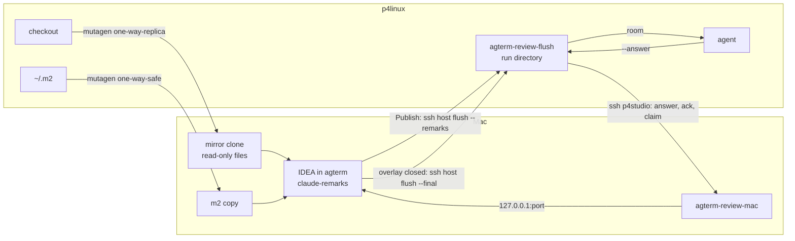

# IDE live review on Linux rows — spec

The live review's IDE viewer, `rebased`, works today only on a local Mac row
(`docs/plans/20261008-ide-live-review-spec.md`). This spec makes it work for an agent in a p4linux row.
The IDE stays where it is: IntelliJ IDEA inside agterm on the Mac, over the left pane.
What changes is how the IDE gets the files and how the notes cross between the two machines.

- The mirror clone on the Mac gets a standing **mutagen** sync of the p4linux working tree, so uncommitted
  work, untracked files and generated sources are visible, and the agent's own `~/.m2` comes along too.
- The run directory stays on p4linux. Everything that must happen on the Mac goes through one new
  Mac-side helper, `agterm-review-mac`, called over `ssh p4studio`.

## Contents

- [Decisions](#decisions)
- [Rejected alternatives](#rejected-alternatives)
- [How it fits together](#how-it-fits-together)
- [What a review looks like](#what-a-review-looks-like)
- [agterm-vim: the synced mirror](#agterm-vim-the-synced-mirror)
  - [Sync sessions](#sync-sessions)
  - [Lifecycle](#lifecycle)
  - [Mirror refresh](#mirror-refresh)
  - [Maven local repository](#maven-local-repository)
  - [Remote-row flags](#remote-row-flags)
  - [On close on a remote row](#on-close-on-a-remote-row)
  - [Read-back and CLI](#read-back-and-cli)
- [agterm-agents: helper, launcher, flush](#agterm-agents-helper-launcher-flush)
  - [The Mac helper](#the-mac-helper)
  - [Claims held for another machine](#claims-held-for-another-machine)
  - [Launcher](#launcher)
  - [Flush](#flush)
  - [Skills](#skills)
- [claude-remarks: no change](#claude-remarks-no-change)
- [New fields and their consumers](#new-fields-and-their-consumers)
- [Control API coverage](#control-api-coverage)
- [Tests by behavior](#tests-by-behavior)
- [What breaks, and the limits](#what-breaks-and-the-limits)
- [Probes before the plan commits](#probes-before-the-plan-commits)
- [Delivery: two plans](#delivery-two-plans)

## Decisions

Settled with Sasha on 2026-10-22 and 2026-10-23, one question at a time.

| Question | Answer |
|---|---|
| Where the IDE runs | On the Mac, in agterm's overlay, as on a Mac row. |
| How the IDE gets the files | The existing mirror clone, plus a mutagen sync of the p4linux working tree into it. |
| Sync scope | One standing sync per mirror, that is per repository the IDE has opened. Started on the first open, kept after the overlay closes, stopped only by the mirror prune. Syncs pile up; that is fine. |
| Who owns the sync | agterm, tied to the mirror's life, so no sync outlives its mirror. |
| Build output | `target/generated-sources` and `target/generated-test-sources` are synced; the rest of `target/` is not. p4linux's `~/.m2/repository` is synced too, and the IDE's Maven local repository for mirror projects points at that copy. |
| Edits in the copy | The copy's files are read-only (`0444`, executable bits kept). IDEA shows a lock and asks before an edit. |
| How notes cross | The run directory stays on p4linux. The hook runs `ssh <host> agterm-review-flush … --remarks`. Answers, acks and the claim go through `ssh p4studio agterm-review-mac`. |
| How the review ends | `--on-close` on a remote row runs its command **on the row's host**, so closing the IDE runs `--final` on p4linux. |

## Rejected alternatives

- **JetBrains Gateway (remote development).** The backend would run on p4linux next to the agent, and the
  note round trip would work unchanged. The license is not the blocker: agterm's IDE is IntelliJ IDEA
  2026.2.3, product code `IU`, with `idea.key`. The blockers:
  - The client is always a separate JVM process, and a second process's window cannot sit in the overlay
    (measured failing; `.claude/rules/rebased-overlay.md`).
  - agterm runs one JVM, started once in one mode. Starting it in the bundle's `thinClient` mode instead
    would leave Mac rows without a local IDE, and the bridge plugin is built for the full IDE.
  - claude-remarks is not a split plugin, so its tool window, gutter actions and balloons are drawn on the
    backend and streamed, which JetBrains itself calls "usually of insufficient quality".
  - Reports say the client does not reconnect reliably after a dropped link.
- **A live mount** (SMB, which exists, or `sshfs`). It shows everything live, but IDEA indexes over the
  network, its file watcher does not work on network mounts, Mac git and p4linux git would share and keep
  rewriting one `.git/index`, IDEA writes `.idea/` into the real checkout, and a dropped link hangs file
  reads inside agterm's process.
- **Git mirror only, with a working-tree snapshot commit.** No generated sources, no SNAPSHOT jars, and
  the view goes stale as soon as the agent edits a file.

## How it fits together

## What a review looks like

1. The agent on p4linux runs `agterm-review-live --code <checkout> [--base <ref>]`. With
   `AGTERM_ANNOTATE_CODE_VIEWER` unset, the viewer is `rebased` when `agterm-review-mac probe` answers.
2. The launcher opens the overlay as on a Mac row:
   `session overlay open --rebased --pane left --cwd <checkout> --diff <merge-base>.. --working-tree --on-close '<flush> <run> --final'`.
   The Mac refreshes the mirror. On the first open of this repository it also starts the sync and waits for
   its first pass. Then it flushes the sync and opens the diff.
3. `agterm-review-mac claim` writes the hook file on the Mac for the mirror's remarks identity.
4. `agterm-review-mac ready` waits for this request's view `opened` and the claude-remarks handshake. It
   returns the port and token, and the launcher stores them in the run. Then `activate`.
5. Sasha reads the diff and adds remarks. Each Publish Unread runs the hook: the batch bytes go over ssh
   stdin to `agterm-review-flush <run> --remarks` on p4linux and reach the room as today.
6. An "Ask Claude" remark is answered with `agterm-review-flush <run> --answer <id> --nonce <n>`, which
   reaches the gutter through `agterm-review-mac post answer`.
7. Closing the overlay makes agterm run `ssh <host> '<flush> <run> --final'`. `--final` sends the closing
   message and releases the claim through `agterm-review-mac release`.

## agterm-vim: the synced mirror

All fork-only, on top of the Remote rows section of `.claude/rules/rebased-overlay.md`.

### Sync sessions

A new core type, `RebasedMirrorSync`, builds every mutagen argv; the app runs them on `RebasedHost`'s
serial mirror queue, like every other job that writes under `mirrors/`.

- Binary: the first of `/opt/homebrew/bin/mutagen` and `/usr/local/bin/mutagen` that is executable.
  None: every remote open behaves exactly as today (commits only). No setting.
- Only the Mac needs mutagen. It copies its agent to the host over `scp` and uses the normal
  `~/.ssh/config`.
- **Tree session**, one per mirror:
  - alpha `<host>:<top>`, beta the mirror directory `<stateDir>/rebased/mirrors/<host>/<hash>/<name>`;
  - `--sync-mode one-way-replica`;
  - ignores: `.git/`, `.idea/`, `node_modules/`, and `target/` except `target/generated-sources/` and
    `target/generated-test-sources/`;
  - `--default-file-mode-beta 0444`. Directories stay writable, so IDEA can create `.idea/`.
- **m2 session**, one per host:
  - alpha `<host>:` its `~/.m2/repository`, beta `<stateDir>/rebased/m2/<host>/repository`;
  - `--sync-mode one-way-safe`, so jars the Mac IDE downloads itself into the copy survive.
- Names and labels: every session carries `agterm-state=<id>`, where `<id>` is the mirror `<hash>` function
  applied to the state directory path, so a Debug instance never touches the live app's sessions. A tree
  session also carries `agterm-mirror=<hash>`; an m2 session carries `agterm-m2=<host>`.
- ⚠️ `.idea/` must stay ignored. claude-remarks stores remarks in `.idea/workspace.xml`
  (`RemarkStore`, `claude-remarks/src/main/kotlin/dev/sasha/clauderemarks/store/RemarkStore.kt:34`), and
  replica mode deletes anything on the Mac that p4linux does not have. A test pins the ignore list.

### Lifecycle

- **Create.** The first refresh of a mirror, once its fetch has landed, creates the tree session and the
  host's m2 session if missing, then runs `mutagen sync flush` on the tree session so the first view sees
  files. The slot reads `fetching` until then; no new state value.
- **Every later open and `session rebased show`** on a synced mirror runs `mutagen sync flush` for the tree
  session after the fetch and before the view request is sent. A failed flush fails the view request, as a
  failed fetch does today.
- **Start.** `RebasedHost.start`, beside the start prune, runs `mutagen daemon start`, resumes the sessions
  whose mirror exists, and terminates every session labelled with this `agterm-state` whose mirror is gone.
  An m2 session whose host has no mirror left is terminated too, and its copy is deleted.
- **Prune.** `RebasedMirrorCleanup` terminates a mirror's tree session before it deletes the clone, inside
  the same job. When the last mirror of a host goes, the m2 session is terminated and its copy deleted.
- A sync that outlives its mirror is the defect this lifecycle exists to prevent: every path that removes
  a mirror terminates its session first, and the start sweep catches what a hard kill left.

### Mirror refresh

`RebasedMirror.refreshCommands` gets a synced variant. `git init` and the `fetch` stay. The last step
changes:

- Unsynced mirror: `checkout -q --force --detach refs/agterm/head`, as today.
- Synced mirror: `update-ref --no-deref HEAD refs/agterm/head`, then `read-tree refs/agterm/head`. HEAD and
  the index move; the files are left to mutagen. `git status` in the mirror then shows exactly the
  host's uncommitted work.
- A mirror that becomes synced moves from the first form to the second at its first synced refresh.

### Maven local repository

- The bridge plugin (`agterm/Resources/rebased/src/agterm/rebased/`) sets the Maven local repository of
  every project under `<stateDir>/rebased/mirrors/<host>/` to `<stateDir>/rebased/m2/<host>/repository`,
  on project open. User settings (`~/.m2/settings.xml`, with its servers) stay the default.
- This needs the Maven plugin's settings API from the bridge, as an optional dependency, so Rebased
  without Maven still loads it. It is the riskiest part; see [Probes](#probes-before-the-plan-commits).

### Remote-row flags

Today remote rows refuse `--working-tree`, `--file`, `--project` and `--on-close` on open, and the view
flags on show (`ControlServer+Rebased.localRebasedFlag`, `RebasedHost.openOverlay`, `ForwardPolicy.route`).

- `--working-tree` works on a remote row when its mirror is synced, on open and on `session rebased show`.
  Unsynced: refused with `--working-tree on a remote row needs mutagen on this Mac`.
- `--file PATH[:LINE]` works on a synced mirror. The host path is mapped into the mirror through the
  repository top the refresh already asks for; a path outside it is refused.
- `--on-close` works on a remote row, with the meaning below.
- `--project` stays refused.

### On close on a remote row

- `RebasedOnClose` gains `host`, set from `Session.remoteHost` at open. Its `cwd` is then the host path
  (`--cwd`, else the row's cwd), and no Mac environment is captured.
- `RebasedOnCloseRunner` runs a host callback as
  `/usr/bin/ssh -o BatchMode=yes -o ConnectTimeout=10 -- <host> 'cd <cwd> && <command>'`, detached, as it runs
  a local one. The command gets the host's login environment.
- The release rules are unchanged: the same release paths run it once; hide, hand-back and promotion
  never run it.
- `ForwardPolicy.route` stops refusing a forwarded `--rebased` open carrying `--on-close`, and
  `RebasedHost.openOverlay` stops refusing it. The command never runs on the Mac, so a forwarded open gains
  no new power there.

### Read-back and CLI

- `rebased mirror list` gains `sync` per mirror: `{state, error?}`, where `state` is mutagen's own status
  for the tree session, `paused`, or `none` when there is no session, read from
  `mutagen sync list --label-selector`. A list never waits on the mirror queue for it; it reads mutagen
  directly.
- `rebasedOverlay.onClose` stays a bool.
- No new command. A dry-run prune reports the sessions it would terminate.

## agterm-agents: helper, launcher, flush

Work in a worktree off `main`: the main checkout is shared with other sessions.

### The Mac helper

New `bin/agterm-review-mac`, installed on the Mac by `install.sh`. The launcher and the flush on p4linux call
it with `ssh <mac> agterm-review-mac <verb> …`, where `<mac>` is `AGTERM_REVIEW_MAC`, default `p4studio`:
the alias with a full shell on the Mac (`docs/claude/remote-agents.md`, the traps section). Bodies go on
stdin; no body is ever part of a command string.

| Verb | What it does |
|---|---|
| `probe` | Exit 0 when the IDE app and mutagen are both present. Otherwise exit 1 with the reason. |
| `claim --overlay <id> --run <run> --flush <path> --label <l> --deadline <t>` | Finds the overlay by id across every window's `tree --json` and waits until its state leaves `fetching`: until then `rebasedOverlay.project` is the host path, and only after the refresh lands is it the mirror path (`RebasedHost` remote open). Reads the host from `source`, computes `remarks_hash(project)` and claims under the lock. `--flush` is the flush's absolute path on the host, from the launcher. The hook argv is `["/usr/bin/ssh", "-o", "BatchMode=yes", "-o", "ConnectTimeout=5", "<host>", "<flush>", "<run>", "--remarks"]`. Prints `{hash, project, host}`. |
| `ready --overlay <id> --request <r> --hash <h> --deadline <t>` | Waits until that request's view is `opened` and the handshake port equals `rebased.port`, with the launcher's three error cases. Prints `{port, token}`. |
| `activate --hash <h> --run <run> --port 
` | As `claude_remarks.activate`. |
| `release --hash <h> --run <run>` | As `claude_remarks.release`. |
| `post --port 
 answer\|published-read` | Token on the first stdin line, JSON body after it. POSTs to `127.0.0.1:<port>` and prints the response JSON. |

It imports `hooks/claude_remarks.py`, which stays the one owner of the hash, the lock and the record shape.
It runs `agtermctl` read-only (`window list`, `tree --json`) against the Mac's own instance. A global
`--socket <path>`, passed by the launcher when `AGTERM_REVIEW_MAC_SOCKET` is set, points it at an isolated
Debug instance for the end-to-end test.

### Claims held for another machine

A claim written for a p4linux run cannot be checked with the Mac's own process table or file system.

- `claude_remarks.claim` takes an optional `host`, written into the record.
- `_live` for a record with `host`:
  - `opening`: live while its deadline has not passed. No pid check: the pid would be the helper's own.
  - `active`: asks the host, `ssh -o BatchMode=yes -o ConnectTimeout=5 <host> test -d <run> -a ! -e <run>/done`.
    Exit 0 is live, exit 1 is stale, and an unreachable host counts as live.
- The refusal for a host record names `agterm-review-flush <run> --final` on that host.

### Launcher

`bin/agterm-review-live`:

- `rebased_blocker()` stops refusing a remote row or a non-Mac platform outright. On a remote row it runs
  `ssh <mac> agterm-review-mac probe` and refuses with its stderr when that fails or the Mac is unreachable.
  A named `rebased` that cannot run stays exit 2.
- On a remote row the order is open, claim, ready, activate, because the remarks identity is the mirror's
  path, known only after the open. The claim and readiness deadline on a remote row is 15 minutes, the
  mirror queue's worst case (`rebased-overlay.md`, Remote rows), because the first open of a repository
  waits for the full first copy. A refused claim closes the overlay by its id and exits 1 with the
  refusal. Every other failure releases the claim and closes the overlay by id, as today.
- `run.json` gains `mac` (the alias used) and `host` (the name the Mac knows p4linux by, from the claim).
- `opening_body` for a remote `rebased` run adds: "The IDE shows a read-only copy of p4linux's checkout,
  synced within a second."

### Flush

`bin/agterm-review-flush`:

- One seam picks the transport from `run.json`: no `mac` means the local `claude_remarks` calls, as today;
  `mac` means `ssh <mac> agterm-review-mac`.
- `--remarks` and the worker are unchanged: the hook already delivers the bytes to p4linux.
- The ack and `--answer` go through `post`. A failed ssh is a failed ack, kept queued and retried by the
  next worker and by `--final`, as today. A failed `--answer` exits non-zero; the answer is still in the room.
- `--final` releases the claim through `release`. An unreachable Mac leaves the claim, which the next
  claim's host check finds stale once the run has `done`.

### Skills

- `skills/live-review/SKILL.md` (agterm-agents): the remote-rows table gains `rebased` for a p4linux row;
  the prerequisite (mutagen on the Mac); the first open of a repository waits for the first sync; the copy
  is read-only; `AGTERM_REVIEW_MAC`; the host-claim refusal and its recovery.
- `~/.claude/skills/rebased-diff/SKILL.md`: on a p4linux row, uncommitted work shows once the repository's
  sync exists, with `--working-tree`. This skill lives in no repository, with a copy on each machine;
  both copies are edited by hand.
- The agterm skill (`plugins/agterm/skills/agterm/`): `--working-tree`, `--file` and `--on-close` on a
  remote row, and `sync` in `rebased mirror list`.

## claude-remarks: no change

- The hook argv's first element is absolute (`/usr/bin/ssh`), which `readHook` requires
  (`claude-remarks/src/main/kotlin/dev/sasha/clauderemarks/review/PublishHook.kt:60`), and `runHook` runs it
  directly with the batch on stdin. ssh fits inside the 10 s timeout on a working link.
- Batch paths are project-relative (`relativePathOf` in `store/RemarkTarget.kt`), so they match the p4linux
  checkout without rewriting.
- A failed hook leaves the remarks not `READ`, so the next Publish Unread sends them again.

## New fields and their consumers

agterm-vim paths: `RebasedMirrorRefresh`, `RebasedHost`, `RebasedOnCloseRunner` are in `agterm/Rebased/`;
`RebasedMirror`, `RebasedMirrorCleanup`, `RebasedView` (`RebasedOnClose`), `RebasedProjection`
(`ControlRebasedMirrorNode`) and `ForwardPolicy` are in `agtermCore/Sources/agtermCore/`;
`ControlServer+Rebased` and `ControlServer+RebasedMirrors` are in `agterm/Control/`; the new
`RebasedMirrorSync` goes to `agtermCore/Sources/agtermCore/RebasedMirrorSync.swift`.

| New thing | Consumers | Count |
|---|---|---|
| `RebasedMirrorSync` (argv, labels, ignores, modes) | `RebasedMirrorRefresh` (create, flush), `RebasedHost.start` (resume, sweep), `RebasedMirrorCleanup` prune (terminate), `ControlServer+RebasedMirrors` list (`sync`) | 4 |
| `<stateDir>/rebased/m2/<host>/` | `RebasedMirrorSync` m2 session, bridge plugin Maven setting, `RebasedMirrorCleanup` (delete with the host's last mirror), start sweep | 4 |
| synced refresh variant of `RebasedMirror.refreshCommands` | `RebasedMirrorRefresh` | 1 |
| `RebasedOnClose.host` | `RebasedHost.openOverlay` (capture), `RebasedOnCloseRunner` (ssh), `ForwardPolicy.route` (refusal removed), `rebased-overlay.md` On close | 4 |
| `--working-tree`, `--file` on a remote row | `ControlServer+Rebased.localRebasedFlag`, `RebasedHost` remote open and show, host-path mapping in core, agterm skill | 4 |
| read-back `rebased mirror list` `sync` | `ControlRebasedMirrorNode`, `ControlServer+RebasedMirrors`, `agtermctlKit/RebasedCommands.swift` output, agterm skill | 4 |

agterm-agents paths: `bin/agterm-review-live`, `bin/agterm-review-flush`, the new `bin/agterm-review-mac`,
`hooks/claude_remarks.py`, `install.sh`, `skills/live-review/SKILL.md`.

| New thing | Consumers | Count |
|---|---|---|
| `bin/agterm-review-mac` verbs | `agterm-review-live` (probe, claim, ready, activate, release on rollback), `agterm-review-flush` (post, release), `install.sh` | 3 |
| claim record `host` | `claude_remarks.claim`, `_live`, `_refusal`, `agterm-review-mac claim` | 4 |
| `run.json` `mac`, `host` | `agterm-review-flush` transport seam (worker ack, `--answer`, `--final`), `agterm-review-live` rollback | 2 |
| `AGTERM_REVIEW_MAC` | `agterm-review-live`, `agterm-review-flush` (through `run.json`), live-review skill | 3 |

## Control API coverage

Per `CLAUDE.md` "Cross-surface contracts":

- Protocol and dispatch: no new command. Three refusals are lifted for remote rows; the dispatcher's
  Rebased-only flag conflicts are unchanged.
- `agtermctl`: `rebased mirror list` prints `sync`; help text for the remote-row meaning of `--on-close`.
- Read-back: `sync` on each mirror node.
- Headless: `ForwardPolicy` forwards `--on-close` with `--rebased`; `HeadlessCatalog` is unchanged.
- Docs: `.claude/rules/rebased-overlay.md` (Remote rows, On close), the agterm skill, `FORK-NOTES.md`,
  `CHANGELOG-fork.md`. Not `site/commands.html`.
- `fork-merge.md`: offer `ForwardPolicy.swift` and `RebasedOnCloseRunner.swift` as `flagged` candidates when
  the feature lands; a merge that restores the remote `--on-close` refusal passes every gate.

## Tests by behavior

- agterm-vim (core): the tree and m2 argv, with the ignore list, both modes, `0444` and the labels; the
  synced refresh moves HEAD and the index and never checks out; host-path mapping for `--file`, refusing a
  path outside the top; `ForwardPolicy` forwards a Rebased open with `--on-close`; a remote `RebasedOnClose`
  builds the ssh argv with the host cwd.
- agterm-vim (hosted): a missing mutagen binary keeps today's refresh and refuses `--working-tree`; a
  prune terminates the session before removing the clone; the start sweep terminates only its own
  `agterm-state` and only for missing mirrors; a remote `--on-close` runs once across the release paths.
- agterm-agents: the transport seam picks local or ssh from `run.json`; a host claim is live while
  `opening` without a pid check, live while `active` and the host answers 0 or is unreachable, stale on
  exit 1; a refused remote claim closes the overlay by id; a failed ssh ack stays queued.
- End to end, an isolated Debug instance on the Mac with a test repository on p4linux: an uncommitted
  edit on p4linux shows in the left-pane diff; a file edit in the IDE is refused by the lock; one publish
  reaches the room; one answer reaches the gutter; closing the overlay runs `--final` on p4linux; a prune
  removes the mirror and its session.

## What breaks, and the limits

- **A dropped link mid-review.** The copy stays at its last state, read-only. A publish fails with the
  hook's warning balloon, and the remarks go out with the next Publish Unread. An answer fails and stays in
  the room. An ack stays queued. Whether mutagen reconnects by itself is a probe.
- ⚠️ **Closing the overlay while p4linux is unreachable** runs no `--final`; the failed ssh is logged. The
  recovery is `agterm-review-flush <run> --final` on p4linux by hand, as after a hard-killed agterm.
- **HEAD lag.** The files follow p4linux within a second, but the mirror's HEAD and index move only at a
  refresh (every open and every `session rebased show`). If the agent commits or switches branch, the
  review diff (merge base to working copy) stays right while the merge base is in the mirror, but IDEA's
  Commit window can show a stale change list until the next refresh.
- **Untracked files** are in the project tree but not in the tracked-only diff, as on a Mac row.
- **The first open of a repository** waits for the full first copy of the tree inside the refresh job, while
  the slot reads `fetching`; the view deadline is armed only after it. The m2 session is not flushed, so
  the first Maven import can run before the m2 copy lands and shows red until it does. Later opens are warm.
- **Disk.** Every mirror holds a full working copy, and each host's m2 copy is about the size of its
  `~/.m2/repository` (2.7 GB on p4linux, 2026-10-22) plus what the Mac IDE downloads into it.
- **inotify.** Each tree session watches its checkout on p4linux; the per-user limit there is 524288
  watches, shared with everything else. `node_modules/` is ignored for this reason.
- **The token crosses.** The handshake token lands in the p4linux run directory, owner-only, as the port
  and token already do on a Mac row.
- The copy is read-only, but a chmod or an IDE "make writable" still lets an edit through, and the next
  sync cycle overwrites it.

## Probes before the plan commits

The agterm-vim plan's first task runs these in an isolated Debug instance against a test repository on
p4linux, and the plan changes course on any failure:

1. The bridge plugin can set a mirror project's Maven local repository, and the Maven import resolves from
   the m2 copy with no red in a Magnolia module.
2. Mutagen ignores keep `target/generated-sources/` while ignoring the rest of `target/`, and leave an
   ignored `.idea/` on the beta untouched in replica mode.
3. `--default-file-mode-beta 0444` gives read-only files with executable bits kept, and replacing a file
   still works.
4. The m2 alpha accepts a home-relative path; one-way-safe keeps a jar created on the Mac; and when the
   same artifact or a `maven-metadata-*.xml` is written on both sides, the session neither stalls nor
   keeps the Mac's stale copy.
5. A session reconnects after the link drops, or `mutagen sync resume` is needed.

## Delivery: two plans

`pair start --plan` works in one repository, so this is two plans, run in order. claude-remarks needs none.

1. **agterm-vim** (L): the probes first; then `RebasedMirrorSync`, the lifecycle, the synced refresh, the
   Maven setting in the bridge plugin, the lifted remote refusals, remote `--on-close`, `sync` read-back,
   docs. Size drivers: mirror queue ordering, the bridge plugin's Maven dependency, hosted tests.
2. **agterm-agents** (M): `agterm-review-mac`, host claims in `claude_remarks.py`, the launcher order, the
   flush transport seam, the skills, `install.sh`.

⚠️ Manual, once, before the end-to-end run: `brew install mutagen-io/mutagen/mutagen` on the Mac.
