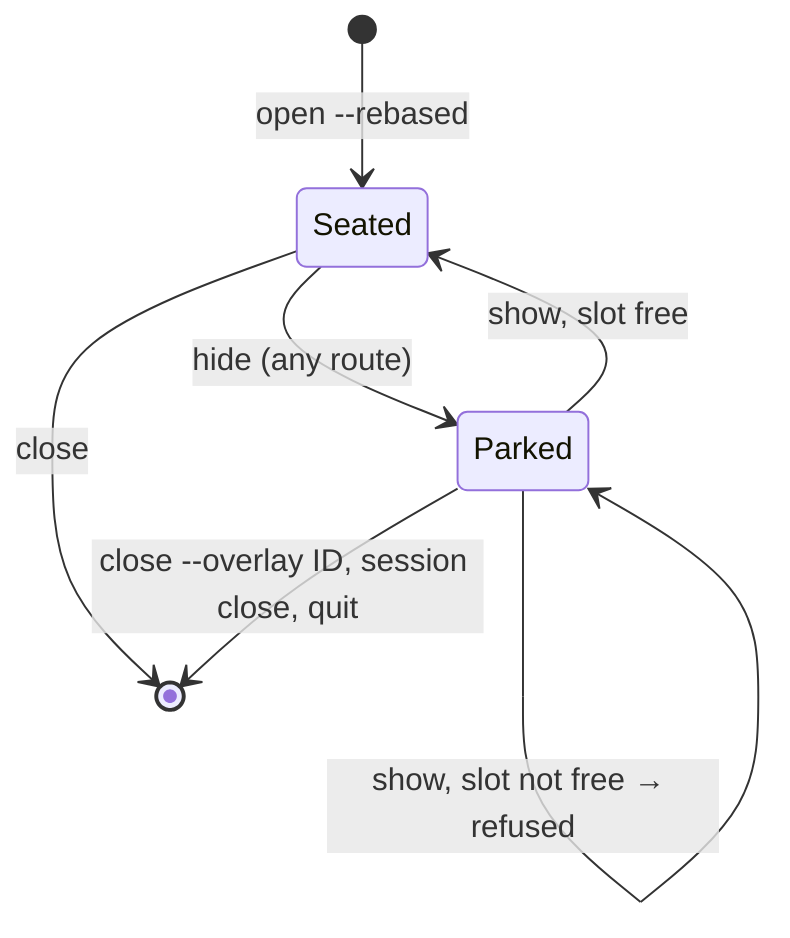

# Park a hidden session-wide IDE out of the overlay slot

<!-- plan-review: planning:plan-review 2026-10-22 findings=15 resolved -->

## Contents

- [Problem](#problem)
- [Decision](#decision)
- [Design](#design)
- [Read-back](#read-back)
- [Consumers](#consumers)
- [Tasks](#tasks)
- [Gates](#gates)
- [Out of scope](#out-of-scope)

## Problem

A hidden session-wide Rebased IDE keeps the session's overlay slot.
Every other session-wide overlay is then refused: a picker (`session overlay open '<cmd>'`) answers
`overlay hidden` or `overlay already open`, an `--html` page the same.
Found in a live test on 2026-10-19 (room `Hidden Rebased IDE holds the overlay slot`, `msg-233938-ead9`).
The upstream merge `303bf332` (#790) kept it: upstream refuses an open into any hidden slot.
A pane IDE is not affected: it holds its pane's slot, and session-wide overlays still open.

## Decision

Sasha, 2026-10-22: park it.
Hiding a session-wide IDE moves it out of the slot. The JVM, its window and its `onClose` stay alive.
The slot is then empty, so any overlay opens normally.
Showing the IDE again puts it back into the slot.

⚠️ This breaks from upstream's rule ("a hidden occupant keeps the slot") for the IDE only.
Every other occupant keeps upstream's behaviour.

Showing a parked IDE while the slot is not free is refused with `overlay already open`; the chord beeps.
The user closes the picker or page first. Closing it for them could end a running program, so it is not done.

## Design

**Model.**
`Session` gains `parkedRebased: ParkedRebased?`, holding the `RebasedOverlay` and the slot's `overlaySizePercent`.
Neither `rebasedOverlay` nor `parkedRebased` is saved in a snapshot.
Park moves `rebasedOverlay` there and empties the slot like `AppStore.closeOverlay` does, with two differences:
no `RebasedOverlayReleases.release`, and no `onReplicaOverlayClosed` (an IDE slot has no replica).
Unpark seats it back through the same code as the session-wide branch of `AppStore.openRebasedOverlay`.
That code moves into one helper both call, so the slot fields (generation, exit code, remote failure,
size, background) are set the same way.

**Hide reports.**
`RebasedOverlayReleases.hiddenChanged` looks the IDE up in the slot, which is empty after a park.
Park and unpark therefore call `onHiddenChange(session, overlay.id, hidden)` themselves.
The park and unpark branches of `setSlotHidden` return before its generic `hiddenChanged` call,
so each transition reports exactly once.
`AppActions.rebasedSlotHidden` then moves the IDE window exactly as today.

**The free slot, defined once.**
"No cover occupant" means no program, page or IDE holds the session-wide slot; a HUD does not count,
because the unpark closes it, as `openRebasedOverlay` does.
`AppStore.sessionSlotFree(_ session:)` is true when there is no cover occupant,
`remoteOverlays.slot(nil)` is nil, and `presentationHub?.hasPresenter` is false for the session
(the guard `openRebasedOverlay` already applies). It lives on `AppStore` because the presenter does.
Unpark refuses unless the slot is free.

**Refusals.**
The unpark refusal is typed and keeps its cause:
a cover occupant or a remote reservation answers `overlay already open`,
a presenter answers `RebasedOverlayOpenFailure.presenter.message`.
`setOverlaysHidden` returns it as a new `OverlayVisibilityFailure` case, so a bare `session overlay show`
whose unpark is refused answers `ok: false` with that message, never `ok` with `text: hidden`.
Every other slot and every remote page command in the same call is applied first; the unpark refusal is
returned last.
`AppActions.toggleOverlays` (the `toggle_overlay` chord, the menu item and the title-bar button) beeps on a
refusal, as `performRebasedToggle` does.

**`rebasedPlacement` includes the parked IDE, as `pane: nil`.**
Its readers find the IDE by id, project or session. They keep working unchanged:
`RebasedHost` lookups, `confirmCloseSession`, the tree projection in `AppStore`, `ControlServer+Rebased`,
and the second-open refusal in `openRebasedOverlay`.
So while an IDE is parked, an open for a different project still answers `overlay already open`,
although the slot is empty: one session holds one IDE. Task 4 documents it.
The writers that read `pane == nil` as "in the slot" get a parked branch:

- `updateRebasedOverlay`: also matches `parkedRebased`.
- `closeRebasedOverlay`: a parked IDE is released and cleared, without touching the slot.
- `setRebasedHidden`: for a session-wide IDE, parks on hide and unparks on show.
  It returns the typed refusal from [Refusals](#design), so `AppActions.toggleRebasedOverlay` names the
  real cause, and `no Rebased overlay in this session` only when there is none.
- `teardownOverlaySlot`: also releases the parked IDE, so a session close does not leak the JVM window.

**`rebasedHidden`** is true for a parked IDE.
`RebasedSlotView.isVisible` and `RebasedHost.overlayHidden(_:)` read it.

**The slot bit is never set for an IDE.**
`setSlotHidden(session, slot: nil, true)` with an IDE seated parks it instead of setting `overlayHidden`.
So `coverOverlayVisible`, `programOverlayVisible`, the deck gates and focus never see a hidden IDE.
They see an empty slot, which they already handle.

**The upstream hide routes learn the parked IDE through one predicate.**
`Session.slotEffectivelyHidden(_ pane:)` is `overlayHidden(pane)`, and also true for `nil` when the slot
has no cover occupant and an IDE is parked. Below, "empty" means "no cover occupant": a remote reservation
does not make it non-empty, it only makes the unpark refuse.
`overlayHidden(_:)` itself is unchanged: the open refusal in `ControlServer+SessionActions` must keep
reading the raw bit, or a parked IDE would block opens again.

- `setOverlaysHidden`'s `changing` filter and `setSlotHidden`'s no-change guard read `slotEffectivelyHidden`.
- `hideableOverlaySlots(nil)` lists `nil` when the slot is occupied, or when it is empty and an IDE is parked.
- `anyOverlayShown` and `hiddenOverlayNames` read `slotEffectivelyHidden`.
- `setSlotHidden(nil, false)` with an empty slot and a parked IDE unparks it, when the slot is free.
- A bare `hide` while the IDE is already parked changes nothing. In particular it leaves the bit clear.
- With a picker in the slot and an IDE parked, a bare `session overlay show` acts on the picker only.
  The IDE stays parked until the slot is free.

**Unchanged routes.**
`session rebased toggle` and the chord go through `setRebasedHidden`, so they park and unpark.
An open for the same project with a `--view` or `--diff` still routes to the existing IDE.
A parked IDE stays parked and queues the view, as a hidden one does today.

**App side.**
`WindowContentView+Detail` renders `RebasedSlot` only while `session.rebasedOverlay` is set.
A parked IDE has none, so the panel shows the slot's real occupant.
On unpark the slot view mounts again and reports itself visible; `RebasedHost.show` waits for that report.
The ⌘W cover branch reads `session.rebasedOverlay` for its confirmation. That stays right: it closes the
slot's occupant, and a parked IDE is not it.
With an empty slot ⌘W falls through to the session close, whose `confirmCloseSession` reads
`rebasedPlacement` and so still names the parked review.

**Remote rows.**
The IDE always runs on the Mac. `AppStore+RemoteOverlay`'s local-slot hold for a nil pane is
`overlayActive && !hudActive`, false for a parked IDE, so a remote overlay can open over it.
The Linux headless origin keeps no IDE and needs no change.

## Read-back

A parked IDE reads, with an empty slot:

- `overlay: false`, where today's hidden IDE reads `true`;
- `hiddenOverlays: ["session"]`, because a bare `show` would bring the IDE back;
- `rebasedOverlay.hidden: true`, no `pane`.

With another occupant in the slot, `overlay` and `hiddenOverlays` describe that occupant.
`rebasedOverlay.hidden` stays `true`.
`rebasedOverlay` gains nothing. Whether the IDE is parked or in the slot shows in `overlay` and `hidden`.

The human `tree` tag in `SocketClient` shows ` (overlay hidden)` whenever `hiddenOverlays` names `session`,
also when `overlay` is false. Without that, a parked IDE shows no tag at all.

## Consumers

The fields whose meaning changes are `overlay` and `hiddenOverlays` for a session with a hidden IDE.
Six readers outside the core, counted on 2026-10-22:

1. `~/dev/agterm-agents/rooms/rooms_pane.py`: refuses to type into a pane while `overlay` is true.
   A hidden IDE now lets typing through. Correct: the terminal is what the user sees.
2. `~/dev/agterm-agents/bin/xchat-hud-notify.sh`: skips its HUD while `overlay` is true.
   It now opens the HUD over a parked IDE, and an unpark closes it. Correct: the slot is free.
3. `~/dev/agterm-agents/bin/agterm-pulse`: `covered()` reads `overlay`. Same as 1: correct, no change.
4. `~/dev/agterm-agents/bin/agterm-review-live`: `row_overlay` reads `rebasedOverlay` only. No change.
5. `agtermCore/Sources/agtermctlKit/SocketClient.swift`: the human `tree` tag. Changes, see [Read-back](#read-back).
6. The bundled skill, `plugins/agterm/skills/agterm/SKILL.md` and `reference.md`, describes `hiddenOverlays`.
   Add one line for the IDE.

In-repo readers of the hide predicates, which see the parked IDE through `anyOverlayShown` and
`hideableOverlaySlots`. Four, each checked in Task 3:

1. `AppActions+Palette.swift`: palette enablement of the hide and show entries.
2. `agtermApp+Menus.swift`: the menu item title.
3. `WindowContentView+Titlebar.swift`: the title-bar hide button.
4. `AppActions+Overlay.swift`: the close-dialog text.

## Tasks

### Task 1: park and unpark in the core

- [ ] Write failing tests in `AppStorePaneTests+Rebased`:
  - hiding a session-wide IDE leaves `overlayActive` false and keeps `rebasedPlacement`;
  - a program overlay and an HTML page then open;
  - showing the IDE refuses while a program holds the slot, and while a remote reservation holds it;
  - showing it with the slot free (also with a HUD open) seats it with its size and closes the HUD;
  - closing a parked IDE by id releases it once; deleting its session releases it once;
  - `onHiddenChange` fires on park and on unpark;
  - the tree reads as in [Read-back](#read-back).
  - a presenter makes the unpark refuse with the presenter message.
- [ ] Move the existing tests that pin the old contract to the parked read-back, in `AppStorePaneTests+Rebased`:
  the one expecting `rebasedOverlayActive` after a hide, and `everyHideRouteFlipsTheIDEsSlotBitAndTellsTheApp`,
  whose `slot: "session"` case must still hear exactly `[true, false]`.
- [ ] Add `parkedRebased`, `AppStore.sessionSlotFree`, the shared seat helper, the typed refusal from
  `setRebasedHidden`, and the parked branches listed in [Design](#design).
- [ ] Check: `cd agtermCore && swift test --filter 'AppStorePaneTests|HtmlOverlayTests|AppStoreTreeProjectionTests'`

### Task 2: the upstream hide routes

depends: 1

- [ ] Write failing tests:
  - bare `hide`, `show` and `toggle` park and unpark;
  - a bare `hide` while parked leaves `overlayHidden` false, and a picker then opens;
  - `hiddenOverlays` follows the rule in [Design](#design);
  - with a picker in the slot and an IDE parked, bare `show` acts on the picker only;
  - bare `show` with a parked IDE, a remote reservation and a hidden left-pane overlay shows the pane
    overlay, then answers `ok: false`, `overlay already open`;
  - the human `tree` tag reads ` (overlay hidden)` for a parked IDE.
- [ ] `OverlayVisibilityFailure` is public and `agterm-linux` consumes `agtermCore`: before adding the case,
  search that fork for exhaustive switches over it (`gh search code --owner p4elkin OverlayVisibilityFailure`,
  or a clone), and note the result in the commit message.
- [ ] Add `slotEffectivelyHidden` and the beep in `AppActions.toggleOverlays`; change `hideableOverlaySlots`, `anyOverlayShown`, `hiddenOverlayNames`,
  `setOverlaysHidden`, `setSlotHidden` and the `SocketClient` tag.
- [ ] Check: `cd agtermCore && swift test --filter 'OverlayVisibility|AppStorePaneTests|SocketClient'`

### Task 3: app side and hosted tests

depends: 2

- [ ] Add `testAProgramOverlayOpensOverAHiddenIDE` to `ControlServerRebasedOverlayTests`:
  hide the IDE, open a program overlay, close it, `session rebased toggle`, and expect the IDE shown.
- [ ] Move the two hosted tests that read `session.rebasedOverlay` while hidden to `rebasedPlacement`:
  the `view?.state` read and the `XCTUnwrap(session.rebasedOverlay)` after a hide, both in
  `ControlServerRebasedOverlayTests`.
- [ ] Check the four in-repo predicate readers in [Consumers](#consumers) against a parked IDE.
  Fix what reads wrong.
- [ ] Check: `scripts/test-app.sh -only-testing:agtermTests/ControlServerRebasedOverlayTests`

### Task 4: docs

depends: 3

- [ ] `.claude/rules/rebased-overlay.md`: the "Slots, hide and focus" section, the read-back paragraph,
  and the one-IDE-per-session refusal while parked.
- [ ] `.claude/rules/control-api.md`: the hide paragraph names the IDE exception in one clause.
- [ ] `.claude/rules/fork-merge.md`: the Rebased hook list adds `Session+OverlayVisibility.swift`.
  Its `AppStore+RemoteOverlay.swift` line changes, because a hidden holder no longer reserves the slot.
- [ ] `FORK-NOTES.md` and `CHANGELOG-fork.md` (`## Unreleased`, Changed).
- [ ] The bundled skill line from [Consumers](#consumers).
- [ ] Check: `make lint`

## Gates

Run once at the end: `cd agtermCore && swift test`, `make test-app`, `make lint`.
`agtermCore` changes, so also run the Linux gate on p4linux in a fresh `/tmp` clone:
`swift test --no-parallel` and `swift build --product agterm-headless`.
Then review with native revmux, profile `codex-claude`.

The fix reaches the live terminal only after `make deploy` and a restart. The restart is Sasha's call.

## Out of scope

- A hidden pane IDE still holds its pane's slot. Nobody has reported that as a problem.
- The pane-IDE chord question in `msg-233938-ead9` (keys going to the IDE window) is a separate thread.
