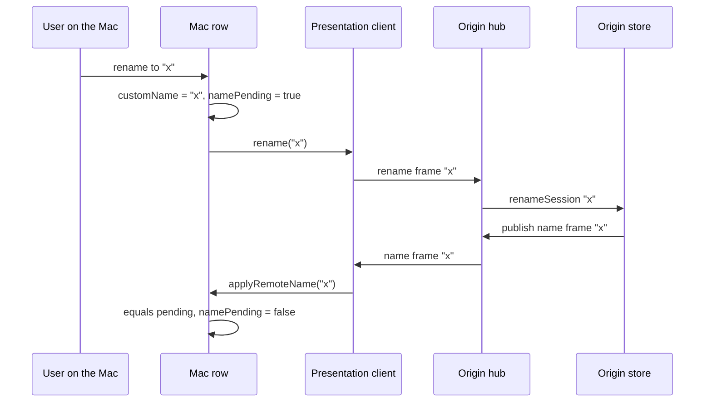

# Remote row names — plan

<!-- plan-review: planning:plan-review 2026-10-22 findings=18 resolved; one left to Sasha: the unnamed-row display (Attach seeding, "Known limit") -->

A remote row's name belongs to its origin. A rename on the Mac travels to the origin, a rename on the
origin travels to every attached Mac, and a relaunch restores the name the row last had.

Written on branch `remote-row-names`, based on `origin/main` `303bf332`.

## Contents

1. [What is true today](#what-is-true-today)
2. [Evidence from a live install](#evidence-from-a-live-install)
3. [The design](#the-design)
   1. [Wire format](#wire-format)
   2. [Origin side](#origin-side)
   3. [Viewer side](#viewer-side)
   4. [The pending rename](#the-pending-rename)
   5. [Attach seeding](#attach-seeding)
   6. [The row book](#the-row-book)
   7. [Read-back](#read-back)
4. [Rejected alternatives](#rejected-alternatives)
5. [New fields and outcomes, and who reads them](#new-fields-and-outcomes-and-who-reads-them)
6. [Tasks](#tasks)
7. [Final gates](#final-gates)
8. [Decisions](#decisions)
9. [Review rounds](#review-rounds)

## What is true today

Files this plan edits are named by construct, not by line.

- `ControlServer.discoverRemoteRow` takes the origin tree's `name` into `RemoteRow.sessionName`.
  The origin fills that `name` from `session.displayName`: the custom name, else the OSC title, else the
  cwd basename (`RemoteTreeMerger.remoteSession`).
- `ControlServer.insertRemoteRow` creates the row with `addSession(name: row.sessionName)`, so that value
  becomes the Mac row's `customName`. An origin row with no custom name is frozen on the Mac as a manual
  name equal to its cwd basename.
- `RemoteRowBook.Record` stores `sessionName = binding.origin.sessionName`, the attach-time value.
  `ControlServer.restoreRemoteRows` rebuilds the row from it. A rename made on the Mac afterwards changes
  only the in-memory `customName`, and remote rows are not in the window snapshot, so it is lost on
  relaunch.
- `AppStore.renameSession` publishes nothing to the presentation hub. The stream carries no name in
  either direction. A rename on the origin never reaches the Mac.
- `HeadlessActions.renameSession` already serves `session rename` on the headless origin and persists.
- The `seen` frame is the one Mac→origin frame that any viewer may send, mirrors included (presenter
  take and the ask and overlay answers are presenter-only).
- The `context` frame plus the snapshot's `context` field is the closest origin→Mac per-session value to
  copy (status, HUD and layout travel the same way).

## Evidence from a live install

Measured 2026-10-22, a Mac (`p4studio`) attached to a headless origin (`p4linux`):

- 84 remote rows. 3 had been renamed on the Mac (`parking`, `labels preservation`, `6.4.11 stack`).
  Their book records say `sessionName: "sasha"`, the cwd basename of `/home/sasha`. A relaunch shows
  `sasha`.
- One origin row is `webctl` on the origin and `sasha` on the Mac: a rename on the origin never arrived.
- On the origin, `agterm-claude-map` (agterm-agents) names a new row after its Claude conversation with
  `agtermctl session rename`. That rename never reaches the Mac either, so a new remote row keeps the cwd
  name there.

## The design

### Wire format

- New body `.name(String?)`, kind `"name"`, origin→viewer. The origin's `customName`; nil means none.
- New body `.rename(String?)`, kind `"rename"`, viewer→origin. nil or blank asks to clear.
- Both carry the value under the frame key `name`. `encodeIfPresent`, like `context`.
- `PresentationSnapshot.name: String?`, the origin's `customName`.
- `"name"` joins `PresentationHub.supportedKinds`. The hub's hello answer lists it only when the viewer
  listed it, so the client learns from the answer whether the origin speaks names. That one capability
  covers both directions: an origin that lists `name` also accepts `rename`.
- No version bump. An older peer decodes both kinds as `.unknown` and skips them
  (`.claude/rules/control-api.md`, "skips an unknown kind without ending the stream").

### Origin side

- `AppStore.renameSession` becomes `@discardableResult -> Bool` (changed or not). On a change it
  publishes `.name(renamed)` to the hub. Every rename path goes through it: UI, `session.rename`, the hub.
- `AppStore.presentationSnapshot` fills `name: session.customName`.
- `PresentationHub.receive` routes `.rename(name)` from any current viewer, mirrors included, to a new
  `onRename: (UUID, String?) -> Void`, as `.seen` reaches `onSeen`.
- `AppStore.renameFromViewer(_:to:) -> Bool` runs `renameSession` and, when nothing changed, publishes
  `.name(session.customName)` anyway, so the sender's pending rename still sees its echo. One method in
  core, tested once on Linux.
- Headless wiring, next to `attachSeenPresentation`: `hub.onRename` resolves the session, calls
  `renameFromViewer`, and persists on a change.
- Mac-origin wiring in `ControlServer`'s presentation setup: `hub.onRename` calls `renameFromViewer`
  (`renameSession` already saves).

### Viewer side

- A remote row's `customName` is the origin's custom name as this Mac last knew it. It is not mirrored
  into a separate field like `context`: the origin owns the name, so there is no local override to keep.
- `RemotePresentationState.namePending: Bool`, true while a Mac rename has not been confirmed by the
  origin.
- `AppStore.renameSession` on a session with `remotePresentation` sets `customName`, sets
  `namePending = true`, and calls a new `onRemoteSessionRenamed: (UUID, String?) -> Void`. The
  `ControlServer` wiring calls `remoteClients[id]?.rename(name)`.
- `RemotePresentationClient`:
  - records `namesSupported` from the hello answer's `kinds`, reset on every launch;
  - `rename(_:) -> Bool` sends `.rename` when a link is up and `namesSupported`;
  - on a snapshot, calls `effects.snapshotName(snapshot.name)` only when `namesSupported`;
  - on a `.name` frame, calls `effects.name(name)` only when `namesSupported`.
- `AppStore.applyRemoteName(_:forSession:)`, the live update:
  - not pending: set `customName` to the sanitized value (the same `TerminalText.sanitized` plus
    `trimmedOrNil` that `renameSession` applies, so an echo compares equal; a test pins that this is
    idempotent);
  - pending and the value equals `customName`: clear `namePending` (the echo);
  - pending and another value: ignore it. Our rename is in flight and its echo follows.
- `AppStore.applyRemoteSnapshotName(_:forSession:) -> Bool`, the snapshot:
  - not pending, or pending and the snapshot already carries the pending value: apply as a live update
    (which ends the pending) and return false;
  - pending with another value: keep `customName` and return true. The `ControlServer` effect then sends
    `rename(customName)`. This is the one-time push decided in [Decisions](#decisions).
- `applyRemoteName` and `applyRemoteSnapshotName` never go through `renameSession`: that would send the
  origin's own name back to it and loop. A test pins that an applied name calls no rename hook.
- Each change of `customName` or `namePending` calls `scheduleTreeChanged`, which also rewrites the book.
- The stream ending does NOT clear the name, unlike status, context and HUD: a name describes the row,
  not live state, and the row keeps showing it while disconnected.

### The pending rename

- Set by a rename on the Mac. Cleared only by the origin's echo.
- Kept across stream drops and relaunches (book field), so a rename made while disconnected reaches the
  origin at the next snapshot.
- Against an origin that does not speak names, `rename` sends nothing and the snapshot carries nothing
  applied, so the row behaves as today: the local name stays, and pending stays true (the read-back says
  so) and does no harm.
- The push repeats with every snapshot, so at every reconnect, until the echo confirms it.
- Accepted risk: the echo must equal the row's name exactly. Both sides run the same sanitizer today and
  a test pins that it is idempotent. If a future origin build normalized names differently, the row would
  stay pending, ignore the origin's names and push its own at every reconnect.
- Two Macs renaming the same row at once converge. Every `rename` the origin receives produces exactly
  one `.name` publish to all viewers (a change publishes; no change echoes). Mac A sends `a`, Mac B sends
  `b`, the origin applies `a` then `b`:
  - publish `a`: A is pending on `a`, clears. B is pending on `b`, ignores it.
  - publish `b`: A is no longer pending, applies `b`. B is pending on `b`, clears.
  - Both end on `b`, the origin's value.

### Attach seeding

- `discoverRemoteRow` seeds the row with the origin tree's `name`, as today, with `namePending = false`.
  That name may be the origin's automatic one; the first snapshot, which arrives as the stream connects,
  replaces it with the origin's custom name or none. An origin without names keeps today's behaviour.
- A `named` flag in `zmx tree` was considered and dropped (plan review): it would add a public field on
  every tree node only to save the second or so before the first snapshot.
- `RemoteRow` gains `name: String?` and `namePending: Bool`, used by `insertRemoteRow` for
  `addSession(name:)` and for `bindRemote(_:forSession:namePending:)`, which sets the flag before
  `startRemotePresentation`. `sessionName` keeps its other jobs (the attach command's label, the
  disconnect notice).
- Known limit: a row the origin never named shows the Mac's automatic name, the OSC title or else the
  basename of the Mac-side cwd, which stays the Mac's home because OSC 7 from the far host does not
  change it. Measured on the live pair: the 13 rows without an origin name show `sasha` today and show
  `sasha` or their Claude title after this change. It applies in any folder: an unnamed origin row in
  `~/dev/foo` with no title showed `foo` (the frozen origin name) and now shows `sasha`. Claude rows set a
  title and `agterm-claude-map` names new rows, so a plain untitled shell is the case that loses.

### The row book

- `RemoteRowBook.Record` gains `name: Name?`, `struct Name: Codable, Equatable { value: String?; pending: Bool }`.
  Built from `session.customName` and `namePending`.
- Restore reads `Record.restoredName`: `name` present → `value` and `pending`. `name` absent (a file written by an older build) →
  `sessionName` with `pending = false`, today's behaviour; the first snapshot then corrects it.
- Upgrade note: the older build never saved a Mac-only name, so those are lost at the upgrade relaunch.
  Renaming such rows on the origin before upgrading carries them over.

### Read-back

- `ControlPresentationNode.namePending: Bool?`, present only when true. `tree` shows it on a remote row.
- The row's name already reads back as the tree node's `name`.

## Rejected alternatives

- ssh one-shot `agtermctl session rename` for the Mac→origin direction: a second channel, an ssh per
  rename, and the pending flag is still needed when the link is down.
- Polling the origin tree for names: late, and an ssh per poll.
- A separate `mirroredName` with a local override, like `context`: makes a Mac name win over the origin
  forever, the opposite of the decision.
- Last-writer-wins with timestamps: needs agreeing clocks and a stored stamp on both sides.

## New fields and outcomes, and who reads them

| New item | Consumers (count) |
|---|---|
| frame `.name` | `RemotePresentationClient.apply`; older client `.unknown` (2) |
| frame `.rename` | `PresentationHub.receive` → `onRename`; older hub `default`; the client's exhaustive `apply` switch (no-op arm) (3) |
| `PresentationSnapshot.name` | `RemotePresentationClient.apply(.snapshot)` (1) |
| `"name"` in `supportedKinds` | hub hello answer, client hello, `sendToPresenter` filter (no `.name` goes there), client `namesSupported` (4) |
| `PresentationHub.onRename` | `Headless` wiring, `ControlServer` presentation setup (2) |
| `RemotePresentationEffects.name`, `.snapshotName` | `ControlServer.remoteEffects` (1 each) |
| `AppStore.onRemoteSessionRenamed` | `ControlServer` presentation setup (1) |
| `RemotePresentationState.namePending` | `applyRemoteName`, `applyRemoteSnapshotName`, `RemoteRowBook.Record.init`, `presentationNode` (4); docs: `control-api.md`, skill `reference.md`, `site/commands.html` |
| `RemoteRow.name`, `.namePending` | `insertRemoteRow` (1) |
| `RemoteRowBook.Record.name` | `Record.restoredName`, the writer's equality check (2) |
| `RemoteRowBook.Record.restoredName` | `restoreRemoteRows` (1) |
| `ControlPresentationNode.namePending` | `tree --json` output; skill `reference.md`; `site/commands.html` (3) |
| `renameSession` return value | `renameFromViewer` (1) |
| `AppStore.renameFromViewer` | headless `onRename`, Mac-origin `onRename` (2) |

## Tasks

Each task is test-first. Core tests run on Linux (`swift test --no-parallel` in `agtermCore/`) and on
the Mac (`make test`). App tests run on the Mac (`make test-app`).

- [x] **Wire format.** `.name`, `.rename`, snapshot `name`, `"name"` in `supportedKinds`.
  Tests in `PresentationFramesTests`: round trip of both kinds, nil omits the key, a snapshot without
  `name` decodes nil, an older reader sees `.unknown`.
- [x] **Hub routing.** `.rename` → `onRename` from any viewer; a stale generation is dropped.
  Tests in `PresentationHubTests`, beside `seenRoutesFromAnyCurrentViewerToItsOwnSession`; plus the
  hello answer lists `name` only for a viewer that listed it.
- [x] **Origin store.** `renameSession` returns changed and publishes `.name`; snapshot carries the name.
  Tests beside `aContextChangeReachesTheHubAndAClearTravelsAsNone` and `anUnchangedContextPublishesNothing`.
- [x] **Headless wiring.** `onRename` renames, persists, publishes; an unchanged rename still echoes.
  Tests in `AgtermHeadlessKitTests` beside `aSeenFrameClearsUnseenAndOnlyAutoResetStatus`.
- [x] **Viewer store.** `namePending`, `applyRemoteName`, `applyRemoteSnapshotName`, remote-row
  `renameSession` hook, stream drop keeps the name, `presentationNode.namePending`.
  New `AppStoreRemoteNameTests`.
- [x] **Client.** `namesSupported`, `rename`, `name` and `snapshotName` effects.
  Tests in `RemotePresentationClientTests` beside the context tests: applied only after a hello answer
  listing `name`; `rename` false without a link or support; a relaunch resets support.
- [x] **Attach seeding.** `RemoteRow.name` and `.namePending`; `discoverRemoteRow`, `insertRemoteRow`,
  `bindRemote(namePending:)`. Covered by the round-trip test below and `RemoteRowRestoreTests`.
- [x] **Round trip.** `RemoteNameRoundTripTests` (core, Linux): a real origin store and hub, real viewer
  stores and clients, joined by a frame queue. Mac rename reaches the origin and the echo ends pending;
  origin rename reaches the Mac; a rename made before connecting goes out with the snapshot; a blank
  rename clears both; two Macs renaming at once converge; an automatic seed is cleared by the snapshot.
- [x] **Row book and restore.** `Record.name`, `restoreRemoteRows`. `RemoteRowBookTests` (round trip,
  old file decodes with nil `name`), `RemoteRowRestoreTests` (name and pending restored; old record
  uses `sessionName`).
- [x] **App wiring.** `remoteEffects` `name` and `snapshotName` (resend when pending),
  `onRemoteSessionRenamed` → `rename`, Mac-origin `onRename`. Tests in
  `ControlServerRemotePresentationTests`: a rename on a remote row sends a frame; a snapshot while
  pending sends the pending name and keeps it; the echo clears pending.
- [x] **Docs.** `.claude/rules/control-api.md` (a name bullet beside the context one, the "Presentation
  carries" line, the `presentation` read-back line, the XCUITest exemption line);
  `.claude/rules/headless-origin.md` (the `onRename` wiring); `docs/plans/20260929-headless-origin-spec.md`
  (the two table rows saying a Mac rename acts locally; the section 3.2 "Today" line is history and
  stays); `plugins/agterm/skills/agterm/reference.md` and `site/commands.html` (the `presentation`
  read-back and what attach mirrors); `FORK-NOTES.md` "Remote origin" catalog; `CHANGELOG-fork.md`.

## Final gates

- Linux: `swift test --no-parallel` in `agtermCore/` (swiftly env sourced). Baseline at `303bf332`:
  5255 tests, 2 failing before this change (`HudTests.aFramelessPanelIsAsTallAsItsText`,
  `ZmxReplayScriptTests.interruptedPayloadStillExecsTheFinalShell`); no new failure is allowed.
- Mac: `make test`, `make test-app`, `make lint`.
- Review: native revmux, `codex-claude` profile, on the branch against `origin/main`.
- End-to-end on the live pair (deploy the Mac build and the headless server, rename on each side,
  relaunch): left to Sasha. It replaces running software on both machines.
- No push and no merge without Sasha.

## Decisions

- The origin owns the name (Sasha, 2026-10-22).
- Conflict at reconnect: the origin wins, except a Mac rename the origin never received is pushed once
  first (Sasha, 2026-10-22).
- Transport: the presentation stream only, no ssh command (Sasha, 2026-10-22).

## Review rounds

Round `01-initial` (revmux, `codex-claude`, 4 of 4 sources, none degraded) found four; all fixed:

- An older echo could end a newer rename (rename to x, y, x before the first echo). The viewer now keeps
  `namesInFlight` and matches echoes in order; a snapshot push resets it to the one value pushed.
- Closing a window inside the row book's debounce lost a pending rename, since a closed window keeps its
  last written records. `WindowLibrary.onWindowClosing` fires while the store is loaded, and
  `RemoteRowBookWriter` writes on it.
- A name over the 256 KiB frame limit would end the stream on every reconnect. `Session.nameByteLimit`
  (1024 UTF-8 bytes) is enforced by `session.rename`, `session.new --name` and `renameSession`.
- The relaunch test did not catch a stale `namesSupported`; it now checks `rename` before the new hello.

Round `02-after-fix` (same profile, 4 of 4 sources, none degraded) confirmed the four fixes and found two:

- `zmx.new --name` skipped the name limit (raised by two sources). The `zmx.new` arm now rejects it, and
  `addSession` drops an over-long name as a backstop.
- The changelog said no frame could carry a name over 1024 bytes; it is the application's limit, not the
  frame's. Reworded.

Round `03-final` (4 of 4 sources) found one, raised by every source: snapshot restore copied a name an
older build saved without a limit, and this branch puts that name into the presentation snapshot. Restore
(`session(from:)`) now drops an over-long name, with a test that the snapshot still encodes.
