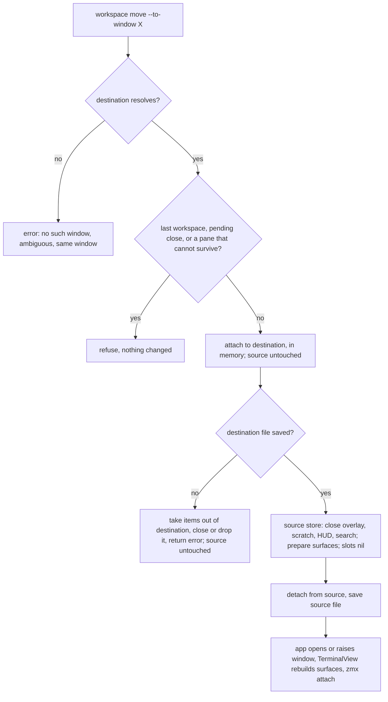

# Move a workspace or sessions to another window

## Contents

- [Overview](#overview)
- [Context (from discovery)](#context-from-discovery)
- [Solution Overview](#solution-overview)
- [Technical Details](#technical-details)
- [Consumers of the new pieces](#consumers-of-the-new-pieces)
- [Development Approach](#development-approach)
- [Testing Strategy](#testing-strategy)
- [Progress Tracking](#progress-tracking)
- [What Goes Where](#what-goes-where)
- [Before the pair starts](#before-the-pair-starts)
- [Implementation Steps (pair board)](#implementation-steps-pair-board)
- [Mac stage (lead, after the pair lands)](#mac-stage-lead-after-the-pair-lands)
- [agterm-agents stage (lead)](#agterm-agents-stage-lead)
- [Risks and open questions](#risks-and-open-questions)
- [Post-Completion](#post-completion)

## Overview

- Today a session moves only between workspaces of one window (`session.move <workspace>`), and a workspace only
  reorders inside its window (`workspace.move --to`). Nothing moves either to another window.
- This adds `--to-window <new|name|id|prefix>` to `workspace move` and `session move`, plus two chords: the active
  workspace to a new window, and a picker that chooses the destination window.
- Both panes of a row survive: the primary and the split keep running because their zmx daemons are named after
  `Session.paneIdentity` / `splitPaneIdentity`, and the move keeps the same `Session` object. Scratch, overlays,
  the HUD and search state are closed by design.
- Mac GUI only. The headless origin keeps refusing (`ForwardPolicy` already refuses `workspace.move` and
  `session.move` there).

Decisions already taken with Sasha (brainstorm, 2026-10-22):

- Entry points are the CLI and keymap chords. No sidebar menu, no drag and drop.
- Moving a window's last workspace is refused.
- The destination may be named by window name; a name shared by two windows is an error listing both ids.
- Approach: re-home the live `Session` objects between stores. Rejected: snapshot/restore (loses transient state),
  re-hosting the surface views (breaks the Metal drawable, `ARCHITECTURE.md` "Surface ownership").

Decided while revising after plan review (lead):

- No `--force`. A pane that cannot survive is refused; the user closes or converts it first.
- No special reattach launch. Moved panes are rebuilt by the normal `makeSurface` / `makeSplitSurface`, which
  attach to an existing daemon exactly as a relaunch does.

## Context (from discovery)

All references are at `origin/main` `28c169b3` of `p4elkin/agterm-vim`.

- zmx naming: `ZmxSupport.daemonName(for paneIdentity:)` builds `agterm-<compact uuid>` from the pane identity
  only. `Session.paneIdentity` and `Session.splitPaneIdentity` are persisted fields. One socket directory per state
  directory, so every window shares one namespace. `ZmxSupport.attachCommand` attaches or creates: the creation
  arguments run only when the daemon is missing.
- Surface build: `agtermApp.makeSurface` / `makeSplitSurface` call `ZmxLaunch.configuration(paneIdentity:…)`;
  `TerminalView` builds a surface only when the session's slot is nil. Remote rows are not wrapped locally
  (`ZmxLaunch.wrapsLocally`); their `initialCommand` is the ssh attach from `RemoteSession.attachPaneCommand`.
- Kills: only the store's `paneFinalizer` ends daemons. Callers: `AppStore.closeSession`, `removeWorkspace`,
  `closeSplit`, pane exit through `handlePaneExit`, soft-close hard finalize, `WindowLibrary.removeWindow`,
  `zmx prune`, the launch reap. `GhosttySurfaceView.teardown()` frees the surface and clears `onExit`; it never
  calls the finalizer. `replacePane` shows the safe order: `claimProcessExit()` then destroy.
- Launch reap: `WindowLibrary.prepareLaunchPaneInventory` claims identities from every indexed window file, open
  or closed. A daemon claimed by no file is killed at the next launch. `AppStore.dropLaunchPanes` removes claims.
- Bookkeeping templates: `AppStore.moveSessions(_:toWorkspace:at:)` (no closed/created events, keeps
  `selectedSessionID`) and `AppStore.removeWorkspace(_:)`. `AppStore.save()` swallows errors; the internal
  `saveChecked()` reports them. Overlay, scratch and HUD state close through `AppStore.closeOverlay(_:)` and
  `closeScratch(_:)` (`AppStore+Panes.swift`). `releaseLeavingSession` (`AppStore+RemoteOverlay.swift`) cleans
  remote overlays and pending asks of a session leaving a store.
- Windows: `WindowLibrary.newWindow(name:)` seeds "workspace 1" with one `$HOME` session and sanitizes the name
  with `TerminalText.sanitized`. `WindowInfo.name` lives in `windows.json` and is not unique.
  `ControlResolve.resolve` matches `active`, a UUID or a UUID prefix (one character is enough), never a name.
  `ControlTargetResolver.resolveWindowStore` requires an open window.
- Control: `ControlServer+WindowCommands.windowNew` is `async`, opens a window through `actions.openWindow` and
  polls `WindowRegistry`. `ControlDispatcher.dispatchWorkspaceCommand` is synchronous today. Unsupported
  defaults live in `ControlActionsDefaults.swift` and answer `ControlActionsUnsupported.message(...)`.
  `ControlArgs` already carries `force` (used by `zmx kill`) and `workspaceName` (used by `session.new`).
- CLI: `workspace move` declares `to` as required (`WorkspaceCommands.swift`); `session move` `validate()`
  demands a workspace, `--to` or `--after/--before` (`SessionCommands.swift`).
- Headless: `AgtermHeadlessKit` uses the same `WindowLibrary` and `AppStore` without a `paneFinalizer`.
- Repo docs rules: the bundled skill `plugins/agterm/skills/agterm/` is the source of the installed copies
  (`CLAUDE.md`); `FORK-NOTES.md` gets one or two lines plus a pointer to the `.claude/rules` file with the detail.
- UI tests: `.claude/rules/ui-tests.md` allows live zmx (`AGTERM_UITEST_ENABLE_ZMX=1`) only in the focused zmx
  persistence test, which must kill its exact daemons in teardown.

## Solution Overview



- Model, validation and ordering live in `agtermCore` (host-free, tested on Linux). The app target only implements
  `prepareForTransfer`, opens or raises the window, and answers the control request.
- Order: attach to the destination, save it with `saveChecked()`, and only then detach from the source and save it.
  A failed destination save takes the items back out of the destination; the source was never detached, so nothing
  there needs restoring. A crash between the saves leaves the workspace in both files: a duplicate row, never an
  unclaimed daemon for the launch reap to kill.
- The sessions sit in both stores for one synchronous main-actor step. `Workspace` is a struct holding `Session`
  references, so nothing renders in between and nothing but the destination save writes.
- Surfaces are released only after the destination saved. A rollback before that point leaves the source fully
  live: the source deck keys its primary host by surface revision, and a slot set to nil would not rebuild there.
  `Snapshot` persists no overlay, scratch, HUD or search state, so the destination file is the same either way.
- New `ControlActions` requirements are `async` and get defaults, so the app target and `HeadlessActions` keep
  compiling before the Mac stage adds the real app behaviour.

## Technical Details

**Destination resolution** (`agtermCore`): `WindowLibrary.resolveTransferDestination(_ raw: String, source: UUID)
-> Result<TransferDestination, TransferRefusal>`:

1. `new` → `.new`. A window named `new` is therefore reachable only by id.
2. Sanitize and trim `raw` exactly as stored names are (`TerminalText.sanitized`, then `trimmedOrNil`), then match
   `WindowInfo.name` exactly across all windows, open or closed. One match → that window. Several →
   `ambiguous window name: <raw> (<id>, <id>…)`.
3. Then `ControlResolve` over window ids (`active`, UUID or prefix). `active` is normally the source and ends in
   `same window`.
4. If a name matched in step 2 and `raw` is also a prefix of a different window's id → `ambiguous window: <raw>
   matches a name and an id prefix`.
5. No match → the canonical `no such window: <raw>`; an ambiguous prefix → the canonical ambiguous-prefix error
   from `ControlResolve.errorMessage`.
6. The resolved window equals the source → `same window`.

**Surviving panes** (`Session.canSurviveTransfer`): for each pane slot (primary, and split when `hasSplit`):

- a nil slot survives (nothing realized, nothing to lose; covers a moved session not mounted yet);
- a realized surface with `slot.backedByZmx == true` survives. Read each slot directly: `zmxBacking(for:)` falls
  back to the sibling slot, which is the opposite of a per-slot rule;
- a remote row survives (its rebuild re-runs the ssh attach; the far daemon is untouched);
- anything else → `pane not zmx-backed: <session id>`.

**Store transfer** (`agtermCore`, new file `AppStore+Transfer.swift`). None of these call `save()`.

- `releaseForTransfer(_ sessionIDs: [UUID])`, while the sessions are still in the source store:
  `closeOverlay(_:)`, `closeScratch(_:)` and then `scratchActive = false` explicitly (`closeScratch` returns early
  when the scratch surface is nil), `teardownPaneOverlays()`, the parked-rebased overlay slot, `clearSearch()`
  unconditionally (no primary, split or scratch surface is left), `prepareForTransfer()` on primary and split,
  every surface slot set to nil. Must not reach `paneFinalizer`. `closeOverlay` and `closeScratch` do not save.
- `attachWorkspace(_ ws: Workspace, selecting: UUID?)`, `attachSessions(_ s: [Session], toWorkspace: UUID)` and
  `attachSessions(_ s: [Session], toNewWorkspaceNamed: String) -> UUID`: append, select, `scheduleTreeChanged()`.
  The last one creates the workspace without `addWorkspace` (which saves). No `sessionCreated` event: the ids
  already exist.
- `withdrawTransferred(sessionIDs: [UUID], workspaceID: UUID?, createdWorkspace: Bool, previousSelection: UUID?)`:
  the rollback on the
  destination. Removes exactly what attach added, including a workspace the transfer created, with no
  `sessionCreated` / `sessionClosed`, no recent-closed record, no finalize. The previous selection is restored
  normally, so `sessionSelected` fires and subscribers see the selection go back. `freshWorkspaceID` is not restored.
  ➕ The caller reads the destination's `selectedSessionID` before the attach and passes it as
  `previousSelection` (the store keeps no copy). A focus filter that the attach switched off stays off.
- `detachWorkspace(_ id: UUID)` and `detachSessions(_ ids: [UUID])`, run on the source only after the destination
  saved. Keep from `removeWorkspace` / `moveSessions`: `releaseLeavingSession`; selection moved off a detached
  active session (`workspaceRemovalTarget` for a workspace, `closeReselectionTarget(after:)` for sessions, then
  `replaceSidebarSelection`, `disableFocusIfSelectionOutsideSet`, `recordRecency`; else `pruneSidebarSelection`);
  `dropFocusMember`; `removeFromRecency(_:)`; `forgetFreshWorkspace`; the id dropped from
  `parkedRevealedWorkspaceIDs` by direct write (not `commitParkedHiding`, which saves); `scheduleTreeChanged()`.
  Never: `recordRecentClosedWorkspace`, `emitSessionClosed`, `finalizePaneIdentities`, `dropLaunchPanes` (the panes
  stay claimed), `sessionDidFinalize` (it drops bookmarks), the watermark sweep.
- Refusal checks, `workspaceTransferRefusal(_ workspaceID: UUID) -> String?`, returning a plain message (Task 4 wraps it in `TransferRefusal`): the last workspace of
  the store → `last workspace in window`; a workspace that a pending-close record names as its undo target
  (`PendingSessionClose.workspaceID`) → `workspace has a pending close`.
- None of these call `save()`.

**Library move** (`agtermCore`, new file `WindowLibrary+Transfer.swift`):

`transferWorkspace(_ id:, from:, to: TransferDestination, windowName:)` and
`transferSessions(_ ids:, from:, to:, workspace: TransferWorkspaceTarget, windowName:)`, both returning
`Result<TransferResult, TransferRefusal>`. `TransferResult` holds the destination window id, the moved session ids
and `needsOpen`, and builds the control answer with existing `ControlResult` fields: `id` = destination window id,
`affected` = moved session count (`.claude/rules/control-api.md`: the response shape is owned in core).

1. Validate everything without side effects: destination, last workspace, pending close, surviving panes, a `.id`
   workspace target. A closed destination is validated against its file (`persistenceStore(for:).load()`), never
   through `loadStore`, which writes the index and emits `sessionCreated`.
2. Destination store: `.new` builds it in memory with `newWindow(name:seed:)`, a variant whose store holds the
   moved workspace (or the new target workspace) as its only workspace and no `$HOME` session. Unlike `newWindow`
   it does not call `saveIndex()` or set `frontmostWindowID` yet. The name defaults to the moved workspace's name
   (session move: the target workspace's name); `windowName` overrides. A closed window: `loadStore(for:)` now,
   and `needsOpen` is set. An open window: its store.
3. Destination attach, then destination `saveChecked()`. On failure: `withdrawTransferred` on the destination;
   a closed destination is closed again with the existing `closeWindow(id)` (its `sessionClosed` balances the
   `sessionCreated` that `loadStore` emitted, and `windows.json` comes out unchanged); a new window is dropped from
   memory. Return `destination save failed`. The source was never touched.
4. On success: for `.new`, `saveIndex()` and set frontmost. If the window file saved but `saveIndex()` fails, do
   not roll back: `retryUnsavedIndex` and the stray-file claim in `prepareLaunchPaneInventory` cover it, and a
   rollback would leave an orphan file holding the workspace.
5. Source `releaseForTransfer`, detach, then source `save()`.

Code that needs the private `makeStore` or `persistenceStore(for:)` lives in `WindowLibrary.swift`:
`newWindow(name:seed:)`, a small internal `closedSnapshot(for:)` used by step 1, dropping an unsaved new window on
rollback (`windows`, `stores`, `openSetVersion` are only writable there), and the index and frontmost writes of
step 4.

Session-move target workspace (`TransferWorkspaceTarget`):

- `.id(raw)`: resolved against the destination store's workspaces. Not allowed with `.new` →
  `a new window has no workspace ids; use --workspace-name`.
- `.name(n)`: reuse the destination's workspace with that exact name, else create it. This differs from
  `session new --workspace-name`, which errors unless `--create-workspace` is given; documented in `windows.md`.
- `.none`: the same as `.name(<name of the first moved session's workspace, in tree order>)`. A batch from several
  source workspaces lands in that one workspace.
- A single `target` is a batch of one (`targets ?? [target]`).

A workspace move into a window that already has a workspace with the same name appends a second one; names are not
unique anywhere else either.

**Protocol** (`ControlProtocol.swift`, `ControlDispatcher.swift`, `ControlActionsDefaults.swift`):

- `ControlArgs` gains `toWindow: String?` and `windowName: String?` with their `init` parameters. `force` and
  `workspaceName` already exist; `force` stays unused by this feature.
- The two new arms live in a new `ControlDispatcher+Transfer.swift`, like `ControlDispatcher+Zmx.swift`: the
  `ControlDispatcher` type body is near SwiftLint's `type_body_length` limit of 800.
- `.workspaceMove`: `toWindow` set → `await transferWorkspace(_:window:toWindow:windowName:)`; `to` and `toWindow`
  together → `--to and --to-window are exclusive`. `dispatchWorkspaceCommand` becomes `async`, awaited at its call
  site.
- `.sessionMove`: `toWindow` set → `await transferSessions(_:window:toWindow:workspace:workspaceName:windowName:)`
  with the batch targets; `toWindow` with `to`, `after` or `before` → `--to-window cannot be combined with --to,
  --after or --before`.
- Defaults answer `ControlActionsUnsupported.message("workspace.move --to-window")` and
  `ControlActionsUnsupported.message("session.move --to-window")`.

**CLI** (`agtermctlKit`):

```
agtermctl workspace move (--to <dir> | --to-window <new|name|id>) [--window-name N] [--target W] [--window SRC]
agtermctl session move  --to-window <new|name|id> [--window-name N] [<workspace> | --workspace-name N] [--target S ...]
```

- `workspace move`: `to` becomes optional; `validate()` requires exactly one of `--to`, `--to-window`.
- `session move`: `validate()` accepts `--to-window` as a destination and rejects it with `--to`, `--after`,
  `--before`. `--workspace-name` is new on `session move`, needs `--to-window`, and is rejected together with the
  `<workspace>` argument.
- Both: `--window-name` needs `--to-window new`.

## Consumers of the new pieces

Recount at acceptance (Task 7 and Mac step 5). Readers and implementers only, by name.

| New piece | Consumers | Count |
|---|---|---|
| `ControlArgs.toWindow` | dispatcher `.workspaceMove`, dispatcher `.sessionMove` | 2 |
| `ControlArgs.windowName` | dispatcher `.workspaceMove`, dispatcher `.sessionMove` | 2 |
| `ControlArgs.workspaceName` (existing, new use) | dispatcher `.sessionMove` | 1 |
| `ControlActions.transferWorkspace` / `transferSessions` | default in `ControlActionsDefaults.swift`, `ControlServer` override (Mac step 2) | 2 |
| `TerminalSurface.prepareForTransfer()` | protocol default (`DaemonSurface`, test fakes), `GhosttySurfaceView` override (Mac step 2), caller `AppStore.releaseForTransfer` | 3 |
| `Session.canSurviveTransfer` | `WindowLibrary.transferWorkspace`, `transferSessions` | 2 |
| `TransferDestination`, `TransferWorkspaceTarget`, `TransferResult` | `WindowLibrary` transfer methods, `ControlServer` override | 2 |
| `TransferResult` control answer (`id`, `affected`) | `ControlServer` override | 1 |
| `TransferRefusal` and its messages | `ControlServer` override (maps to an error answer) | 1 |
| `WindowLibrary.resolveTransferDestination` | `ControlServer` override | 1 |
| `WindowLibrary.newWindow(name:seed:)` | `transferWorkspace`, `transferSessions` | 2 |
| `RemoteRowBook` (implicit) | rewrites on `treeChanged`; Task 4 tests the record names the destination window, Mac step 4 checks the live row | 1 |

Total: **20**. Producers (not counted): `agtermctl workspace move`, `agtermctl session move`, `bin/agterm-window-picker`.

## Development Approach

- **testing approach**: TDD. Write the failing test, then the code.
- complete each task fully before moving to the next; small, focused changes
- **every task includes new or updated tests**, success and error cases, as separate checklist items
- **all tests of the task pass before the task lands**
- update this plan when scope changes; follow `.claude/planning-rules.md` (never drive the live terminal,
  `agtermCore` stays host-free, comment rules, file limits, no `CHANGELOG.md` edits)

## Testing Strategy

- **Linux gate** (pair tasks): `swift test --no-parallel` from `agtermCore/` with swiftly Swift 6.2.4, narrowed by
  `--filter` per task. Each task creates its own suite, so its filter is known in advance.
- **Mac gates** (Mac stage): `make build`, `make lint`, narrowed `make test-app -only-testing:…`, then the wide
  gates once at the end.
- **UI test**: a new `ControlAPIUITests` case on an isolated instance, run alone with `-only-testing`.

## Progress Tracking

- mark completed items with `[x]` immediately
- add newly discovered tasks with ➕, blockers with ⚠️
- keep the plan in sync with the work

## What Goes Where

- **Pair board** (`### Task N`): `agtermCore` code and tests that the Linux gate checks, plus fork docs and the
  bundled skill.
- **Mac stage** (lead, not on the board): app-target code, hosted and UI tests, Mac wide gates.
- **agterm-agents stage** (lead, other repo): picker script, keymap lines, `agent-sessions` skill.
- **Post-Completion**: Sasha's manual check, merge and deploy.

## Before the pair starts

- Done 2026-10-22 on `wsmove-base` (`28c169b3`): the full Linux gate ran 5334 tests in 243 suites with 3 issues in
  two tests, both unrelated to this work: `HudTests.aFramelessPanelIsAsTallAsItsText` (Linux markdown renders
  `- a`, not `• a`) and `ZmxReplayScriptTests.interruptedPayloadStillExecsTheFinalShell` (missing `payload-log`).
  Task 7's Check skips exactly these two.

## Implementation Steps (pair board)

Parallel start: Tasks 1, 3 and 5 share no files. Task 2 needs 3; Task 4 needs 1 and 2; Task 6 needs 5.
Task 2 is the only task touching `AppStore.swift`; Tasks 1 and 4 are the only ones touching `WindowLibrary.swift`.

### Task 1: Resolve a transfer destination by `new`, name, id or prefix

**Files:**
- Modify: `agtermCore/Sources/agtermCore/WindowLibrary.swift`
- Create: `agtermCore/Tests/agtermCoreTests/WindowLibraryTransferDestinationTests.swift`

- [ ] write failing tests: `new`; exact name of an open window; exact name of a closed window; a name that needs
      sanitizing; full id; unique prefix; ambiguous prefix (canonical error); a hex-looking name such as `cafe`
      that is also a prefix of another window's id (ambiguous error); two windows with one name (both ids listed);
      unknown (`no such window: …`); destination equal to source (`same window`)
- [ ] add `TransferDestination`, `TransferRefusal` and `resolveTransferDestination(_:source:)` as in Technical Details
- [ ] run the check

Check: `bash -lc "source ~/.local/share/swiftly/env.sh && cd agtermCore && swift test --no-parallel --filter WindowLibraryTransferDestinationTests"`

### Task 2: Release, detach and attach in `AppStore`

depends: 3

**Files:**
- Create: `agtermCore/Sources/agtermCore/AppStore+Transfer.swift`
- Modify: `agtermCore/Sources/agtermCore/AppStore.swift` (access level of `orderedSessionIDs` only, it is private)
- Create: `agtermCore/Tests/agtermCoreTests/AppStoreTransferTests.swift`

- [x] write failing tests for `releaseForTransfer` with fake surfaces and a recording `paneFinalizer`:
      `prepareForTransfer()` on primary and split, `overlayActive == false`, `scratchActive == false` (also when
      the scratch surface was nil), `hudSpec == nil`, `searchActive == false`, every surface slot nil, pane
      identities unchanged, finalizer never called
- [x] write failing tests for attach: appended at the end, `selecting` selects, `toNewWorkspaceNamed` creates one
      workspace, `treeChanged` scheduled, no `sessionCreated`, no file written
- [x] write failing tests for `withdrawTransferred`: workspaces and selection equal their state before the attach,
      including a created workspace removed; `sessionSelected` fires for the restored selection; no recent-closed
      item, no `sessionCreated` or `sessionClosed`
- [x] write failing tests for detach: no finalize, no `sessionClosed`, no recent-closed item, no launch-pane drop,
      `releaseLeavingSession` ran, selection moves off a detached active session (workspace and session cases),
      focus set, recency, fresh workspace and parked-revealed ids drop the detached ids, `treeChanged` scheduled,
      no file written
- [x] write failing tests for the refusal checks: last workspace; a workspace named by a pending-close record
- [x] implement as in Technical Details > Store transfer, using `removeFromRecency(_:)`, never writing
      `sessionRecency` directly
- [x] run the check

Check: `bash -lc "source ~/.local/share/swiftly/env.sh && cd agtermCore && swift test --no-parallel --filter AppStoreTransferTests"`

### Task 3: `prepareForTransfer` and the surviving-pane rule

**Files:**
- Modify: `agtermCore/Sources/agtermCore/TerminalSurface.swift`
- Modify: `agtermCore/Sources/agtermCore/Session.swift`
- Create: `agtermCore/Tests/agtermCoreTests/SessionTransferSurvivalTests.swift`

- [x] write failing tests: the default `prepareForTransfer()` calls `teardown()` once; an overriding fake is
      dispatched through `any TerminalSurface`
- [x] write failing tests for `canSurviveTransfer`: zmx-backed primary; zmx-backed primary plus split; split not
      zmx-backed (false); plain unwrapped primary (false); both slots nil (true); a remote row (true)
- [x] add `prepareForTransfer()` as a protocol requirement of `TerminalSurface` with a default in an extension
      (an extension-only method would not dispatch to the app's override)
- [x] add `Session.canSurviveTransfer`, reading `surface?.backedByZmx` and `splitSurface?.backedByZmx` directly
- [x] run the check

Check: `bash -lc "source ~/.local/share/swiftly/env.sh && cd agtermCore && swift test --no-parallel --filter SessionTransferSurvivalTests"`

### Task 4: Move a workspace or sessions between windows in `WindowLibrary`

depends: 1, 2

**Files:**
- Modify: `agtermCore/Sources/agtermCore/WindowLibrary.swift`
- Create: `agtermCore/Sources/agtermCore/WindowLibrary+Transfer.swift`
- Create: `agtermCore/Tests/agtermCoreTests/WindowLibraryTransferTests.swift`

- [x] write failing tests: workspace to a new window (store holds only the moved workspace, no `$HOME` session,
      name defaults to the workspace name, `windowName` overrides, index and frontmost written after the window
      file); to an open window; to a closed window (loaded, `needsOpen`); same session ids and pane identities in
      the destination; the source no longer holds them; `TransferResult` answers `id` and `affected`
- [x] write failing tests for session moves: `.id` in an existing window; `.id` with `.new` refused; `.name`
      reusing an existing workspace; `.name` creating one; `.none` using the first moved session's workspace name;
      a batch from two source workspaces lands in one workspace in tree order; a single target
- [x] write failing tests for ordering: a destination save failure (make `windows/` mode `0o555` and restore it
      afterwards; `WindowLibraryRecentClosedTests` shows the read-only-directory technique) leaves the source store and file unchanged (surface slots
      still set, `prepareForTransfer` never called), the destination without the moved items or a created
      workspace, no new window in the index, and a closed destination closed again with `windows.json` unchanged
- [x] write failing tests for claims: after a successful move, a second
      `WindowLibrary(directory:paneFinalizer:launchInventorySink:)` on the same directory reports every moved local
      pane identity as claimed (remote rows are never in snapshots, so they are left out)
- [x] write a failing test that `RemoteRowBook.records(from:previous:)` for a moved remote row names the
      destination window
- [x] write failing tests for refusals: each refusal from Tasks 1–3 changes no file and no store; a refused `.id`
      into a closed window leaves `windows.json` and `isOpen` unchanged
- [x] add `newWindow(name:seed:)`, `closedSnapshot(for:)`, `TransferWorkspaceTarget`, `TransferResult`,
      `transferWorkspace`, `transferSessions` as in Technical Details
      ➕ Landed as `newWindow(name:seed:selecting:)` (a workspace move selects its active session) and
      `dropUnsavedWindow(_:)`; the control answer is `TransferResult.controlResult`; an empty session list
      answers `no sessions to move`; an unknown source window, workspace or session answers `no such <noun>: <id>`.
- [x] run the check

Check: `bash -lc "source ~/.local/share/swiftly/env.sh && cd agtermCore && swift test --no-parallel --filter WindowLibraryTransferTests"`

### Task 5: Protocol arguments and async dispatcher routing

**Files:**
- Modify: `agtermCore/Sources/agtermCore/ControlProtocol.swift`
- Modify: `agtermCore/Sources/agtermCore/ControlDispatcher.swift`
- Create: `agtermCore/Sources/agtermCore/ControlDispatcher+Transfer.swift`
- Modify: `agtermCore/Sources/agtermCore/ControlActionsDefaults.swift`
- Modify: `agtermCore/Tests/agtermCoreTests/MockControlActions.swift` (recording witnesses on `MockControlActions`,
  `Call` cases in `MockControlActionsBase`, as the file comment requires)
- Create: `agtermCore/Tests/agtermCoreTests/ControlTransferRoutingTests.swift`
- Modify: `agtermCore/Tests/AgtermHeadlessKitTests/HeadlessCoverageTests.swift`

- [ ] write failing tests: `toWindow` and `windowName` decode and encode; `workspace.move` with `toWindow` awaits
      `transferWorkspace`; `to` with `toWindow` gives the exclusive error; `session.move` with `toWindow` awaits
      `transferSessions` with the batch targets (a single `target` as a batch of one), workspace and workspace
      name; `toWindow` with `to`, `after` or `before` gives the combination error; requests without `toWindow`
      route exactly as before
- [ ] write a failing test through `DefaultsOnlyActions` that the defaults answer `ControlActionsUnsupported.message(...)`
      for both commands
- [ ] add a regression guard in `HeadlessCoverageTests` through `HeadlessActions.respond(to:)`: `workspace.move` and
      `session.move` with `toWindow` still get the headless catalog refusal (passes before the change, because
      `ForwardPolicy` refuses first)
- [ ] add the args, the two `async` requirements, their defaults, the arms in `ControlDispatcher+Transfer.swift`;
      make `dispatchWorkspaceCommand` `async`
- [ ] run the check

Check: `bash -lc "source ~/.local/share/swiftly/env.sh && cd agtermCore && swift test --no-parallel --filter 'ControlTransferRoutingTests|HeadlessCoverage'"`

### Task 6: `agtermctl` flags for `--to-window`

depends: 5

**Files:**
- Modify: `agtermCore/Sources/agtermctlKit/WorkspaceCommands.swift`
- Modify: `agtermCore/Sources/agtermctlKit/SessionCommands.swift`
- Create: `agtermCore/Tests/agtermctlKitTests/TransferFlagsTests.swift`

- [ ] write failing tests: each flag lands in the request JSON; `workspace move` needs exactly one of `--to`,
      `--to-window`; `session move` accepts `--to-window` alone and rejects it with `--to`, `--after`, `--before`;
      `--workspace-name` without `--to-window`, and with `<workspace>`, is rejected; `--window-name` without
      `--to-window new` is rejected; existing `workspace move --to` and `session move` forms still parse; help text
      lists the new flags
- [ ] make `workspace move`'s `to` optional and extend both `validate()` methods
- [ ] run the check

Check: `bash -lc "source ~/.local/share/swiftly/env.sh && cd agtermCore && swift test --no-parallel --filter TransferFlagsTests"`

### Task 7: Verify acceptance on Linux

owner: lead
depends: 4, 6, 8

- [ ] every requirement in Overview has code and a test, except the app-target parts listed in the Mac stage
- [ ] recount the consumers in [Consumers of the new pieces](#consumers-of-the-new-pieces); list the ones left for the Mac stage
- [ ] full Linux gate passes, skipping only the two baseline failures

Check: `bash -lc "source ~/.local/share/swiftly/env.sh && export PATH=$HOME/.local/share/mise/installs/node/26/bin:$PATH && cd agtermCore && swift test --no-parallel --skip 'aFramelessPanelIsAsTallAsItsText|interruptedPayloadStillExecsTheFinalShell'"`

### Task 8: Fork docs and the bundled agterm skill

depends: 4, 6

**Files:**
- Modify: `.claude/rules/windows.md`
- Modify: `FORK-NOTES.md`
- Modify: `CHANGELOG-fork.md`
- Modify: `plugins/agterm/skills/agterm/reference.md`
- Modify: `plugins/agterm/skills/agterm/SKILL.md`

- [ ] `.claude/rules/windows.md`: what a transfer keeps (both panes, ids, name, status) and closes (scratch,
      overlays, HUD, search), the attach-save-detach order and rollback, the refusals, destination name rules
      (`new`, `active`, sanitizing), `--workspace-name` reuse-or-create, the stale `AGTERM_WINDOW_ID` inside a
      moved shell, the duplicate after a crash between saves
- [ ] `FORK-NOTES.md`: one or two lines and a pointer to `.claude/rules/windows.md`
- [ ] `CHANGELOG-fork.md`: one entry for the two commands
- [ ] `reference.md`: the new flags on `workspace move` and `session move`; `SKILL.md`: a trigger for moving a
      workspace or session to another window, in the `when_to_use:` block or the command summary, never in
      `description` (1020 of 1024 characters, enforced by `SkillInstallTests`)
- [ ] no `CHANGELOG.md` change

Check: `bash -lc "grep -q -- '--to-window' .claude/rules/windows.md && grep -q -- '--to-window' FORK-NOTES.md && grep -q -- '--to-window' CHANGELOG-fork.md && grep -q -- '--to-window' plugins/agterm/skills/agterm/reference.md && git diff --quiet 28c169b3 -- CHANGELOG.md && source ~/.local/share/swiftly/env.sh && cd agtermCore && swift test --no-parallel --filter SkillInstallTests"`

## Mac stage (lead, after the pair lands)

The integration branch reaches the Mac by `git fetch` over ssh from p4linux, never by a push. Work in a Mac
worktree that follows the repo's symlink rule for `GhosttyKit.xcframework` and the ghostty resources.

### Mac step 1: Fetch and build

- [ ] fetch `pair/wsmove` into a Mac worktree; `make build` and `make lint` pass before any change

### Mac step 2: App adapter

- [ ] `GhosttySurfaceView.prepareForTransfer()`: `claimProcessExit()` then `teardown()`
- [ ] `ControlServer` implements `transferWorkspace` / `transferSessions`: resolve the source window, call the
      library, open the destination through `actions.openWindow` when it is new or `needsOpen` and wait for
      `WindowRegistry` as `windowNew` does, raise it, answer with the `TransferResult` control answer; map a
      `TransferRefusal` to an error answer with its message
- [ ] confirm by reading `makeSurface` / `makeSplitSurface` that a rebuilt surface for an existing daemon only
      attaches; no factory change expected
- [ ] `make build`, `make lint`

### Mac step 3: Hosted and UI tests

- [ ] hosted test: `prepareForTransfer()` on a live surface does not call `handlePaneExit`
- [ ] `ControlAPIUITests`: two windows on an isolated instance (`AGTERM_STATE_DIR`), with
      `AGTERM_UITEST_ENABLE_ZMX=1` and teardown that kills its exact daemons; extend `.claude/rules/ui-tests.md`
      to name this second zmx test. A workspace with a split row moves to the second window; afterwards
      `zmx list` shows both `agterm-<pane identity>` daemons with the same pids and one client each, and
      `tree --window <dest>` holds the same session ids. A refused move (last workspace) changes nothing.
- [ ] run each new test alone with `-only-testing`

### Mac step 4: Remote rows

- [ ] check the store-scoped remote state after a move: presentation stream, remote overlays and replicas, and
      that the live `RemoteRowBook` rewrite (tested on Linux in Task 4) puts the row in the destination window
- [ ] if any of it breaks, either fix it in the transfer or make `canSurviveTransfer` refuse remote rows, with a test
- [ ] ⚠️ this decides whether p4linux rows viewed on the Mac can move; report the outcome to Sasha

### Mac step 5: Wide gates

- [ ] recount consumers: all 20 done
- [ ] `cd agtermCore && swift test`, `make test-app`, `make lint`, each once
- [ ] commit the Mac changes on the integration branch; p4linux fetches them back over ssh

## agterm-agents stage (lead)

Separate branch in `~/dev/agterm-agents`.

- [ ] read the Mac's keymap file (`~/.config/agterm/keymap.conf`, never through the socket) and the app defaults for
      `cmd+ctrl+m` and `cmd+ctrl+shift+m`; the agterm
      cheatsheet lists `cmd+ctrl+m` as bound and an older plan used `cmd+ctrl+shift+m` for lazygit. If either is
      taken, ask Sasha for the chord
- [ ] `bin/agterm-window-picker`: `fzf` over `agtermctl window list --json` without the source window, last line
      `New window…` with an optional name prompt; Enter runs `workspace move --to-window <id> --target <workspace
      id>` with the workspace captured before the overlay opens (the overlay closes during the move); an error
      stays on screen until a key press; tests in the repo's test style
- [ ] `config/keymap.conf`: the two `command` lines
- [ ] `agent-sessions` skill keymap section: the two chords

## Risks and open questions

- A daemon that died between release and rebuild is re-created by the normal factory, as on relaunch, so the row
  gets a fresh shell instead of a "session is gone" message.
- The shell inside a moved daemon keeps its old `AGTERM_WINDOW_ID` and `AGTERM_WORKSPACE_ID` (fixed when the
  daemon started). Tools that read them in that shell see the source window. Accepted; documented in
  `.claude/rules/windows.md`.
- After a crash between the two saves, both windows hold the same session ids. Closing either copy runs
  `finalizePaneIdentities` and kills the daemon the other copy still shows. Rare (a crash inside one main-actor
  step); documented in `.claude/rules/windows.md` with the fix: close the duplicate with its window, not the row.
- Remote rows: store-scoped remote state, decided in Mac step 4.
- The deployed app is built from `remote-row-names` (`e402b443`), which is not in `origin/main`. Deploying this
  branch alone would drop that work.

## Post-Completion

*Manual, no checkboxes.*

**Manual verification** (Sasha, on the deployed app): move a workspace holding a running Claude row with a split to
a new window and to a named window; both panes keep running; try the picker chord.

**External updates**: Sasha merges `pair/wsmove` and decides the deploy, together with `remote-row-names`. The
installed agterm skill copies refresh from `plugins/agterm/skills/agterm/` by the usual sync.

<!-- plan-review: planning:plan-review 2026-10-22 findings=49 resolved -->
