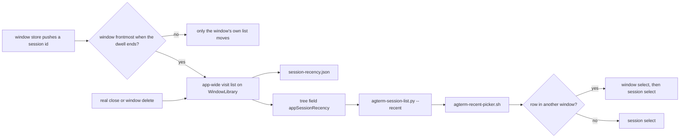

# Recent-session picker across windows, and moving a window's last workspace

<!-- plan-review: planning:plan-review 2026-10-26 findings=34 resolved -->

## Contents

- [Overview](#overview)
- [Context (from discovery)](#context-from-discovery)
- [Solution Overview](#solution-overview)
- [Technical Details](#technical-details)
- [Consumers of the new and removed pieces](#consumers-of-the-new-and-removed-pieces)
- [Upstream-merge cost](#upstream-merge-cost)
- [Development Approach](#development-approach)
- [Testing Strategy](#testing-strategy)
- [Progress Tracking](#progress-tracking)
- [What Goes Where](#what-goes-where)
- [Before the pair starts](#before-the-pair-starts)
- [Implementation Steps (pair board)](#implementation-steps-pair-board)
- [agterm-agents part (lead, own branch)](#agterm-agents-part-lead-own-branch)
- [Mac stage (lead, after the pair lands)](#mac-stage-lead-after-the-pair-lands)
- [Risks](#risks)
- [Post-Completion](#post-completion)

## Overview

Two pieces of work in one plan.

**Part one: the `ctrl+space>tab` picker lists the sessions Sasha really visited, in every window.**

- Today the picker (`~/dev/agterm-agents/bin/agterm-recent-picker.sh`) reads `tree --json`, which carries only the
  frontmost window's `sessionRecency`. A session in another window never appears.
- Each window keeps its own `RecencyStack<UUID>`. It has no timestamps, so lists from two windows cannot be merged
  into one true order. The app has to keep one more list.
- This adds one app-wide list of **visits** on `WindowLibrary`, persisted in its own file and exposed as the new
  top-level tree field **`appSessionRecency`**.
- A **visit** is a session Sasha opened and stayed on: selected while its window is the frontmost one, for the
  recency dwell. It counts in every window. A selection he never saw is not a visit: a launch restore, a script
  selecting in a window behind, a background window reselecting after a close. A reselection after a close in the
  frontmost window IS a visit once the dwell passes, because he is looking at it. Only the source window's fallback
  after a move is excluded outright.
- The picker raises the owning window with `window select` before `session select`.

**Part two: moving a window's last workspace deletes the emptied window.**

- Today `workspace move --to-window` refuses the last workspace of a window with `last workspace in window`.
- New: the move goes ahead, the now-empty source window is deleted, and the destination window is raised and
  focused. The `workspace has a pending close` refusal stays. `session move --to-window` does not change: an
  emptied workspace and its window stay.

Decisions made by Sasha:

- Scope of part one is ONLY the `ctrl+space>tab` picker. `agterm/Views/SessionSwitcher.swift` (Ctrl-Tab) and the
  title-bar recent popover are not touched. Per-window lists stay exactly as they are.
- What counts as a visit: as defined above, "the sessions that I actually been opening and working with, counted
  regardless of the window". A reselection after a close counts after the dwell when its window is frontmost, and
  not when it is behind.
- After a move: the moved session becomes most recent only if Sasha stays on it in the raised destination for the
  dwell (at once when the dwell is Immediately). The session the source window falls back to is never pushed to the
  app-wide list. Until then a moved session keeps its place; its id does not change.
- A closed or deleted session, and every session of a deleted window, leaves the list.
- A window switch alone (⌘` or a click on another window) is not a visit. Out of scope.
- Selecting a session in another window raises that window.
- `agterm-session-list.py --recent` keeps today's behaviour when the app does not send the new field.
- Moving the last workspace deletes the emptied window. Deleting it may finalize that window's other pending
  closes, as window delete does today.

Decided in this plan (argued in [Solution Overview](#solution-overview)):

- First launch seeds the list from the per-window lists, frontmost window first.
- The list lives in its own file, `session-recency.json`, not in `windows.json`.
- `appSessionRecency` is the same app-wide value whatever `--window` says.
- `session select` is not changed. The picker runs `window select` first, as `bin/agsess` already does.

## Context (from discovery)

References are at `origin/main` `7aa4343c` of `p4elkin/agterm-vim`. Files this plan edits are cited by construct
name only, never by line.

**Per-window recency, where it is pushed.**

- `AppStore.sessionRecency` is `@ObservationIgnored public private(set)`, so only code in `AppStore.swift` can
  mutate it.
- Two push sites, both in `AppStore.swift`: the deferred fire inside `recordRecency()` (the recency dwell, on
  `recencyDwellDebouncer`), and `recordRecencyNow()`. With a nil dwell, `recordRecency()` returns
  `recordRecencyNow()` (`guard let recencyDwell else { return recordRecencyNow() }`).
- `Debouncer.schedule` cancels the pending work before it schedules new work
  (`agtermCore/Sources/agtermCore/Debouncer.swift:27-35`), so a second `recordRecency()` replaces an armed push.
- Callers of `recordRecency()`: `selectSession` (only when the selection moved), `addSession`, `closeSession` and
  `removeWorkspace` reselection, `setRecencyDwell`, the pending-close restore paths in `AppStore+PendingClose.swift`,
  the recent-closed reopen in `AppStore+RecentClosed.swift`, and the transfer helpers `reselectAfterDetach` (source)
  and `selectAttached` (destination) in `AppStore+Transfer.swift`.
- Callers of `recordRecencyNow()`: `restore(from:launchRestore:)` (the bootstrap push of the restored selection)
  and the control `session.select` path, `agterm/Control/ControlServer+SessionActions.swift:404-414`.
- Typing flushes an armed push: `agtermCore/Sources/agtermCore/AppStore+AutoFollow.swift:45`.
- `setRecencyDwell` re-arms a push for the current selection whenever the dwell value changes, and does nothing for
  an unchanged value. The app calls it when a window mounts (`agterm/ContentView.swift:100`), for every window at
  scene start (`agterm/agtermApp.swift:306`), and on a Settings change (`agterm/SettingsModel.swift:388-391`, through
  `applyRecencyDwellToAllWindows` at `:863-871`).
- A store starts with `recencyDwell == nil` (record at once). `makeStore`, `newWindow(name:seed:selecting:)` and
  `loadStore` never set it; only the app does, after the window mounts.

**Per-window recency, where it is removed.**

- Real closes: `closeSession` and `removeWorkspace` call `sessionRecency.remove(...)` directly;
  `hardFinalizePendingSessions` (end of a soft-close grace) calls `removeFromRecency(_:)`.
- Transfer, not a close: `detachWorkspace`, `detachSessions` and `withdrawTransferred` call `removeFromRecency(_:)`.
- A soft close keeps the id in the list during the undo grace on purpose.
- `removeWorkspace` does NOT call `sessionDidFinalize`, while `closeSession` and `hardFinalizePendingSessions` do.
  So `sessionDidFinalize` cannot be the hook for "a session is really gone".

**Per-window recency, where it is persisted.** `Snapshot.sessionRecency`
(`agtermCore/Sources/agtermCore/Snapshot.swift:33`), written by `AppStore+Snapshot.swift:20` and re-read in
`restore(from:launchRestore:)`.

**Library and its persistence.**

- `WindowLibrary` owns `stores`, `frontmostWindowID`, `activeWindowID`, and the app-wide `recentClosedItems` and
  `bookmarks`. `makeStore(for:persistence:)` is a single `AppStore(...)` expression that wires `sessionDidFinalize`,
  `snapshotDidSave` and the event sink, each capturing the library weakly.
- `newWindow(name:seed:selecting:)` attaches the seed before it adds the store to `stores`, so a push from that
  attach never sees its window as the active one.
- `windows.json` is read by `loadIndex()` with synthesized `Codable`
  (`agtermCore/Sources/agtermCore/WindowLibrary+Index.swift:42`). A decode failure makes the whole index count as
  absent, which sends bootstrap to orphan recovery and renames every window `window N`.
- Prior art for app-wide state in its own file: `BookmarkPersistence` (`bookmarks.json`,
  `agtermCore/Sources/agtermCore/BookmarkPersistence.swift`). Its comment gives the reason: a schema change elsewhere
  must not discard it.
- Prior art for a cross-window list of sessions with their windows: `attentionAcrossWindows`
  (`agtermCore/Sources/agtermCore/WindowLibrary+Attention.swift:18-24`).
- The headless origin also builds a `WindowLibrary` (`agtermCore/Sources/AgtermHeadlessKit/Headless.swift:40`), so it
  will create and seed its own `session-recency.json`.

**The tree.**

- `ControlTree` (`ControlProjection.swift`) has no `CodingKeys`, so property names are the wire keys. Every property
  is `let`. App-global fields (`app`, `liveReset`, `indexUnsaved`, `rebased`) are passed into
  `AppStore.controlTree(...)` by `ControlServer.buildTree(in:)` (`agterm/Control/ControlServer.swift:853`).
- The `tree` command is `controlTree(window:)` in `ControlServer+AppCommands.swift`. `buildTree(in:)` is also used by
  the remote window projection (`agterm/Control/ControlServer+Zmx.swift:165`), which does not need the new field.
- `sessionRecency` on the wire is `navigableRecentSessions`: the window's visible navigation scope, the active
  session dropped (`agtermCore/Sources/agtermCore/AppStore+Recency.swift:14`, `:32`).
- `SkillInstallTests.bundledSkillDocumentsSessionRecency` counts `ControlTree`'s top-level fields with `Mirror`
  (22 today) and checks that `SKILL.md` and `reference.md` name each one.
- `.claude/rules/control-api.md` still says the skill counts "fourteen" fields. That is stale; it is 22.

**Does `session select --target <id>` raise the owning window? No.**

- `ControlServer.selectSession` (`agterm/Control/ControlServer+SessionActions.swift:404-414`) resolves the target
  across all open stores (`ControlTargetResolver.resolveSession`, `agterm/Control/ControlTargetResolver.swift:73`),
  then calls `store.selectSession(id)` and `store.recordRecencyNow()`. Nothing raises a window or calls
  `takeFrontmost`.
- Prior art: `bin/agsess:179-187` in agterm-agents runs `window select <id>`, then `session select`.
  `window select` (`agterm/Control/ControlServer+WindowCommands.swift:63-72`) opens or raises, waits for the
  registry, then calls `takeFrontmost`.

**Moving a window's last workspace.**

- `AppStore.workspaceTransferRefusal` returns `last workspace in window`. `detachWorkspace` also guards on
  `canRemoveWorkspace`. Both are in the fork-only `AppStore+Transfer.swift`.
- `detachWorkspace` calls `releaseLeavingSession` for each leaving session. `.claude/rules/windows.md` relies on it.
- `WindowLibrary.transferWorkspace` → `land(...)`: save the destination; for `.new` set `frontmostWindowID` and save
  the index; release the source surfaces; detach; save the source (`WindowLibrary+Transfer.swift`, fork-only).
- `WindowLibrary.removeWindow`, in order: finalize pending closes; `finalizeWindowPanes(id)` (from the LIVE store when
  loaded, else from the window FILE); `releaseLeavingSession` + `emitSessionClosed` for every session still in the
  store; `cancelPendingSave`; the watermark sweep over the store's session ids; drop the store; delete the file;
  clear `frontmostWindowID` if it was this window; `saveIndex()`.
- App-side delete is always `WindowRegistry.shared.close(id)` then `library.removeWindow(id)`
  (`agterm/Control/ControlServer+WindowCommands.swift:234-243`, `AppActions.deleteActiveWindow`).
- The NSWindow `willClose` handler (`agterm/Views/WindowAccessor.swift:138-196`) captured the window's `store`. It
  cancels pending asks, finalizes pending closes, tears down the surfaces of every session in `store.workspaces`, and
  refreshes `DockBadgeController`. Its comment says it can run after `removeWindow` already dropped the store.
- `applicationShouldTerminateAfterLastWindowClosed` keys off `library.openIDs()`, not AppKit's window count
  (`agterm/AppDelegate.swift:546-552`).
- `reportFrontmost` reconciles auto-hidden sidebars on every key report, even when the id did not change
  (`agterm/Views/WindowAccessor.swift:235-247`).
- `ControlServer+Transfer.present` opens or raises the destination, waits for `WindowRegistry`, and calls
  `takeFrontmost`. It does not move first responder.
- agterm-agents: `bin/agterm-window-picker` only shows a refusal; it does not depend on one. Its test
  `test_a_refused_move_stays_on_screen` uses `last workspace in window` as sample text.
  `skills/agent-sessions/SKILL.md` says "Moving a window's last workspace is refused."
- `~/.local/bin/agterm-recent-picker.sh` and `~/.local/bin/agterm-session-list.py` are symlinks into the main
  agterm-agents checkout, so an edit there is live at once.

**Semantic search.** `jbcontext` was not used for this plan. Prior art was found by grep and by reading.

## Solution Overview



### How a visit is recorded

Every per-window push also offers the id to the library. The library takes it only when the pushing window is the
active (frontmost) window at the moment the push happens, which is when the dwell ends. That is the visit rule.
Three cases show why the check is needed.

- **Relaunch.** Anna has three windows: `work` (frontmost), `notes`, `ops`. The dwell is 20 s. At scene start
  `setRecencyDwell` re-arms a push for each window's selection. Without the check, twenty seconds later `notes`'s
  `docs` and `ops`'s `logs` jump to the top of the picker in timer order, although Anna never looked at them. With
  the check only `work`'s `api` is taken, and that is the session she is in.
- **Script.** A script runs `session select --target logs` in `ops`, behind `work`. `ops`'s own list records it.
  The app-wide list does not.
- **Reselection after a close.** A session closes in `notes` while Anna works in `work`. `notes` reselects a
  neighbour behind her: not a visit. When she closes a session in `work` itself, `work` reselects a neighbour in
  front of her; it becomes a visit once she has stayed on it for the dwell. No special code: the frontmost check
  decides.

Also suppressed: the restore push in `restore(from:launchRestore:)`, through `restoringSelection`.

### After a move

- `land(...)` sets `frontmostWindowID` to the destination for every destination kind, once the destination saved
  (it already does this for `new`). For a `new` or `loaded` destination it first copies the dwell,
  `landing.store.setRecencyDwell(sourceStore.recencyDwell)`: such a store has not mounted, so its dwell is still nil
  and would record at once. The dwell is one global setting fanned out to every open store, so the source holds the
  current value, and the app's own call after mounting is then a no-op. Then `land` calls `recordRecency()` on the
  destination store. With the dwell at
  Immediately the moved session becomes most recent at once. With a 20 s dwell it becomes most recent only if it is
  still selected in the still-frontmost destination 20 s later. The earlier push armed by `selectAttached` is
  replaced by this one (`Debouncer.schedule` cancels it).
- The source's fallback selection (`reselectAfterDetach`) arms with app-wide recording turned off. It never reaches
  the app-wide list, even if Anna goes back to the source window before its timer fires.
- Setting `frontmostWindowID` in `land` makes `present`'s `takeFrontmost` return early for `.open` and `.loaded`, as
  it already does for `new`. `land` saves the index itself. The sidebar reconcile still runs, because `reportFrontmost`
  reconciles on every key report.

### Seed on first launch

The choice: start empty, or seed from the per-window lists.

- **Empty.** After the upgrade the field is omitted until Anna has made a visit, so the script falls back to
  `sessionRecency` and the picker shows today's rows. After one visit it shows one row.
- **Seed, frontmost first.** The frontmost window's list in its own order, then each other open window's list in
  window order. The first rows are today's picker rows; the other windows' sessions follow. The order across windows
  is a guess, replaced as Anna works.

Chosen: seed, only on a missing or unreadable `session-recency.json`. Closed windows are not read.

### Own file, not `windows.json`

- One bad value in a new `windows.json` field would fail the whole index decode and rename every window. Avoiding
  that needs a custom decoder on an upstream struct.
- `session-recency.json` follows `BookmarkPersistence`: load never throws, save writes atomically, a failed write
  keeps the in-memory list and the next change retries.
- Written on every change that moved something. At most 100 UUIDs. No debounce, so no exit-flush hook in upstream
  `saveAllChecked`.

### The tree field

- Name `appSessionRecency`. An array of `{"session": "<uuid>", "window": "<uuid>"}`, most recent first.
- Only sessions in an OPEN window, filtered by that window's own `navigableSessions`, so it hides what each window's
  `sessionRecency` hides.
- The active window's active session is dropped, as `sessionRecency` drops it. Other windows' selected sessions stay.
- Omitted when empty. The same value whatever `--window` says, like `app`, `liveReset` and `indexUnsaved`.
- A pending-close session is in no store's tree, so it is not shown. Its id stays in the list until the grace ends.
- Not produced by `HeadlessActions.controlTree` or the remote window projection.

### Raise the owning window: picker, not app

The choice: change `session select` to raise, add a `--follow` flag to it, or have the picker run `window select`.

- **Change `session select`.** `bin/agterm-zmx`, `bin/agterm-session-search` and `bin/agsess` would pull background
  windows forward. It also edits `ControlServer+SessionActions.swift`, an upstream file on the flagged list.
- **Add `--follow`.** A protocol argument, CLI flag, dispatcher arm, headless catalog entry, docs and tests for one
  caller.
- **Picker runs `window select <id>` first.** No app change; `bin/agsess` does exactly this. `window select` calls
  `takeFrontmost` before it returns, so the following `session select` push counts as a visit.

Chosen: the picker.

### Last workspace leaves: delete the emptied window

- `workspaceTransferRefusal` drops the `last workspace in window` clause. The pending-close clause stays.
- `detachWorkspace` may now empty the store. Its only caller is `WindowLibrary.transferWorkspace`.
- `land(...)`: when the detach leaves the source with no workspace, it calls `removeWindow(source)` INSTEAD of
  `sourceStore.save()`, and the result carries `removedSourceWindow`. `frontmostWindowID` is already the
  destination (see [After a move](#after-a-move)), so `removeWindow` does not clear it.
- App side (`ControlServer+Transfer.transfer`): right after a success that carries `removedSourceWindow`, before
  `present` awaits anything, `WindowRegistry.shared.close(id)`. `present` then raises the destination and, for this
  case, also calls `actions.focusActiveSession()`.
- `session move --to-window` is unchanged.

The order is argued in [Ordering of the source window delete](#ordering-of-the-source-window-delete).

## Technical Details

### `AppStore` hooks

In `AppStore.swift`, beside `sessionDidFinalize`:

```swift
/// Told each id this window's recency pushes, and each id a real close drops; the library keeps the visit order.
@ObservationIgnored var onRecencyPush: ((UUID) -> Void)?
@ObservationIgnored var onRecencyForget: ((UUID) -> Void)?
```

- Set after construction by the library, so the `AppStore` initializer (upstream, plus `AppStoreCompatibility`) does
  not change.
- `recordRecency(appWide: Bool = true)`: the flag is captured by the deferred fire. The nil-dwell branch no longer
  returns `recordRecencyNow()`; it calls `pushRecency(selected, appWide: appWide)` itself, so the flag survives a dwell
  of Immediately.
- `private func pushRecency(_ id: UUID, appWide: Bool)`: `sessionRecency.push(id)`, then `onRecencyPush?(id)` when
  `appWide && !restoringSelection`. Three callers: the deferred fire, the nil-dwell branch, and `recordRecencyNow()`
  (which passes `true`).
- `reselectAfterDetach` calls `recordRecency(appWide: false)`. Every other caller keeps the default.
- `func forgetRecency(_ id: UUID)`: `sessionRecency.remove(id)`, then `onRecencyForget?(id)`. It replaces the direct
  removal in `closeSession` and `removeWorkspace`, and the `removeFromRecency` call in `hardFinalizePendingSessions`.
- The transfer paths keep `removeFromRecency(_:)`, which never notifies.

### `AppSessionRecency` (new, fork-only `agtermCore/Sources/agtermCore/AppSessionRecency.swift`)

- `@MainActor public final class AppSessionRecency`, holding a `RecencyStack<UUID>` (limit 100) and an optional
  persistence value.
- `public var items: [UUID]`, `push(_:)`, `forget(_ ids: some Sequence<UUID>)`, `seed(_ ids: [UUID])`. `seed` does
  nothing unless the load found no usable file. Each mutation writes only when the list changed.
- `AppSessionRecencyPersistence` mirrors `BookmarkPersistence`: file `session-recency.json` in the state directory,
  shape `{"sessions": ["<uuid>", ...]}`, `load()` returns nil for a missing or corrupt file, unknown keys ignored.
- `public struct ControlRecentSession: Codable, Sendable, Equatable { public let session: String; public let window: String }`.

### `WindowLibrary` wiring

In `WindowLibrary.swift`, a few lines only (the class is near SwiftLint's type-length limit):

- stored `@ObservationIgnored public let appRecency: AppSessionRecency`, built in `init` before `bootstrap()`;
- after `bootstrap()` in `init`: `seedAppRecencyIfFresh()`;
- `makeStore(for:persistence:)` becomes `let store = AppStore(...)`, then `wireAppRecency(store, windowID: windowID)`,
  then `return store`;
- in `removeWindow`, beside the watermark sweep over `doomed`: `appRecency.forget(doomed)`. `doomed` comes from the
  live store when open, else from the file. After a last-workspace move the live store is empty, so the moved
  sessions are NOT forgotten.

New fork-only `agtermCore/Sources/agtermCore/WindowLibrary+SessionRecency.swift`:

- `wireAppRecency(_:windowID:)`: both closures capture the library weakly. `onRecencyPush` pushes only when
  `activeWindowID == windowID`; `onRecencyForget` always forgets.
- `seedAppRecencyIfFresh()`: frontmost open store's `sessionRecency.items`, then the other open stores in window order.
- `public func controlAppSessionRecency() -> [ControlRecentSession]?`, shaped like `attentionAcrossWindows`: map
  session id to window id over every open store's `navigableSessions`, drop the active store's `activeSession`, keep
  list order, nil when empty.

### Wire field

- In `ControlTree`: `public internal(set) var appSessionRecency: [ControlRecentSession]?`, one-line doc, not in the
  initializer. Precedent: `ControlSessionNode.remoteState` is `public internal(set) var`.
- `public func with(appSessionRecency:) -> ControlTree` in a fork-only extension, so the app target can set it.
- `ControlServer+AppCommands.controlTree(window:)` returns
  `buildTree(in: store).with(appSessionRecency: library.controlAppSessionRecency())`.

### `agterm-session-list.py --recent` (agterm-agents)

- Field present: entries in order. One `agtermctl window list --json` call gives names and the `active` window; the
  stdin tree is that window's. For the first entry of each other window, fetch `agtermctl tree --json --window <id>`
  once. Stop when N rows are filled. A failed fetch drops that window's entries.
- The agtermctl path comes from `AGTERM_CTL`, default `agtermctl`, as `bin/agsess` does.
- Field absent, or `window list` fails: today's path over `sessionRecency`. Neither field present: the existing exit
  message.
- `--recent` output becomes `session-id<TAB>window-id<TAB>label`. The window id is `-` for the current window and in
  the fallback. Rows from another window end with `  [<window name>]`. Default mode keeps `id<TAB>label`.

### `agterm-recent-picker.sh` (agterm-agents)

- Runs the list script beside itself, `${0:A:h}/agterm-session-list.py`, instead of the fixed
  `~/.local/bin/agterm-session-list.py`. Through the `~/.local/bin` symlink `:A` resolves into the same checkout, and
  a test or a worktree runs its own copy.
- `fzf --with-nth=3..`; split the pick into session id and window id; when the window id is not `-`, run
  `agtermctl window select "$wid"` first; then `session select` and `mode off` as today.
- Deploy both files together. With the new script and the old picker the rows only show an extra `-` column, since
  field one is still the session id. With the new picker and the old script the picker reads the label as the window
  id and runs `window select` on it.

### Ordering of the source window delete

**A moved workspace still listed in the source store when that window goes away loses its panes.**

What would happen if `removeWindow` or the `willClose` handler saw the moved sessions in the source store:

1. Anna's window `scratch` holds one workspace, `api`, with a split row. She runs `workspace move --to-window work`.
2. `work` saves with `api` in it. The source surfaces are released.
3. If `api` were still in `scratch`'s store, `removeWindow(scratch)` would run `finalizeWindowPanes` over its live
   sessions and end both zmx daemons `work` now shows. It would emit `session.closed` for each moved session and
   delete their rendered `.text` watermark PNGs (keyed by session id, which did not change).
4. The `willClose` handler of `scratch`'s NSWindow captured the same store. It would cancel the moved sessions'
   pending asks and call `teardown()` on their surfaces. `Session` is a shared object, so those are the NEW surfaces
   `work` built.

So the plan fixes this order, all in one synchronous main-actor turn:

1. `transferWorkspace` attaches `api` to `work` and saves `work` (unchanged).
2. `land` sets `frontmostWindowID = work`, saves the index, copies the dwell if `work` is new or loaded, re-arms
   `work`'s recency.
3. Release the source surfaces; `detachWorkspace` empties `scratch`'s store (releasing each session once, as today).
   The source file is NOT saved.
4. `removeWindow(scratch)` runs with an empty LIVE store. `finalizeWindowPanes` takes its live branch and finds
   nothing; the release-and-close loop and the watermark sweep see nothing; `cancelPendingSave` stops a debounced
   write from re-creating the file; the file is deleted.
5. In `ControlServer+Transfer.transfer`, still before any `await`: `WindowRegistry.shared.close(scratch)`. The
   `willClose` handler sees an empty store and `isOpen == false`, so it saves nothing and tears down nothing.
6. `present`: raise or open `work`, wait for the registry, `takeFrontmost(work)` (a no-op now),
   `focusActiveSession()`.

Risks found, and what holds each one off:

- **An `await` between steps 3 and 5** would let SwiftUI render `scratch` with zero workspaces, a state the views
  have never seen. Held off by doing steps 1 to 5 before `present`.
- **`removeWindow` reading the source FILE** (its closed-window branch) would finalize the panes still written there.
  Held off because the transfer requires `stores[source]`. A test pins that the daemons are not finalized.
- **A crash between the destination save and the file delete** leaves `api` in both files: the existing
  duplicate-after-crash case in `.claude/rules/windows.md`, with its remedy.
- **Other pending closes in `scratch`** are finalized by `removeWindow`, as window delete does (Sasha's decision). A
  pending session close inside `api` is still refused.
- **Frontmost.** AppKit makes another window key when `scratch` closes and queues an async `reportFrontmost` for it
  (`agterm/Views/WindowAccessor.swift:126-131`). The raise in step 6 queues the destination's report after it, so
  `work` ends frontmost. Checked by hand on the Mac.
- **App termination** when `scratch` was the only on-screen window and `work` is `new`: not a risk. The terminate
  check reads `library.openIDs()`, which already holds the new store.

## Consumers of the new and removed pieces

Recount at acceptance (Task 9, Agents step 4 and Mac step 4). Readers only, by name.

**New pieces**

| New piece | Consumers | Count |
|---|---|---|
| `AppStore.onRecencyPush` | `WindowLibrary.wireAppRecency` | 1 |
| `AppStore.onRecencyForget` | `WindowLibrary.wireAppRecency` | 1 |
| `AppStore.pushRecency(_:appWide:)` | the `recordRecency(appWide:)` deferred fire, its nil-dwell branch, `recordRecencyNow()` | 3 |
| `recordRecency(appWide: false)` | `reselectAfterDetach` | 1 |
| `AppStore.forgetRecency(_:)` | `closeSession`, `removeWorkspace`, `hardFinalizePendingSessions` | 3 |
| `AppSessionRecency` | `WindowLibrary.init`, `wireAppRecency`, `seedAppRecencyIfFresh`, `removeWindow`, `controlAppSessionRecency` | 5 |
| `session-recency.json` | `AppSessionRecencyPersistence.load`, `.claude/rules/windows.md` | 2 |
| `ControlRecentSession` | `ControlTree.appSessionRecency`, `controlAppSessionRecency` | 2 |
| tree field `appSessionRecency` | `bin/agterm-session-list.py --recent`, `SkillInstallTests.bundledSkillDocumentsSessionRecency`, skill `SKILL.md`, skill `reference.md`, `.claude/rules/control-api.md`, `FORK-NOTES.md`, `CHANGELOG-fork.md` | 7 |
| `ControlTree.with(appSessionRecency:)` | `ControlServer.controlTree(window:)` | 1 |
| `WindowLibrary.controlAppSessionRecency()` | `ControlServer.controlTree(window:)` | 1 |
| `land` re-arm of the destination recency | `transferWorkspace`, `transferSessions` | 2 |
| `land` dwell copy into a `new` or `loaded` destination | `transferWorkspace`, `transferSessions` | 2 |
| `TransferResult.removedSourceWindow` | `ControlServer+Transfer.transfer` (closes the NSWindow), `ControlServer+Transfer.present` (focus) | 2 |
| `--recent` output column `window-id` | `bin/agterm-recent-picker.sh` | 1 |

Total: **34**, docs counted wherever they name the piece. The tree field has one code reader, the Python script. Producers (not counted):
`ControlServer.controlTree(window:)`. `HeadlessActions.controlTree` and the remote window projection never produce it.

**Removed pieces: the `last workspace in window` refusal and the `canRemoveWorkspace` guard in `detachWorkspace`**

| Consumer | Task | Count |
|---|---|---|
| `AppStore.workspaceTransferRefusal` | Task 6 | 1 |
| the `canRemoveWorkspace` guard in `detachWorkspace` | Task 5 | 1 |
| `AppStoreTransferTests.theLastWorkspaceIsRefused` | Task 6 | 1 |
| `WindowLibraryTransferTests.theLastWorkspaceIsRefused` | Task 6 | 1 |
| `ControlServerTransferTests.testARefusedMoveAnswersTheRefusalAndChangesNothing` | Mac step 2 | 1 |
| the refused `workspace.move` block in `ZmxLiveUITests` | Mac step 3 | 1 |
| `.claude/rules/windows.md`, Transfer between windows, "Refused" | Task 7 | 1 |
| skill `reference.md`, `workspace move --to-window` | Task 8 | 1 |
| agterm-agents `skills/agent-sessions/SKILL.md` | Agents step 3 | 1 |
| agterm-agents `tests/test_agterm_window_picker.py` | Agents step 3 | 1 |

Total: **10**.

## Upstream-merge cost

| File | Owner | Change |
|---|---|---|
| `AppSessionRecency.swift`, `WindowLibrary+SessionRecency.swift` | fork, new | all new logic |
| `AppStore+Transfer.swift`, `WindowLibrary+Transfer.swift`, `ControlServer+Transfer.swift` | fork | moves |
| `AppStore.swift` (flagged) | upstream | 2 stored properties, 2 helpers, the `appWide` parameter, 2 push sites (already fork code) and 2 removal lines |
| `AppStore+PendingClose.swift` | upstream | one call renamed in `hardFinalizePendingSessions` |
| `WindowLibrary.swift` | upstream | 1 stored property, 2 init lines, `makeStore` split into 3 lines, 1 line in `removeWindow` |
| `ControlProjection.swift` | upstream | 1 property in `ControlTree` |
| `ControlServer+AppCommands.swift` | upstream, `declined` in `fork-merge.md` | 1 line in `controlTree(window:)` |
| `SkillInstallTests.swift`, `reference.md`, `SKILL.md`, `ZmxLiveUITests.swift` | upstream | counts, docs, one test block |

No file joins the `fork-merge.md` `flagged` list: none holds key routing, and the new files are fork-only.

## Development Approach

- **testing approach**: TDD. Write the failing test, then the code.
- one task at a time; small, focused changes
- every task adds or updates tests, success and error cases as separate checklist items
- all tests of the task pass before the task lands
- follow `.claude/planning-rules.md`: never drive the live terminal, never launch the app, `agtermCore` stays
  host-free, short comments, file limits, no `CHANGELOG.md` edits

## Testing Strategy

- **Linux gate** (pair board): `swift test --no-parallel` from `agtermCore/` with swiftly, narrowed by `--filter`.
  Every Check runs under `bash -lc`, because `pair` runs checks through `/bin/sh`, which has no `source`.
  A task carries its command once, on its Check line. Its last checkbox says "the Check below passes" with no
  backticks: `pair` collects every Acceptance line and every Check line, and would run a repeated command twice.
- **agterm-agents**: bare `pytest` (a uv tool) in the worktree `~/dev/agterm-agents-recent`, never in the main
  checkout.
- **Mac** (Mac stage, lead): `make build`, narrowed `scripts/test-app.sh -only-testing:…`, one UI test alone, then
  `swift test`, `make test-app`, `make lint` once each.
- Dwell timing uses `recencyDwellDebouncer.flush()`, as `AppStoreRecencyDwellTests` does. Nothing sleeps.

## Progress Tracking

- mark completed items with `[x]` immediately
- add newly discovered tasks with ➕, blockers with ⚠️
- keep the plan in sync with the work

## What Goes Where

- **Pair board** (`### Task 1:` to `### Task 9:`): `agtermCore` code and tests, fork docs, the bundled skill, the
  full Linux gate. Every Check runs on p4linux.
- **agterm-agents part** (`### Agents step N:`, lead): its own branch and worktree. Its steps end in a Verify
  line, never an Acceptance or Check line, so `pair start` never stores them as board checks.
- **Mac stage** (`### Mac step N:`, lead): app-target code, hosted and UI tests, Mac gates, deploy.
- The `Agents step` and `Mac step` headings do not match `Task N:`, so neither the pair board nor ralphex picks them.

## Before the pair starts

Lead, on p4linux, before `pair start`. Board checks are frozen when the pair starts, so the skip list in Task 9 is
fixed here.

- [ ] `main` holds untracked files (`docs/headless-origin-report.md`, this plan), so `pair start --base main` refuses.
      Cut a base branch: `git branch cross-window-recent-base main`
- [ ] measure the baseline in a temporary worktree, never in a clone another session works in:
      `git worktree add /tmp/cwr-baseline cross-window-recent-base`, then run Task 9's command there without its
      `--skip`, and record every failing test. The two skips in Task 9 were measured at `28c169b3`; replace them with
      what fails at this base
- [ ] edit the main-checkout copy of this plan (the file `pair start --plan` reads and the board checks are built
      from): write the measured skip list into Task 9 and the plan-review marker. Then `cp` it into
      `/tmp/cwr-baseline`, commit it there on `cross-window-recent-base`, and remove the temporary worktree. Keep the
      main-checkout copy identical to the committed one until Mac step 6
- [ ] `pair start --plan docs/plans/20261026-cross-window-recent-sessions.md --mate <claude|codex, chosen at the route
      step> --base cross-window-recent-base --slug cross-window-recent`; the integration branch is
      `pair/cross-window-recent`
- [ ] keep `cross-window-recent-base` until `pair cleanup` has run (Mac step 6): cleanup checks against it

## Implementation Steps (pair board)

Parallel start: Tasks 1 and 2 share no files. Task 3 needs 1 and 2; Task 4 needs 3; Task 5 needs 2 (both touch
`AppStore+Transfer.swift`); Task 6 needs 3 and 5; Tasks 7 and 8 need 4 and 6 (Task 8 shares `reference.md` with
Task 4). Only Task 2 touches `AppStore.swift`; only Task 3 touches `WindowLibrary.swift`. The refusal change lives in
Task 6, beside the window delete, so no task lands with `WindowLibraryTransferTests.theLastWorkspaceIsRefused` red.

### Task 1: The app-wide visit list and its file

**Files:**
- Create: `agtermCore/Sources/agtermCore/AppSessionRecency.swift`
- Create: `agtermCore/Tests/agtermCoreTests/AppSessionRecencyTests.swift`

- [ ] write failing tests: a missing file loads empty and marks the list fresh; a corrupt file the same; a valid file
      loads in order; unknown keys are ignored
- [ ] write failing tests: `push` moves an id to the front and writes; a push of the current front writes nothing;
      `forget` of a known id removes and writes; `forget` of unknown ids writes nothing; the 100 limit holds
- [ ] write failing tests: `seed` fills a fresh list and writes; `seed` on a list loaded from a valid file does
      nothing; a write into a read-only directory keeps the in-memory list (the technique in
      `WindowLibraryRecentClosedTests`)
- [ ] write a failing test: `ControlRecentSession` encodes as `{"session":…,"window":…}` and round-trips
- [ ] add `AppSessionRecency`, `AppSessionRecencyPersistence` and `ControlRecentSession` as in Technical Details
- [ ] the Check below passes

Check: `bash -lc 'source ~/.local/share/swiftly/env.sh && cd agtermCore && swift test --no-parallel --filter AppSessionRecencyTests'`

### Task 2: Store hooks for a visit and a real close

**Files:**
- Modify: `agtermCore/Sources/agtermCore/AppStore.swift`
- Modify: `agtermCore/Sources/agtermCore/AppStore+PendingClose.swift`
- Modify: `agtermCore/Sources/agtermCore/AppStore+Transfer.swift` (reselectAfterDetach only)
- Create: `agtermCore/Tests/agtermCoreTests/AppStoreAppRecencyTests.swift`

- [ ] write failing tests for push: with a nil dwell, a selection change calls `onRecencyPush` once with the id; with
      a dwell, nothing until `recencyDwellDebouncer.flush()`, then once; `recordRecencyNow()` calls it;
      `restore(from:launchRestore:)` calls it zero times while the per-window list still gets the restored selection
- [ ] write failing tests for the move fallback: after `detachWorkspace` and after `detachSessions` of the active
      session, with a nil dwell (through the immediate branch of `recordRecency`) and with a 20 s dwell plus `flush()`,
      the reselected session is first in `sessionRecency` and `onRecencyPush` was called zero times
- [ ] write failing tests for the close reselection: after `closeSession` and after `removeWorkspace` of the active
      session, with a nil dwell and with a 20 s dwell plus `flush()`, `onRecencyPush` is called once with the
      reselected session (the frontmost check is the library's, in Task 3)
- [ ] write failing tests for forget: `closeSession`, `removeWorkspace`, and the end of a soft-close grace each call
      `onRecencyForget` for every removed id; a soft close followed by `undoPendingClose()` calls it zero times
- [ ] write failing tests that transfer never forgets: `detachWorkspace`, `detachSessions` and `withdrawTransferred`
      drop the ids from `sessionRecency` and call `onRecencyForget` zero times
- [ ] add `onRecencyPush`, `onRecencyForget`, `recordRecency(appWide:)` (its nil-dwell branch calls `pushRecency`
      itself), `pushRecency(_:appWide:)`, `forgetRecency(_:)`; route the three push callers and the three real-close
      removals through them; pass `appWide: false` in `reselectAfterDetach`
- [ ] confirm `AppStoreRecencyDwellTests`, `AppStoreSessionRecencyTests` and `AppStoreTransferTests` still pass
- [ ] the Check below passes

Check: `bash -lc 'source ~/.local/share/swiftly/env.sh && cd agtermCore && swift test --no-parallel --filter "AppStoreAppRecencyTests|AppStoreRecencyDwellTests|AppStoreSessionRecencyTests|AppStoreTransferTests|AppStoreCloseReselectionTests|AppStoreTests"'`

### Task 3: The library records visits, seeds, and forgets on window delete

depends: 1, 2

**Files:**
- Modify: `agtermCore/Sources/agtermCore/WindowLibrary.swift`
- Create: `agtermCore/Sources/agtermCore/WindowLibrary+SessionRecency.swift`
- Create: `agtermCore/Tests/agtermCoreTests/WindowLibraryAppRecencyTests.swift`

- [ ] write failing tests for visits: two windows; a selection in the frontmost window enters `appRecency`; a
      selection in the other window does not, while that window's `sessionRecency` does; after `frontmostWindowID`
      changes, the other window's selections count; with a 20 s dwell, a selection whose window stops being frontmost
      before `flush()` is not taken
- [ ] write failing tests for the close reselection: closing the active session in the frontmost window puts the
      reselected session into `appRecency` (with a 20 s dwell only after `flush()`); the same close in a background
      window does not
- [ ] write failing tests for removal: closing a session removes it; `removeWindow` of an open window removes all its
      sessions; `removeWindow` of a closed window removes the sessions read from its file; `closeWindow` keeps them
- [ ] write failing tests for launch: no file, two open windows, frontmost `B`: the list is `B`'s
      `sessionRecency.items` then `A`'s; a second `WindowLibrary` on the same directory loads the saved order and does
      not seed again; a relaunch does not move any window's restored selection to the front
- [ ] add the stored property, the init and seed lines, the `makeStore` split and the `removeWindow` line in
      `WindowLibrary.swift`; put `wireAppRecency` and `seedAppRecencyIfFresh` in the new extension file
- [ ] confirm `WindowLibraryTests` and `WindowLibraryTransferTests` still pass
- [ ] the Check below passes

Check: `bash -lc 'source ~/.local/share/swiftly/env.sh && cd agtermCore && swift test --no-parallel --filter "WindowLibraryAppRecencyTests|WindowLibraryTests|WindowLibraryTransferTests"'`

### Task 4: The tree field `appSessionRecency` and the skill

depends: 3

**Files:**
- Modify: `agtermCore/Sources/agtermCore/ControlProjection.swift`
- Modify: `agtermCore/Sources/agtermCore/WindowLibrary+SessionRecency.swift`
- Modify: `agtermCore/Sources/agtermCore/AppSessionRecency.swift`
- Create: `agtermCore/Tests/agtermCoreTests/ControlTreeAppSessionRecencyTests.swift`
- Modify: `agtermCore/Tests/agtermCoreTests/SkillInstallTests.swift`
- Modify: `plugins/agterm/skills/agterm/reference.md`
- Modify: `plugins/agterm/skills/agterm/SKILL.md`

- [ ] write failing tests for `controlAppSessionRecency()`: entries in list order with their window ids; a session in
      a closed window is left out; a session hidden by its window's focus filter or parked hiding is left out; the
      active window's active session is left out; another window's selected session stays; a pending-close session is
      left out; an empty result is nil
- [ ] write failing tests for the wire: a tree with the field set encodes `appSessionRecency` as an array of objects;
      nil omits the key; an older tree JSON without the key decodes with nil
- [ ] update `SkillInstallTests` to 23 fields and `twenty-three top-level read-only fields`; watch it fail on the docs
- [ ] add `ControlTree.appSessionRecency` in `ControlProjection.swift`; the fork-only extension with
      `with(appSessionRecency:)` in `AppSessionRecency.swift`, beside `ControlRecentSession`;
      `controlAppSessionRecency()` in `WindowLibrary+SessionRecency.swift`
- [ ] `reference.md`: the field in the tree field list (count twenty-three), app-wide like `app`, the same under
      `--window`, `tree`-only; `SKILL.md`: name it beside `sessionRecency`, never in `description`
- [ ] the Check below passes

Check: `bash -lc 'source ~/.local/share/swiftly/env.sh && cd agtermCore && swift test --no-parallel --filter "ControlTreeAppSessionRecencyTests|SkillInstallTests"'`

### Task 5: `detachWorkspace` may empty the store

depends: 2

**Files:**
- Modify: `agtermCore/Sources/agtermCore/AppStore+Transfer.swift`
- Modify: `agtermCore/Tests/agtermCoreTests/AppStoreTransferTests.swift`

- [ ] write failing tests, calling `detachWorkspace` directly on the only workspace: `workspaces` is empty,
      `selectedSessionID` nil, no `sessionClosed`, nothing finalized, no file written
- [ ] write a test that `detachSessions` of every session of the only workspace still keeps the empty workspace
- [ ] drop the `canRemoveWorkspace` part of the guard in `detachWorkspace`; leave `workspaceTransferRefusal` as it is
      (Task 6 changes it), so `theLastWorkspaceIsRefused` in both suites still passes
- [ ] the Check below passes

Check: `bash -lc 'source ~/.local/share/swiftly/env.sh && cd agtermCore && swift test --no-parallel --filter "AppStoreTransferTests|WindowLibraryTransferTests"'`

### Task 6: A move hands frontmost to the destination and deletes an emptied source

depends: 3, 5

**Files:**
- Modify: `agtermCore/Sources/agtermCore/AppStore+Transfer.swift`
- Modify: `agtermCore/Sources/agtermCore/WindowLibrary+Transfer.swift`
- Modify: `agtermCore/Tests/agtermCoreTests/AppStoreTransferTests.swift`
- Modify: `agtermCore/Tests/agtermCoreTests/WindowLibraryTransferTests.swift`
- Modify: `agtermCore/Tests/agtermCoreTests/WindowLibraryAppRecencyTests.swift`

- [ ] write failing tests for frontmost: after `transferWorkspace` and `transferSessions` to `.new`, an open window and
      a closed window, `frontmostWindowID` is the destination and `windows.json` records it; a destination save
      failure leaves `frontmostWindowID` unchanged
- [ ] write failing recency tests for each destination kind, `.new`, `.open` and `.loaded`, each with the source dwell
      nil and with the source dwell 20 s (for `.open`, set the same dwell on both stores, as the app's fan-out does;
      `land` copies a dwell only into `.new` and `.loaded`):
      with nil the moved session is first in `appRecency.items` right after the move; with 20 s it is NOT first before
      `flush()` on the destination store and is first after it; with 20 s, selecting another destination session
      before `flush()` leaves the moved session at its old index; a `.new` or `.loaded` destination store's
      `recencyDwell` equals the source's after the move
- [ ] write failing tests that the move never moves the source's fallback session forward in `appRecency.items` (its
      index is unchanged, or it stays absent when the fixture never visited it): nil dwell; 20 s dwell with `flush()`
      on the source store; 20 s dwell with `frontmostWindowID` set back to the source before that `flush()`
- [ ] replace `theLastWorkspaceIsRefused` in `AppStoreTransferTests` with a failing test that
      `workspaceTransferRefusal` answers nil for the only workspace; keep `aWorkspaceNamedByAPendingCloseIsRefused`
      and add a case where that workspace is the only one
- [ ] replace `theLastWorkspaceIsRefused` in `WindowLibraryTransferTests` with failing tests: the only workspace moves
      to `.new` and to an open window; the source id is gone from `windows`, its store from `stores`, its file from
      disk; `windows.json` lists the destination as frontmost; `TransferResult.removedSourceWindow` is the source id
- [ ] write failing tests for the panes: a recording `paneFinalizer` is never called with a moved pane identity; no
      `session.closed` event for a moved session; `removeWindow` does not release a moved session a second time; a
      second `WindowLibrary` on the directory claims every moved pane identity (as the existing claims test does)
- [ ] write failing tests: the moved sessions stay in `appRecency.items` after the window delete; a destination save
      failure on a last-workspace move leaves the source window, its store and its file unchanged; a pending session
      close inside the moved workspace is still refused; another pending workspace close in the source window is
      finalized by the delete
- [ ] write a failing test that `transferSessions` emptying the only workspace keeps the source window and its empty
      workspace, with `removedSourceWindow` nil
- [ ] drop the last-workspace clause from `workspaceTransferRefusal`
- [ ] in `land`, after the destination save, for every kind: set `frontmostWindowID` and save the index; for `.new`
      and `.loaded` call `landing.store.setRecencyDwell(sourceStore.recencyDwell)`; then `recordRecency()` on the
      destination store. Add `removedSourceWindow` to `TransferResult` (default nil) and the `removeWindow(source)`
      branch
- [ ] the Check below passes

Check: `bash -lc 'source ~/.local/share/swiftly/env.sh && cd agtermCore && swift test --no-parallel --filter "AppStoreTransferTests|WindowLibraryTransferTests|WindowLibraryAppRecencyTests"'`

### Task 7: Fork docs

depends: 4, 6

**Files:**
- Modify: `.claude/rules/control-api.md`
- Modify: `.claude/rules/windows.md`
- Modify: `FORK-NOTES.md`
- Modify: `CHANGELOG-fork.md`

- [ ] `control-api.md`, tree section: one bullet for `appSessionRecency` (what a visit is, open windows only, each
      window's navigation scope, active session dropped, the same under `--window`); correct the stale "fourteen" to
      twenty-three
- [ ] `windows.md`, Model and persistence: `session-recency.json`, the hooks (`pushRecency`, `forgetRecency`, the
      visit rule including the close reselection, the seed, `removeWindow` forgetting from the live store), and that
      the headless origin creates and seeds its own copy but never reports the field
- [ ] `windows.md`, Transfer between windows, "Refused": drop "the last workspace of a window"; keep the pending
      close and the not-zmx-backed pane
- [ ] `windows.md`, Transfer between windows: a move hands frontmost to the destination, copies the dwell into a new
      or loaded destination, and re-arms its recency; the source fallback never counts as a visit; the delete of an
      emptied window and its order (empty the store, then `removeWindow`, then close the NSWindow, all before any
      `await`)
- [ ] `FORK-NOTES.md`: `appSessionRecency` beside `sessionRecency` under Control API and tooling; one line in "Move a
      workspace or sessions to another window"; one sentence that no file joins the `fork-merge.md` lists
- [ ] `CHANGELOG-fork.md`, Unreleased: one entry for the picker across windows, one for the last-workspace move
- [ ] no `CHANGELOG.md` change
- [ ] the Check below passes

Check: `bash -lc 'grep -q appSessionRecency .claude/rules/control-api.md && grep -q session-recency.json .claude/rules/windows.md && ! grep -q "the last workspace of a window" .claude/rules/windows.md && grep -q appSessionRecency FORK-NOTES.md && grep -q appSessionRecency CHANGELOG-fork.md && git diff --quiet "$(git merge-base HEAD origin/main)" -- CHANGELOG.md'`

### Task 8: Skill text for the last-workspace move

depends: 4, 6

**Files:**
- Modify: `plugins/agterm/skills/agterm/reference.md`

- [ ] `workspace move --to-window`: replace "Refuses the window's last workspace" with: the last workspace moves and
      the emptied window is deleted; the pending-close refusal stays
- [ ] the Check below passes

Check: `bash -lc '! grep -q "Refuses the window.s last" plugins/agterm/skills/agterm/reference.md && source ~/.local/share/swiftly/env.sh && cd agtermCore && swift test --no-parallel --filter SkillInstallTests'`

### Task 9: Full Linux gate and consumer recount

owner: lead
depends: 1, 2, 3, 4, 5, 6, 7, 8

- [ ] every Overview item has code and a test, except the parts in the agterm-agents part and the Mac stage
- [ ] recount [Consumers of the new and removed pieces](#consumers-of-the-new-and-removed-pieces); list those left for
      the Mac stage and the agterm-agents part
- [ ] the headless origin builds, and the full suite passes, skipping only the baseline failures recorded in
      [Before the pair starts](#before-the-pair-starts) (the skip list below is replaced there before `pair start`)
- [ ] the Check below passes

Check: `bash -lc 'source ~/.local/share/swiftly/env.sh && export PATH=$HOME/.local/share/mise/installs/node/26/bin:$PATH && cd agtermCore && swift build --product agterm-headless && swift test --no-parallel --skip "aFramelessPanelIsAsTallAsItsText|interruptedPayloadStillExecsTheFinalShell"'`

## agterm-agents part (lead, own branch)

owner: lead

Branch `cross-window-recent` in a worktree at `~/dev/agterm-agents-recent`, cut from `main`. Never edit the main
checkout: `~/.local/bin` links into it, so an edit there is live in Sasha's terminal at once. Merged in the same
sitting as the Mac deploy (Mac step 6); remove the worktree after the merge.

### Agents step 1: `agterm-session-list.py --recent` reads the app-wide list

**Files:** `bin/agterm-session-list.py`, `tests/test_agterm_session_list.py`

- [ ] create the worktree: `git -C ~/dev/agterm-agents worktree add -b cross-window-recent ~/dev/agterm-agents-recent main`
- [ ] write failing tests with a stub `agtermctl` (named through `AGTERM_CTL`) that answers `window list --json` and
      `tree --json --window <id>` from fixture files and logs its calls
- [ ] cases: rows follow `appSessionRecency` across two windows; a row from the other window ends with its window
      name and carries that window id in field two; a current-window row carries `-`; `--recent 2` stops after two
      rows and never fetches a window it does not reach; a failed `tree --window` drops only that window's rows
- [ ] fallback cases: no `appSessionRecency` gives today's rows from `sessionRecency` with `-` in field two and no
      `agtermctl` call; neither field gives the existing exit message; default mode output is unchanged
- [ ] implement as in Technical Details
- [ ] Verify: `bash -lc 'cd ~/dev/agterm-agents-recent && pytest tests/test_agterm_session_list.py'`

### Agents step 2: The picker raises the owning window

**Files:** `bin/agterm-recent-picker.sh`, `tests/test_agterm_recent_picker.py` (new)

- [ ] write failing tests that run `zsh bin/agterm-recent-picker.sh` (not the `-l` shebang, so the test PATH holds)
      with stub `fzf` and `agtermctl` placed IN FRONT of the existing PATH (trimming PATH hides `zsh` and `python3`
      on p4linux); the stub `fzf` prints a chosen line, the stub `agtermctl` logs its arguments
- [ ] cases: a row from another window runs `window select <wid>`, then `session select --target <sid>`, then
      `mode off`, in that order; a `-` row runs no `window select`; an empty pick runs nothing
- [ ] call the list script as `${0:A:h}/agterm-session-list.py`; switch fzf to `--with-nth=3..`; add the
      `window select` step; update the header comment
- [ ] Verify: `bash -lc 'cd ~/dev/agterm-agents-recent && pytest tests/test_agterm_recent_picker.py tests/test_agterm_session_list.py'`

### Agents step 3: Text for the last-workspace move

**Files:** `skills/agent-sessions/SKILL.md`, `tests/test_agterm_window_picker.py`

- [ ] `SKILL.md`: replace "Moving a window's last workspace is refused." with: it moves, and the emptied window is
      deleted
- [ ] `test_a_refused_move_stays_on_screen`: use `workspace has a pending close` as the sample refusal
- [ ] confirm `bin/agterm-window-picker` assumes nothing about the refusal
- [ ] Verify: `bash -lc 'cd ~/dev/agterm-agents-recent && ! grep -q "last workspace is refused" skills/agent-sessions/SKILL.md && pytest tests/test_agterm_window_picker.py'`

### Agents step 4: Full agterm-agents suite

- [ ] bare `pytest` in the worktree, leaving out the files of the nine known Mac-only failures; about 12 minutes,
      so the lead runs it, never a sub-agent
- [ ] recount the agterm-agents consumers: `agterm-session-list.py`, `agterm-recent-picker.sh`, the agent-sessions
      skill, the window picker test
- [ ] Verify: `bash -lc 'cd ~/dev/agterm-agents-recent && pytest --ignore=tests/test_agterm_open_link.py --ignore=tests/test_agterm_open_path.py --ignore=tests/test_agterm_plannotate_proxy.py --ignore=tests/test_huddle.py --ignore=tests/test_install.py'`

## Mac stage (lead, after the pair lands)

The branch reaches the Mac by `git fetch` over ssh from p4linux. Work in a Mac worktree that follows the repo's
symlink rule for `GhosttyKit.xcframework` and the ghostty resources. Starts after Task 9.

### Mac step 1: App adapter

**Files:** `agterm/Control/ControlServer+AppCommands.swift`, `agterm/Control/ControlServer+Transfer.swift`

- [ ] `make build` and `make lint` pass before any change
- [ ] `controlTree(window:)`: `.with(appSessionRecency: library.controlAppSessionRecency())`
- [ ] `ControlServer+Transfer.transfer`: on success with `removedSourceWindow`, `WindowRegistry.shared.close(id)`
      before returning (the `willClose` handler already refreshes the Dock badge); `present`:
      `actions.focusActiveSession()` after `takeFrontmost` when the source was removed
- [ ] `make build`, `make lint`

### Mac step 2: Hosted tests

**Files:** `agtermTests/ControlServerTransferTests.swift`, `agtermTests/ControlServerAppRecencyTests.swift` (new)

- [ ] write a hosted test: two windows, a select in each while it is frontmost; `controlTree(window: nil)` and
      `controlTree(window: <other>)` carry the same `appSessionRecency` with the right window ids
- [ ] replace `testARefusedMoveAnswersTheRefusalAndChangesNothing`: moving the only workspace to `other` answers ok
      with `id` and `affected`; the source id is gone from `library.windows`; the destination holds the session;
      `WindowRegistry` no longer has the source
- [ ] Verify: `scripts/test-app.sh -only-testing:agtermTests/ControlServerTransferTests -only-testing:agtermTests/ControlServerAppRecencyTests`

### Mac step 3: UI test for a last-workspace move with live daemons

**Files:** `agtermUITests/ZmxLiveUITests.swift`

- [ ] in `testAWorkspaceWithASplitMovesToAnotherWindowAndKeepsItsDaemons`, remove the refused `workspace.move` block
      (it would now delete `dest` before the main step)
- [ ] after the main move, `workspace.delete` `dest`'s default workspace, then move the moved workspace back to the
      source: `window.list` no longer lists `dest`; `zmx list` shows both daemons with the same `leaderPID` and
      `clients == 1`; `tree --window <source>` holds the session
- [ ] run it alone from a Mac driver session, never over ssh (`.claude/rules/ui-tests.md`):
      `xcodebuild test -project agterm.xcodeproj -scheme agterm -destination 'platform=macOS' -only-testing:agtermUITests/ZmxLiveUITests/testAWorkspaceWithASplitMovesToAnotherWindowAndKeepsItsDaemons`

### Mac step 4: Manual check and wide gates

- [ ] recount consumers: all 34 new and all 10 removed done
- [ ] bring the agterm-agents branch to the Mac: `git -C ~/dev/agterm-agents fetch p4linux:dev/agterm-agents
      cross-window-recent:cross-window-recent`, then `git -C ~/dev/agterm-agents worktree add
      ~/dev/agterm-agents-recent cross-window-recent`
- [ ] manual check on an isolated Debug instance, following CLAUDE.md "Working norms". In one shell: export a short
      `AGTERM_STATE_DIR` under `/tmp` (agtermctl resolves its socket from it, never from `AGTERM_SOCKET`),
      `mkdir -p "$AGTERM_STATE_DIR/windows"`, prepend the Debug app's `Contents/MacOS` to `PATH`, launch the Debug
      build. From that same shell run `zsh ~/dev/agterm-agents-recent/bin/agterm-recent-picker.sh`: calling `zsh`
      directly skips the `-l` shebang, whose login profile could put the deployed `agtermctl` back in front. The
      picker finds its list script beside itself. Expect, with two windows: the picker lists a session of the other window
      with its name and raises that window; a last-workspace move leaves the destination frontmost and the old window
      gone. A lead step, not a plan-run step: `.claude/planning-rules.md` forbids launching the app during plan
      execution
- [ ] remove the Mac worktree: `git -C ~/dev/agterm-agents worktree remove ~/dev/agterm-agents-recent`
- [ ] `cd agtermCore && swift test`, `make test-app`, `make lint`, each once

### Mac step 5: Deploy (Sasha's go)

- [ ] ⚠️ ask Sasha for the go. `make deploy` replaces `/Applications/agterm.app`, its PATH CLI and installed hooks.
      First check that the deployed build's branch work is all in this branch
- [ ] the agterm-agents branch merges in Mac step 6, the same sitting, so `agterm-session-list.py` and
      `agterm-recent-picker.sh` change together
- [ ] `make deploy` does not restart the running app. The restart is Sasha's call
- [ ] after the restart: `agtermctl version` names the new build; then, in a window where at least two sessions were
      visited, `agtermctl tree --json` carries `appSessionRecency`

### Mac step 6: Merge and clean up (Sasha's go)

- [ ] ⚠️ only on Sasha's go, in the same sitting as Mac step 5
- [ ] commit the Mac changes on `pair/cross-window-recent` in the Mac worktree; on p4linux fetch them back over ssh
      into the integration branch
- [ ] in the main checkout on p4linux, compare the untracked copy of this plan with the branch copy
      (`git show pair/cross-window-recent:docs/plans/20261026-cross-window-recent-sessions.md`), then delete the
      untracked copy, or the fast-forward aborts on it. Leave `docs/headless-origin-report.md` alone
- [ ] merge into `main` on p4linux as a fast-forward (`git merge --ff-only pair/cross-window-recent`); push
      `origin main` only on Sasha's word, after checking source and target
- [ ] `git branch -f cross-window-recent-base main` (the base has no upstream, so cleanup checks the pair branches
      against it), then `pair cleanup --slug cross-window-recent`, then `git branch -D cross-window-recent-base`;
      remove the Mac agterm-vim worktree
- [ ] agterm-agents: fast-forward `main` to `cross-window-recent` on p4linux, remove `~/dev/agterm-agents-recent`,
      delete the branch
- [ ] the `ctrl+space>tab` binding runs on the Mac (`~/.config/agterm/keymap.conf`, "Recent sessions", through the
      Mac's `~/.local/bin` symlinks into its own agterm-agents checkout), so fast-forward that checkout too:
      `git -C ~/dev/agterm-agents pull --ff-only p4linux:dev/agterm-agents main` on the Mac; until then the old picker
      keeps working on `sessionRecency`

## Risks

- `removeWorkspace` never calls `sessionDidFinalize`, so a hard workspace delete does not drop that workspace's
  bookmarks or tell `onSessionFinalized` consumers. Not fixed here; `forgetRecency` does not depend on it.
- With the dwell at Immediately, a selection made a moment before its window becomes frontmost is not a visit. One
  case: a recent-closed reopen into a background window selects before `revealRestoredWindow` raises it.
- Stale ids (a crash, a window file deleted outside the app) stay in the file until 100 newer ids push them out. The
  projection never shows them.
- With auto-hide-inactive-sidebars on and the app inactive (a script drives the move), the sidebar reconcile waits for
  the next key report, because `land` now sets `frontmostWindowID` before `present`'s `takeFrontmost`. A `new`
  destination has behaved this way since transfers landed.

## Post-Completion

*Manual, no checkboxes.*

**Manual verification** (Sasha, on the deployed app): open `ctrl+space>tab` in one window and pick a session from
another window; that window comes forward with the session selected and ready to type. Move a window's only workspace
with `ctrl+space>shift+u`; the old window disappears and both panes of every row keep running.

**External updates**: the installed agterm skill copies refresh from `plugins/agterm/skills/agterm/` by the usual
sync. The agent-sessions skill refreshes with agterm-agents.
