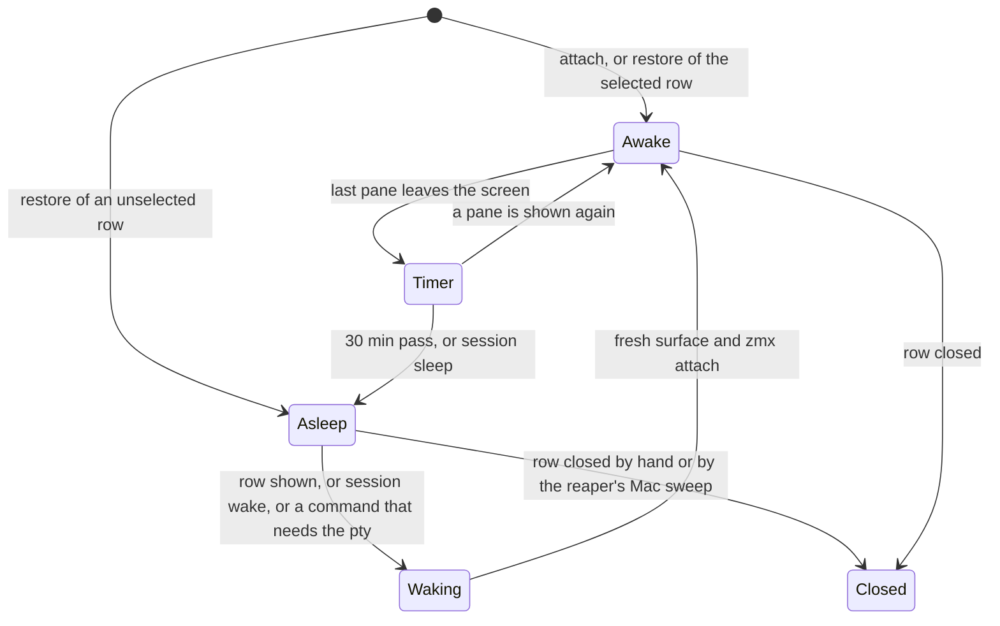

# Spec: sleeping remote rows, and pooled ssh for all streams

Status: approved by Sasha 2026-11-19, local Live rows deferred to a later round. Part 1 revised 2026-11-21 (Sasha chose pooled ssh). Branch `ssh-idle-rows`.
Size: L. What drives it: the deck, which mounts every session, both restore paths at launch, the
reconnect machinery that must tell a sleep from a drop, a new control command pair with read-back,
and a live measurement before and after.
Measurements and the options not chosen are in
[`20261119-idle-remote-rows-findings.md`](20261119-idle-remote-rows-findings.md).

## Contents

- [Problem](#problem)
- [Decisions already taken](#decisions-already-taken)
- [Part 1: pooled ssh for all streams](#part-1-pooled-ssh-for-all-streams)
- [Part 2: sleeping remote rows](#part-2-sleeping-remote-rows)
  - [The rule](#the-rule)
  - [Lifecycle](#lifecycle)
  - [What sleeps and what stays](#what-sleeps-and-what-stays)
  - [What wakes a row](#what-wakes-a-row)
  - [Launch and reconnect](#launch-and-reconnect)
  - [Control API](#control-api)
  - [Where the code changes](#where-the-code-changes)
  - [Consumers of what this adds](#consumers-of-what-this-adds)
- [The reapers](#the-reapers)
- [Remote parity](#remote-parity)
- [Acceptance](#acceptance)
- [Out of scope](#out-of-scope)
- [Settled decisions](#settled-decisions)

## Problem

On 2026-11-19 p4studio showed 121 rows presenting p4linux sessions, and about 20 of their panes were on
screen. Every other pane still held:

- a libghostty surface: 4.6 MB or more and 5 threads when hidden, and 16 MB on average in live agterm;
- a `login` → `/bin/sh` → `ssh -tt` chain: 3.4 MB or more.

Each attached row also holds one `ssh -T ... zmx present` stream. On 2026-11-19 the user's ssh mux was
full, so 144 of 251 streams had their own TCP connection. Since `ea70616a` every stream owns one by design
(see Part 1). 152 of the 157 pane ssh clients started within two minutes, at 03:03–03:04 on 2026-11-19
(`ps -o lstart=`). That was a reconnect storm.

## Decisions already taken

- **Fix the ssh mux and keep ssh. No mosh.** (Part 1 was revised on 2026-11-21: pooled masters, not one per host.) Mosh costs more per pane (6.7 MB client, 7.5 MB server),
  and the presentation streams stay on ssh anyway.
- **Short term: sleep idle remote panes.** A row whose panes have been off screen for **30 minutes**
  sleeps. The time is a setting.
- **Long term: the existing reaper.** The p4linux reaper closes rows idle for 24 h, and its Mac sweep
  removes the Mac rows. Nothing new is needed there.

## Part 1: pooled ssh for all streams

**Revised 2026-11-21, after the upstream merge (Sasha chose this option).** The approved version said one
agterm master per host under a raised fd limit. The merge changed the ground under it, so this section
replaces it.

**What the merge changed:**

- The fork's fix `ea70616a` (2026-11-16) gives every pane, presentation stream and reconnect probe its
  own TCP connection (`ownConnection`: `ControlMaster=no ControlPath=none`). It records two measured
  failures of a shared master:
  - **Freeze.** The user's master had no keepalive. On a dead link it stayed open, and 76 panes froze
    for 42 minutes with no reconnect.
  - **Channel cap.** sshd's `MaxSessions` (stock: 10) caps the sessions on one connection. A master
    raised to 64 was full within 3 s, and later sessions got `no more sessions`.
- Upstream's `SshConnectionPool` (agterm-server #949) spreads one remote window's sessions over masters,
  at most 8 per master (`channelsPerConnection`). Each master starts with a keepalive
  (`keepAliveCheck`). A pooled pane line waits for its master (`connectionWait`). Today only catalog
  rows (`catalogPool(forSession:)`) use it.

**Cause of the cost today.** With one connection per session, p4linux holds about 274 TCP connections
from this Mac: 177 pane attaches and 97 presentation streams (2026-11-20). A network drop or a Mac
wake reconnects all of them, and ufw's `22/tcp LIMIT` (6 new connections per 30 s) lets the last one in
only after about 23 minutes. The fd-limit cause measured on 2026-11-19 (`mux-repro.sh`) was the app
before `ea70616a`. It stays in the findings as history.

**Change.** Rows that are not catalog rows lease their ssh channels from **one `SshConnectionPool` per
host**, the same type the catalog uses:

- what leases: the pane attach (both panes and the origin scratch), the presentation stream, an overlay
  job, and the reconnect probe;
- what does not: page serving and link forwards (few and short-lived), and a `--transport mosh` row,
  which has no ssh channel;
- 8 channels per master keeps a stock sshd working. No fd limit changes: 8 channels need about 24 fds;
- a master dies within about 15 s of a dead link (keepalive), and its clients then exit with 255 at
  once (tested 2026-11-20). So the normal reconnect runs, and the freeze that `ea70616a` fixed does not
  come back;
- an asleep row (Part 2) releases its pane leases and keeps its stream lease. An idle master closes 60 s
  after its last client (`ControlPersist=60`).

**Expected result.** About 274 sessions become about 35 masters. With Part 2, about 120 sessions remain,
so about 16 masters. A reconnect storm costs one handshake per master: about 3 minutes now, and about
1.5 minutes with Part 2. That holds after a launch, where restored rows start asleep and lease only their
streams. Later sleep and wake cycles may spread the streams over more masters, because the pool never
moves a lease to another master.

**Not chosen:**

- **One master per host** (the approved version): one handshake per storm, but it needs `MaxSessions`
  above the session count (p4linux has 512, stock sshd has 10). It also reverts `ea70616a` for these rows.
- **Own connections, mux later:** about 23 minutes per storm, and a dashboard wake waits on ufw.

**Check.** After the change and an app restart:

- every pane `ssh -tt` and every `zmx present` stream to p4linux carries
  `ControlPath=/tmp/agterm-ssh-<uid>/...`, and none carries `ControlPath=none`;
- TCP connections to `p4linux:22` are about the session count divided by 8;
- no master log (`<path>.log`) holds `no more sessions` or `Session open refused`.

**Size: M.** One pool registry, nine attach-line builders, the lease retain, and tests.

## Part 2: sleeping remote rows

### The rule

A remote row sleeps when **none of its panes has been on screen for 30 minutes**. It wakes when one of
its panes would be shown. Nothing else wakes it or puts it to sleep, except the two control commands
below.

"On screen" means the row is the selected row of its window, and that window is visible. This is the
same test as `GhosttySurfaceView.showsOnScreen`. The clock lives in the model (`Session`), not on the
surface view, because sleep destroys that view and a row restored asleep never has one. A row's clock
starts when its last pane leaves the screen.

**Only a row with nothing local sleeps.** A row that holds anything with no zmx daemon behind it never
sleeps: a scratch shell, a program overlay, an HTML overlay, the Rebased IDE, or a terminal ask.
Sleeping would end those for good, and none of them comes back from the origin. One rule, visible on
screen: if the row shows something of the Mac's own, it stays awake.

### Lifecycle

### What sleeps and what stays

| | asleep | why |
|---|---|---|
| sidebar row, name, position, flag, tint | stays | the row is the handle Sasha comes back to |
| presentation stream (`zmx present`) | **stays** | it carries `status`, `name`, `context`, `info`, `notify`, `sound` and `hud`, so the row stays live. The reaper's Mac sweep also needs `remoteState` and `presentation.mode`, which come from it |
| `remoteState`, `remoteSession` | stay, unchanged | `attached` still means "the origin session exists" |
| pane surfaces (libghostty) | **freed** | the main saving |
| `login`, `sh`, `ssh -tt` per pane | **ended** | they end with the surface |
| Mac-side scrollback | lost | after wake, zmx replays its snapshot. How much history that snapshot holds is checked in the plan |
| in-band terminal signals (bell, OSC 9/777, title) while asleep | not seen | agent status and `notify` still arrive through the presentation stream |

The p4linux session keeps running in its zmx daemon. Sleep never touches the origin.

**The presenter role must be checked in the plan.** `startRemotePresentation` gives the client
`leads: leadsHere(id)`. `leadsHere` is `primaryPaneLeads` (the primary pane is `.leader` in
`ZmxLeadBook`) and the user being present. A sleeping row has no primary pane attach, so it cannot
*take* the presenter role. What it *reports*, and whether the origin moves the role to a mirror Mac,
is not known yet. That matters for:

- the reaper's `macPlacement.mode`;
- `agterm-review-mac`, which skips `mirror` rows;
- where the origin sends overlays, asks and jobs for "the presenting Mac".

Task 12 of the plan measures it on a test row. The rule wanted: a sleeping row keeps the role it had, and
a wake does not steal it from a Mac that took it meanwhile.

Measured in Task 12 (2026-11-21, `ControlServerRemotePresentationTests`, `RemotePresentationClientTests`):

- A sleeping row keeps the mode it last had: `presenter` stays `presenter`, `mirror` stays `mirror`.
  So `macPlacement.mode` reads `presenter` for a sleeping row that was presenting.
- Sleep sends a lead report with no leaders (to an origin that takes `lead.report`) and no `presenterTake`.
  The origin's grant (`PresentationHub`) ignores the report, so this Mac stays the presenter.
- Read from the code, not measured: work for a pane goes to a Mac that reports leading it, and to this Mac when
  none does (`PresentationHub.route`). A terminal ask, a held GUI ask and a page wait unseen on the sleeping row
  until it wakes; a GUI ask the origin does not hold is refused (`showReplicaAsk`), so the origin gets `askRejected`.
- `userReturned` takes no role for a sleeping row, and neither does the wake itself. The role is taken only when
  the woken primary pane's first report makes it `leader`.
- A Mac that took the role meanwhile (`presenterRefused` here) keeps it until this Mac's primary pane leads again.

### What wakes a row

One rule: **anything that shows a pane, or needs its pty, wakes the row first.**

- Selecting the row in a visible window. This includes MRU, palette and attention navigation, because
  each of them selects.
- A dashboard tile or a flagged-view tile that shows the pane.
- Control commands that write to the pane or need its live surface, such as `session type`, `paste`,
  `copy`, `search`, `overlay` and `restart`. The plan lists each one from the catalog. They wait for the
  attach before they act.
- `session wake`.

Reads never wake a row: `tree`, `window list`, `zmx list`, events, and the reaper's `session.read_all`.
**`session text` on a sleeping row answers from the origin's screen** (`zmx screen` on p4linux) and
leaves the row asleep, so a script that polls many rows does not keep them awake (Sasha, 2026-11-19).
A wake that fails, because ssh exits 255 or the origin session is gone, goes through the reconnect
path that exists today (`RemoteRowSupervisor`), as for any attached pane.

### Launch and reconnect

- **Launch.** Restored remote rows start asleep, except the selected row of each window. This removes
  the launch storm, about 157 ssh at once against ufw's 6 per 30 s. It applies to both restore paths:
  the fork's `ControlServer.restoreRemoteRows` (`RemoteRowBook`) and the upstream
  `AppStore+AttachedRestore` path that the merge brought. Both exist, and both start rows asleep.
- **Network drop or Mac sleep.** Only awake panes reconnect. A sleeping row has no pane, so it has
  nothing to reconnect. Its presentation stream reconnects as today.

### Control API

- `agtermctl session sleep [--target <row>]`: put the row to sleep now. It is refused for a row that is
  not remote, and for a row that is on screen ("shown rows stay awake").
- `agtermctl session wake [--target <row>]`: wake the row now, without selecting it.
- Tree read-back on `ControlSessionNode`:
  - `asleep: Bool`;
  - `asleepSince: Double?`, as epoch seconds, like `statusChangedAt`.
- Events `session.slept` and `session.woke`, with the row id and the reason (`timer`, `command`,
  `shown`, `pty`, `launch`). The reason also appears in `EventFormatter.human`.
- Setting `remoteSleepAfterMinutes`, default 30. 0 means never. It is in `settings.json` and in
  Settings, under the remote-session settings.
- The headless origin (`agterm-headless`) has no surfaces. It refuses both commands through
  `HeadlessCatalog`, and `ForwardPolicy.kind(of:)` classifies them as local-only: a Mac's view.

### Where the code changes

All names are at fork `main`. The plan opens each before it pins anything.

- `agtermCore/Sources/agtermCore/Session.swift`: sleep state on `Session` (`asleep`, `asleepSince`, and
  `offScreenSince` per row).
- A new pure policy in `agtermCore`, `RemoteSleepPolicy`. It takes rows, their screen times, the
  setting and now, and it returns the rows to sleep. It is testable without the app.
- `agterm/Views/WindowContentView+Zoom.swift`, `deckHostsSurface`: the deck does not mount a sleeping
  row's terminal views, so no surface exists for it. A wake mounts them again, and the existing
  realize path creates the surface. **This is the risky part.** The deck mounts every session today
  on purpose (shells spawn at startup, focus and overlays assume a surface). The plan has to list every
  `session.surface` reader that a missing surface reaches.
- Teardown on sleep reuses the transfer release (`AppStore.releaseForTransfer`'s pane part), without
  closing the row.
- `agterm/Control/RemoteRowSupervisor.swift`, `paneExited`: a pane that exits because its row went to
  sleep is not a disconnect. It does not settle, reattach or turn the row `disconnected`.
  The existing guards cover most of it (`tickReconnects` cancels an entry whose slot is nil). The one
  new guard is in `RemoteRowSupervisor.isStillWaiting` / `settle`.
- Wake builds the attach line with `RemotePresentationState.attachPaneCommand` /
  `RemoteSession.attachPaneCommand`, as reconnect does today.
- Remote rows are never paced (`LaunchSpawnPlan` lists only `wasRestored` sessions), so the pacer does not change.
- `agterm/Control/ControlServer+RemoteRows.swift`, `restoreRemoteRows`, and the upstream restore path:
  start unselected rows asleep.
- The screen time comes from the model's selection and window visibility (`AppStore` selection,
  `lastSelectedAt`, window visibility), not from `GhosttySurfaceView+Visibility.swift`. A sleeping or
  never-mounted row has no surface view to report it.
- Control: the protocol command, `ControlDispatcher`, `agtermctl` (`session sleep|wake`), `tree`, events,
  and their tests.

### Consumers of what this adds

The producer is `AppStore`'s tree build, which fills `ControlSessionNode`. These are fork-only commands, so
`site/docs.html` and `site/commands.html` carry none of them (`control-api.md`, Public catalog).
Recounted at Task 13 (2026-11-21) against the shipped code.

**The tree fields `asleep` / `asleepSince`: 4 consumers in agterm.**

1. `ControlSessionNode` in `ControlProjection.swift` (encode and decode).
2. The `agtermctl tree` human printer, `SocketClient.formatTree`: `(asleep)` in place of `(not realized)`.
3. `plugins/agterm/skills/agterm/reference.md`, plus a trigger and a pointer in `SKILL.md`.
4. `.claude/rules/control-api.md`.

**The commands `session sleep` / `session wake`: 10 places.**

- the protocol command (`ControlProtocol.swift`);
- `ControlDispatcher` (`ControlDispatcher+RemoteSleep.swift`);
- `ControlActions.setSessionAsleep`, with `MockControlActions`;
- `ControlServer`: the dispatcher-handled switch row and `setSessionAsleep`;
- `agtermctl` (`SessionMetadataCommands.Sleep` / `Wake`, registered in `SessionCommands`);
- `HeadlessActions` and `HeadlessCatalogTests` (refused);
- `ForwardPolicy.kind(of:)`;
- agterm-server: `ServerActions+Fork` and `ServerCommandPolicyTests`;
- the skill's reference and `SKILL.md`;
- `.claude/rules/control-api.md`.

**The events `session.slept` / `session.woke`: 5 places.**

- the event kinds and the payload's `reason` (`ControlEvents.swift`);
- `EventFormatter.human`;
- `ControlEventProtocolTests`, which lists every kind;
- the skill's reference and `SKILL.md`;
- `.claude/rules/control-api.md`.

**The setting `remoteSleepAfterMinutes`: 6 places.**

- `AppSettings` (`effectiveRemoteSleepAfterMinutes`);
- `SettingsModel.setRemoteSleepAfterMinutes`;
- the Settings UI (`GeneralSettingsView`, Sessions);
- `ControlServer.tickRemoteSleep`, which hands it to `RemoteSleepPolicy`;
- `.claude/rules/settings.md`;
- the skill's reference.

**agterm-agents: 0 changes.** I grepped `main` and the `reap-macos` worktree.

- `bin/agterm-row-origin` reads `presentation.state` and `presentation.mode`.
- `bin/agterm-review-mac` reads `presentation.mode` and `rebasedOverlay`.

A sleeping row keeps its presentation stream, so both read what they read today. A row that holds a
Rebased overlay never sleeps. The reaper plan's `mac_rows` scripts are not written yet. Their plan reads
`remoteSession`, `remoteState`, `mode` and `state`, and all four stay. The plan recounts every list here
at acceptance.

## The reapers

- **p4linux reaper** (`bin/agterm-reap` in agterm-agents). Idle is the last real transcript row on
  p4linux. A sleeping Mac row does not change it, so a row is not reaped sooner or later because the Mac
  is asleep.
- **The reaper's Mac sweep** (`docs/plans/20261103-reaped-rows-in-place.md` in agterm-agents) closes
  Mac rows by `remoteSession`, and it sweeps `endedOnHost` rows. A sleeping row keeps `remoteSession`,
  answers `session close`, and still turns `endedOnHost`, because its presentation stream stays up. So
  the sweep works unchanged. The one open point is `macPlacement.mode`: what a sleeping row reports as
  its presentation mode is checked in plan Task 12 (see [What sleeps and what stays](#what-sleeps-and-what-stays)).
- **Mac reaper** (`reap-macos`, `docs/plans/20261118-reap-macos-spec.md`). It maps Mac-local Claude
  processes to rows. A remote row has none and gets `skip-no-claude`, asleep or not.
- **The two do not fight.** Sleep is short term and reversible: the row stays, and its origin session
  runs. The reaper is the 24 h close. A sleeping row is still a row the reaper's sweep can find and
  close.
- ⚠️ **Order matters at rollout.** Ship part 1 (pooled ssh) first. A wake is one or two new ssh sessions.
  Without the pool, a burst of wakes, such as a dashboard showing many rows, hits ufw's 6-per-30 s limit.

## Remote parity

This feature lives on the viewing Mac. It applies the same way to:

- a row presenting a p4linux headless session (the measured case);
- a row presenting another Mac's session;
- a mirror row on a second Mac (p4air), which sleeps on its own clock.

The headless origin has no surfaces, so it refuses the commands (above). Nothing else is missing
remotely.

## Acceptance

- `swift test`, `make test-app` and `make lint`, plus the Linux gate on p4linux, because `agtermCore`
  and `HeadlessCatalog` change.
- Policy tests on `RemoteSleepPolicy`:
  - 30 min off screen sleeps;
  - on screen never sleeps;
  - a split row whose panes are shown sleeps only when neither pane has been shown for 30 min;
  - setting 0 never sleeps.
- Control tests:
  - `sleep` and `wake` and their read-back;
  - refusals for a local row and an on-screen row;
  - `type` to a sleeping row wakes it and then types;
  - `tree` does not wake.
- A supervisor test: a pane exit caused by sleep does not reattach or change `remoteState`.
- **Live check on p4studio, with Sasha:**
  - before and after one hour of normal use, record `footprint` of agterm, the thread count, and
    `rowcost.sh`;
  - the expected result is about 140 fewer pane chains and at least 1.1 GB less;
  - wake delay: the time from selecting a sleeping row to its first frame, on 5 rows.

## Out of scope

- **Local Live rows.** 103 local rows hold about 770 `zmx attach` clients, and the same mechanism could
  sleep them. That is a follow-up, if Sasha wants it.
- **The extra graphics in live hidden surfaces, the 18.5 GB peak, and the sockets that children
  inherit.** These are in the findings note as follow-ups.
- Mosh.

## Settled decisions

Sasha decided these on 2026-11-19:

1. **No sleep marker in the sidebar.** Status and notifications still work, and no new interface
   element is added.
2. **The dashboard wakes the rows it shows.** Shown means awake, with no second rule for one view.
3. **`session text` answers from the origin** and does not wake the row.
4. **Local Live rows come in a later round.**
