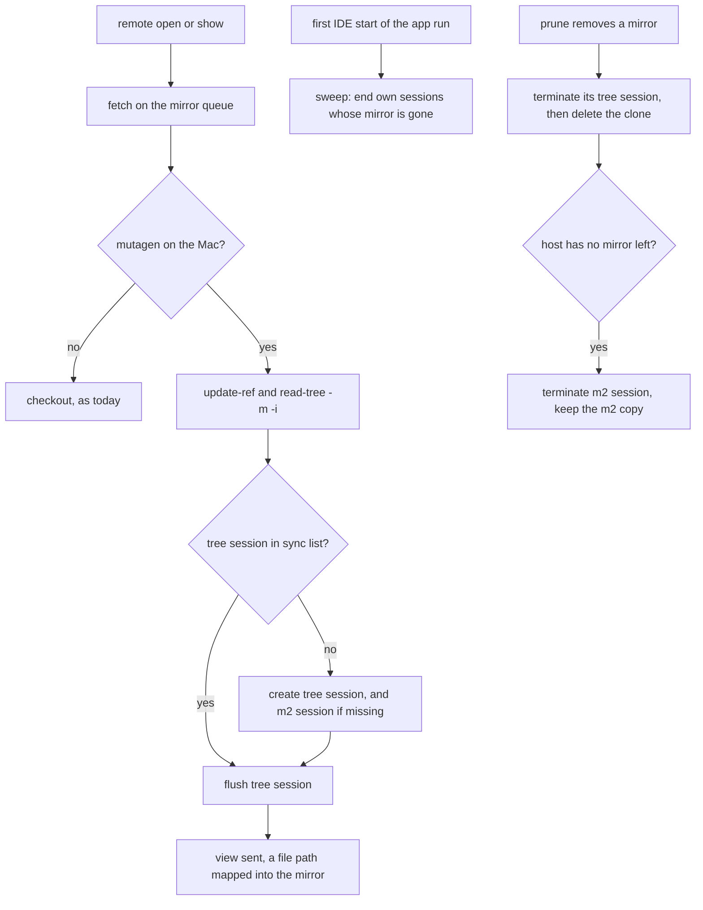

# IDE live review on Linux rows — agterm-vim plan

<!-- plan-review: planning:plan-review 2026-10-23 findings=7 resolved -->

The first of the two plans in `docs/plans/20261022-ide-review-linux-spec.md` (Delivery).
It gives a remote row's mirror a standing mutagen sync of the host's working tree, lifts the remote-row
refusals of `--working-tree`, `--file` and `--on-close`, and points the IDE's Maven at a synced copy of the
host's `~/.m2`. The agterm-agents plan (helper, launcher, flush) comes second and builds on this one.

## Contents

- [Overview](#overview)
- [Context](#context)
- [Development approach](#development-approach)
- [Solution overview](#solution-overview)
- [Technical details](#technical-details)
  - [Session names and labels](#session-names-and-labels)
  - [Refresh steps and timeouts](#refresh-steps-and-timeouts)
  - [Test isolation](#test-isolation)
  - [Refinements of the spec](#refinements-of-the-spec)
- [New fields and their consumers](#new-fields-and-their-consumers)
- [Implementation steps](#implementation-steps)
- [Post-completion](#post-completion)

## Overview

- A remote row's mirror today holds commits only. After this plan, the first open of a repository also
  starts a mutagen sync of the host's checkout into the mirror, so the IDE sees uncommitted work, untracked
  files and generated sources.
- `--working-tree` and `--file` work on a remote row when mutagen is on the Mac. `--on-close` on a remote
  row runs its command on the row's host over ssh.
- The bridge plugin points each mirror project's Maven local repository at a synced copy of the host's
  `~/.m2/repository`, so the IDE resolves the same jars as the agent.
- No mutagen on the Mac: every remote open behaves exactly as today.

## Context

- Spec: `docs/plans/20261022-ide-review-linux-spec.md`. Contract: `.claude/rules/rebased-overlay.md`
  (Remote rows, On close, The bridge plugin, The JVM).
- Core (`agtermCore/Sources/agtermCore/`): `RebasedMirror.swift` (`refreshCommands`, `directory`),
  `RebasedMirrorCleanup.swift` (`prune`, its internal `beforeDelete` seam, `scan`, `RebasedMirrorRecord`),
  `RebasedView.swift` (`RebasedOnClose`, `RebasedViewRequest`), `RebasedProjection.swift`
  (`ControlRebasedMirrorNode`), `ForwardPolicy.swift` (`route`), `RebasedInstall.swift` (host-owned options).
- App (`agterm/Rebased/`): `RebasedMirrorRefresh.swift` (`run`), `RebasedHost.swift` (`configure`,
  `RemoteOpenRequest`, `openOverlay`, `openRemote`, `mirrored`, `open`, `start`, `pruneThenLaunch`,
  `listMirrors`, `pruneMirrors`, `makeMirrorPrune`, the serial `mirrorQueue`), `RebasedHost+Views.swift`
  (`requestView`, `sendView`), `RebasedOnCloseRunner.swift`, `RebasedPluginBuilder.swift`
  (`sourceFiles`, the javac classpath).
- Control: `agterm/Control/ControlServer+Rebased.swift` (`localRebasedFlag`, `localRebasedRefusal`),
  `agterm/Control/ControlServer+RebasedMirrors.swift`, `agtermCore/Sources/agtermctlKit/RebasedCommands.swift`,
  `agtermCore/Sources/agtermctlKit/SessionCommands.swift` (the `onClose` option's help).
- Headless: `agtermCore/Tests/AgtermHeadlessKitTests/HeadlessActionsTests.swift`
  (`theOriginRefusesARebasedOnCloseCommand`) pins today's forward refusal.
- Bridge plugin: `agterm/Resources/rebased/src/agterm/rebased/*.java`, `res/META-INF/plugin.xml`.
- `RebasedHost.swift` is 921 lines and its class body is near the 800-line type limit; new host code goes
  to a new `RebasedHost+Sync.swift` extension, and the new seams are one stored property. The class body
  has about 60 lines left; the prune wrapper's mutagen code and the sweep live in the extension, and the
  class keeps only call sites.
- Mutagen 0.18.1 is installed on the Mac at `/opt/homebrew/bin/mutagen` (2026-10-23), with its
  `mutagen-agents.tar.gz` in the formula's `libexec`.

## Development approach

- TDD: each task writes its tests first, then the code.
- Work in a worktree off `main` on a feature branch. Symlink the six ignored build artifacts from the main
  checkout as `CLAUDE.md` (Worktrees) says.
- Pair run: each task's `Check:` line is its gate. Hosted runs take `lockf` on
  `/tmp/agterm-pair-test-app.lock`, so the two worktrees never run test hosts at once. A hosted run that dies
  at runner init (`Timed out while enabling automation mode`) is retried once, as `CLAUDE.md` says.
- Per task: the narrow gate for what changed, `cd agtermCore && swift test --filter <Test>` or
  `-only-testing:agtermTests/<Class>`. The wide gates run once, in the acceptance task.
- Never run `agterm`/`agtermctl` against the default socket, never launch or quit the app. Any live check
  uses an isolated Debug instance with a short `/tmp` `AGTERM_STATE_DIR`.
- Mark items `[x]` when done; add found work with ➕ and blockers with ⚠️.
- Size: L. Drivers: mirror-queue ordering across refresh, sweep and prune; the bridge plugin's optional
  Maven compile; hosted tests over a fake mutagen; one isolated end-to-end run.

## Solution overview



- `RebasedMirrorSync` (core) builds every mutagen argv and parses `sync list`. The app runs them on the
  same serial mirror queue as every job that writes under `mirrors/`, through one injectable runner.
- The binary is looked up on every use (one `stat`), so installing mutagen while agterm runs takes effect
  at the next open. That lookup is installed only by `configure` (see [Test isolation](#test-isolation)).
- Mutagen's daemon starts on the first mutagen call and keeps its own state in `~/.mutagen`, shared by the
  live app and every Debug instance; only the `agterm-state` label and the session names keep their sessions
  apart. It touches no TCC-protected service.

## Technical details

### Session names and labels

- State id: the FNV-1a hash `RebasedMirror.directory` already computes, extracted into
  `RebasedMirror.hash(_:)` and applied to `RebasedMirrorCleanup.projectPath(stateDirectory)`, the
  symlink-resolved form, so `/tmp/x` and `/private/tmp/x` give one id.
- Tree session name: `agterm-<state>-<hosthash>-<hash>`, where `<hosthash>` is `RebasedMirror.hash(host)` and
  `<hash>` is the mirror's `<hash>` directory. Two hosts with the same repository top share a `<hash>`, so
  the host hash is needed.
- m2 session name: `agterm-<state>-m2-<hosthash>`.
- Labels: `agterm-state=<state>` and `agterm-kind=tree|m2`. A label value cannot hold `@`, so no label carries a
  raw host name.
- Mutagen does not enforce unique names, so create is decided from a `sync list` by name, never assumed.
  Flush and terminate address a session by name. The sweep and the read-back list by
  `--label-selector agterm-state=<state>` and decide from each session's beta path: a tree session whose
  `<hash>/mirror.json` is gone has lost its mirror. The beta path itself is no signal, because mutagen
  rebuilds a deleted beta root (task 1).
- Tree session: alpha `<host>:<top>`, beta the clone directory, `--sync-mode one-way-replica`,
  `--ignore-vcs`, ignores for `.idea/`, `node_modules/`, and `target/` except
  `target/generated-sources/` and `target/generated-test-sources/` at any depth: `-i .idea/ -i node_modules/
  -i '**/target/*' -i '!**/target/generated-sources/' -i '!**/target/generated-test-sources/'` (task 1),
  `--default-file-mode-beta 0444`, `--default-directory-mode-beta 0755`.
- Mutagen gives `0444` only to files it writes; a file already identical on the beta keeps its mode. So
  before it creates the tree session, the refresh removes the write bits from the working tree's files, in
  process, skipping `.git/` and `.idea/`. A new synced mirror never checks out, so this matters for a mirror
  first made without mutagen.
- m2 session: alpha `<host>:.m2/repository` (home-relative, confirmed in task 1), beta
  `<stateDir>/rebased/m2/<host>/repository`, `--sync-mode one-way-safe`.

### Refresh steps and timeouts

`RebasedMirror.refreshCommands` returns steps that carry their own timeout:

| Step | Unsynced | Synced | Timeout |
|---|---|---|---|
| `git init` | yes | yes | 30 s |
| `git fetch` | yes | yes | 300 s |
| `git checkout --force --detach refs/agterm/head` | yes | no | 300 s |
| `git update-ref --no-deref HEAD refs/agterm/head` | no | yes | 30 s |
| `git read-tree -m -i refs/agterm/head` (index only, keeps stat data of unchanged entries; plain `-m` refuses `not uptodate` once mutagen has changed a file) | no | yes | 30 s |
| `mutagen sync list --label-selector agterm-state=<state>` | no | yes | 30 s |
| `mutagen sync create` (tree, and m2 when the list lacks it) | no | when the list lacks them | 60 s each |
| `mutagen sync resume <tree>` | no | when the list shows it paused | 30 s |
| `mutagen sync terminate <tree>` (a halted session; the refresh then creates it again) | no | when halted | 30 s |
| `mutagen sync flush <tree>` | no | yes | 240 s |
| `mutagen sync list` again, for the tree session's problems and copy state | no | yes | 30 s |

- Synced worst case: 30 s query + 30 init + 300 fetch + 30 + 30 + 30 list + 30 terminate + 120 create
  + 240 flush + 30 list = 870 s, about 14.5 minutes, under the 15 minutes `rebased-overlay.md` (Remote rows)
  states today. Create and resume never run in one refresh. The agterm-agents plan's 15-minute remote
  deadline stays valid. Unsynced: 660 s.
- ⚠️ `flush` exits 0 and `lastError` stays empty while a cycle cannot apply its changes: the problem shows
  only in `beta.transitionProblems` (or `alpha`/`beta` `scanProblems`), and `successfulCycles` keeps
  counting (task 1). So the refresh lists the tree session again after the flush. It fails on a problem at
  the root (empty `path`), or when `beta.files` is 0 while `alpha.files` is not, with that problem's error.
  A per-file problem (an absolute symlink, two names differing only in case: task 1) is logged and the open
  goes on.
- An m2 path written on both sides is a `conflicts` entry, and one-way-safe keeps the Mac's copy (task 1). The
  host's copy wins instead: after the tree flush, the refresh deletes each m2 `conflicts[].root` under
  `m2/<host>/repository`, and the next m2 cycle brings the host's file (task 1). Paths only on the Mac stay.
- A failed m2 create is logged and does not fail the refresh: m2 matters only for Maven, and the next
  refresh tries again. `m2/<host>/` is created before the call: `create` makes the beta root but not its
  parent, and a missing parent fails every cycle quietly (task 1).
- ⚠️ A flush that times out while the tree session has not finished its first sync cycle fails the open with
  `first sync of <host>:<top> is still copying; open again`, however many opens came before. The session
  keeps copying. `successfulCycles` cannot tell a finished first copy (task 1); the second list can:
  `status` is still `scanning`, `staging-beta` or `transitioning`, or `beta.files` is 0 while `alpha.files`
  is not. A lower `beta.files` alone is no sign: a case collision keeps it below `alpha.files` for good.
  The agterm-agents launcher retries once on that message; this goes into that plan.
- Opening again works: `openRemote` reusing a held overlay that failed before its first open (state
  `failed`, no frame) puts it back to `fetching` and runs the refresh as a fresh placeholder. The retry is
  sent WITHOUT `--on-close`: the first open's callback stays armed in the holder's `Entry`. Closing the
  failed holder instead would run that callback (`--final`) before any review opened.
- The start sweep also runs on the queue: one 30 s list, then 30 s per terminate. It runs once per process
  and is enqueued after the start prune, so `launch` never waits for it; it delays at most the first refresh
  queued behind it.
- The start prune runs before `launch`. Its wrapper calls `sync list` only when the prune has a mirror to
  remove or report, so a start with no stale mirror runs no mutagen. With one, `launch` waits at most 30 s
  for the list plus 30 s per terminate, also when the CLI refuses an old daemon after `brew upgrade`.

### Test isolation

- `RebasedHost`'s prune and list seams default to no disk work and only `configure` installs the real ones
  (the comment among the mirror seams in `RebasedHost.swift`). The new `sync` seam (lookup plus runner)
  follows that rule: its default answers "no binary" and runs nothing.
- `openRemote` reads `self.sync` on the main actor and passes it to a widened `mirrorRefresh`
  (`(RebasedMirror, URL, sync)`). `RebasedMirrorRefresh.run` takes it as a required parameter with no real
  default, so the existing `RebasedMirrorRefreshTests` keep today's path on every Mac.
- So hosted tests never reach the installed mutagen, on this Mac or on CI. `agtermApp.init` runs in the
  hosted test host, so this rests on tests replacing `RebasedHost.shared`, as the Rebased tests do now.
  Tests that need a binary inject a fake runner.
- `RebasedOnCloseRunner` gets a spawn seam, so its tests never start a real ssh.
- Every hosted test that builds a `RebasedHost` (`RebasedHostSyncTests`, and the forwarded `--on-close` test in
  `RemoteForwardTests`) installs the full seam set of `ControlServerRebasedOverlayTests.setUp`:
  `FakeRebasedRuntime`, `FakeRebasedFrames`, a `/private/tmp` `stateDirectory`, synchronous `offMain` and
  `onMirrorQueue`, a no-op `after`, `store`, then `install()`; `tearDown` restores `RebasedHost.shared` and
  clears `RebasedOverlayReleases.shared.onRelease` and `onHiddenChange`. A bare `RebasedHost()` keeps the live
  state directory, `JNIRebasedRuntime` and `/Applications/Rebased.app`, so a successful fake refresh would
  reach `prepare` on the live `rebased/` directory. One shared fixture helper in `RebasedHostSyncTests.swift`
  builds that host for both files.
- The new `sync` parameter of `makeMirrorPrune` and `makeMirrorList` defaults to "no binary", so the existing
  one-argument calls in `RebasedHostTests.testTheMirrorPruneFactoryLocksOnlyARealPrune` compile and keep
  today's behavior.
- The sync tests go to a new `agtermTests/RebasedHostSyncTests.swift`: `RebasedHostTests.swift` is already
  1548 of 2000 lines.

### Refinements of the spec

- Session names and the `agterm-kind` label replace the spec's `agterm-mirror` and `agterm-m2` labels:
  same purpose, but a raw host cannot be a label value and two hosts can share a `<hash>`.
- The read-back `sync.state` also takes `unknown`, with `error`, when `mutagen sync list` fails.
- Per-step timeouts keep the queue's worst case under today's figure.
- The sweep runs once per process, at the first IDE start, the lazy `RebasedHost.start`, not at app launch.
  It only terminates; a paused session is resumed by the refresh that needs it, right after a `git fetch`
  has shown the host reachable.
- ⚠️ A mutagen daemon that agterm starts lives in agterm's process coalition. Sasha registers it once as a
  launchd agent instead (`mutagen daemon register`) before task 1; that is a change to his Mac, asked first.
- A `--file` path on a remote row stays the host path in the model and in `view.target`; it is mapped into
  the mirror only when sent to the bridge.
- The m2 copy is never deleted by agterm (Sasha, live plan review 2026-10-23: he may use it locally). With
  the host's last mirror only its session ends; the next mirror on that host creates the session again over
  the kept copy. The spec deleted it.
- The spec's probe 1 splits: task 1 checked offline `mvn` resolution against the synced m2 copy; task 11
  checks the IDE import, after task 10 makes the bridge set the repository.

## New fields and their consumers

Recount these in task 12.

| New thing | Consumers | Count |
|---|---|---|
| `RebasedMirror.hash(_:)` | `RebasedMirror.directory`, `RebasedMirrorSync` state id and names | 2 |
| `RebasedMirrorSync` (argv, names, labels, ignores, modes, list parse) | `RebasedMirrorRefresh.run` (list, create, resume, terminate, flush, list again, m2 conflict cleanup), `RebasedHost+Sync` sweep (list, terminate), `RebasedHost.makeMirrorPrune` wrapper (list, terminate tree and m2), `RebasedHost.listMirrors` and `pruneMirrors` (`sync` read-back) | 4 |
| `RebasedProduct` plugin `layout` class paths | `RebasedRuntime` (passes them), `RebasedPluginBuilder` (the Maven `javac` step) | 2 |
| stored `RebasedHost.sync` seam (lookup plus runner) | `configure` (installs it), `openRemote` (into `mirrorRefresh`), the open and show adapter gates, the `makeMirrorPrune` wrapper, `listMirrors`, the sweep | 6 |
| `<stateDir>/rebased/m2/<host>/` | `RebasedMirrorSync` m2 session, `RebasedInstall` `agterm.rebased.m2` option, bridge `MirrorMaven`, the next session create over a kept copy | 4 |
| synced variant of `RebasedMirror.refreshCommands` (steps with timeouts) | `RebasedMirrorRefresh.run` | 1 |
| `RebasedMirror.mirrorPath(hostPath:top:directory:)` | `RebasedHost+Views.sendView` (`--file` on a remote row) | 1 |
| `RebasedOnClose.host` and `RebasedOnClose.remoteArgv` | `RebasedHost.openOverlay` (capture), `RemoteOpenRequest` and the placeholder `Entry` in `openRemote`, `RebasedOnCloseRunner` (spawn) | 3 |
| `--working-tree`, `--file` on a remote row | `ControlServer+Rebased` open and show adapters, `RebasedHost+Views.requestView` (refresh for every view kind), agterm skill | 3 |
| `RebasedMirrorRecord.sync` → `ControlRebasedMirrorNode.sync` `{state, error?}` | the record-to-node mapping in `RebasedMirrorCleanup.swift`, `ControlServer+RebasedMirrors` (list and prune), `RebasedCommands` human row, agterm skill `reference.md` | 4 |
| host options `agterm.rebased.mirrors`, `agterm.rebased.m2` (resolved paths) | bridge `MirrorMaven` | 1 |

Refusals removed (not consumers): `RebasedHost.openOverlay`, the `ControlServer+Rebased` open adapter and
`ForwardPolicy.route` for `--on-close`; the open and show adapters for `--working-tree` and `--file`.

## Implementation steps

### Task 1: Mutagen probes

owner: lead
Check: `grep -rq '^#### Task 1 findings' docs/plans/`

Interactive session only: a delegated run skips this task and reports it. Pure mutagen CLI against a scratch repository on p4linux, sessions labelled `agterm-probe=1` and terminated
at the end. No agterm code.
⚠️ Before it, ask Sasha to run `mutagen daemon register` (a launchd agent), so the probes run under the same
daemon environment as tasks 11 onward and no daemon is ever a child of an agterm process. Also run
`ssh -O check p4linux`; when no master is up, open one from a plain shell, so a later Debug instance never
becomes the parent of the ssh master the live terminal uses, and mutagen too when the master has a free session.

**Files:**
- Modify: this plan (the findings go under each probe)

- [x] probe 2: find the ignore syntax that keeps `target/generated-sources/` and `target/generated-test-sources/`
      at any depth while ignoring the rest of `target/`; confirm an ignored `.idea/` and the beta's own `.git/`
      survive in `one-way-replica` mode
- [x] probe 3: `--default-file-mode-beta 0444` gives read-only files, executable bits kept; a file changed on
      alpha still replaces the read-only beta file; a pre-existing writable checkout becomes read-only
- [x] probe 4: the m2 alpha takes `.m2/repository` relative to home; `one-way-safe` keeps a jar created on the
      Mac; writing the same artifact and a `maven-metadata-*.xml` on both sides neither stalls the session
      nor keeps the Mac's stale copy
- [x] probe 5: after the link drops and returns, the session reconnects by itself, or `sync resume` is needed
- [x] timing: agent install on the first create, and the first copy of a real Magnolia checkout and of
      p4linux's `~/.m2/repository`; adjust the timeout table if needed
- [x] the `sync list` field that tells a session has finished its first sync cycle; whether `create` makes a
      missing beta parent; what `sync terminate <name>` does when no session has that name; the status names
      of a halted session (deleting the beta root halts it), and whether `resume` recovers one
- [x] ➕ substituted: Maven by hand: in standalone IDEA, a Magnolia module whose Maven local repository points
      at the synced m2 copy imports with no red. Replaced by an offline `mvn` resolve, because opening an IDE
      window on Sasha's Mac was not part of the autonomous go; the IDE import is checked in task 11
- [x] capture one `mutagen sync list --label-selector agterm-probe=1 --template '{{json .}}'` output for the
      core parser test; record the fields used (name, labels, status, paused, last error, beta path)
- [x] write the findings here under a `#### Task 1 findings` heading; change the plan before task 2 if a probe fails. If the Maven check fails,
      drop the m2 session from tasks 2 to 5 and 10, and tell Sasha

#### Task 1 findings

Run 2026-10-23 on p4linux with mutagen 0.18.1, the launchd daemon (pid 61153), and scratch sessions
labelled `agterm-probe=1`, all terminated afterwards.

- ssh: the shared master (pid 15768, a child of launchd) is at sshd's default `MaxSessions 10` and refuses
  new sessions (`Session open refused by peer`); mutagen and plain ssh fall back to their own connection and
  work. Nothing in agterm depends on the master.
- Probe 2 passes with the pattern under [Session names and labels](#session-names-and-labels): `target/classes`,
  `target/*.jar` and `node_modules/` stay out; `target/generated-sources/` and
  `target/generated-test-sources/` arrive at any depth; the beta's own `.git/` and `.idea/` survive.
- Probe 3: files mutagen writes are `0444`, executables `0555`; an alpha change replaces a read-only beta
  file. ⚠️ A file already identical on the beta keeps its mode (a cloned `README` stayed `0644`). Hence
  the write-bit step before the first create.
- Probe 4: `p4linux:.m2/repository` resolves under home. A jar created only on the Mac is kept. The same path
  created on both sides becomes a `conflicts` entry; the Mac's copy stays, and the session keeps
  `watching`. ⚠️ That fails the probe's criterion: a SNAPSHOT jar the IDE downloads and the agent then
  installs would stay stale on the Mac. A second probe showed that deleting the conflicting beta file
  clears the conflict and brings the host's file on the next cycle; the refresh now does that.
- Problems are per path (second probe): an absolute symlink is an `alpha.scanProblems` entry
  (`invalid symbolic link: target is absolute`) and two names differing only in case a
  `beta.transitionProblems` entry (`unable to relocate staged file: file exists`), each with its `path`,
  while the rest of the tree syncs. The missing-parent problem has an empty `path`.
- Probe 5: killing the agent on p4linux shows `connecting-alpha` with a `lastError`, then the session
  reconnects by itself within about 10 s. No `resume` is needed; `paused` comes only from an explicit pause.
- Timing: agent install on the first create 1.8 s. `dam` (781 MB on disk, 967 files and 35 MB after the
  ignores) copies in about 1 s. p4linux's `~/.m2/repository` (2.6 GB, 26616 files) copies in about
  1 to 2 minutes. The timeouts hold.
- `create` makes a missing beta root but not its parent: every cycle then fails with a `transitionProblems`
  entry (`unable to open synchronization root parent directory`), while `flush` exits 0, `lastError` stays
  empty and `successfulCycles` keeps rising. Creating the parent lets the next cycle finish.
- `sync terminate <name>` with no such session exits 1:
  `unable to locate requested sessions: specification "<name>" did not match any sessions`.
- Deleting the beta root of a `one-way-replica` session does not halt it: mutagen rebuilds the tree, without
  `.git`. No halt was reproduced. Any `status` starting `halted` is treated as halted and recovered by
  terminate and create, which needs no `resume` semantics.
- Maven: no IDE window was opened on Sasha's Mac. The proxy check passed instead: on the Mac,
  `mvn -o -Dmaven.repo.local=<synced copy> dependency:resolve` in the synced `dam` exits 0. Task 11 checks
  the IDE import.
- `sync list --template '{{json .}}'` gives an array of sessions with lowercase keys. Used: `identifier`,
  `name`, `labels`, `status` (`watching`, `scanning`, `staging-beta`, `transitioning`, `connecting-alpha`,
  …), `paused`, `successfulCycles`, `lastError` (absent when empty), `alpha`/`beta` `path`, `connected`,
  `files`, `transitionProblems` and `scanProblems` (each `{path, error}`, absent when empty), and
  `conflicts`. Captured, one session per line, beta paths replaced by `/STATE/…`:

```json
{"identifier":"sync_2n97SsfIoO3FodVBxFVJLIGL4oMDqHyVo9QDR9RkaW2","version":1,"creationTime":"2026-10-23T12:06:49.398758Z","creatingVersion":"0.18.1","alpha":{"protocol":"ssh","host":"p4linux","path":"agterm-probe/repo","ignore":{},"symlink":{},"watch":{},"permissions":{},"compression":{},"connected":true,"scanned":true,"directories":9,"files":6,"totalFileSize":59},"beta":{"protocol":"local","path":"/STATE/list1.json","ignore":{},"symlink":{},"watch":{},"permissions":{"defaultFileMode":"0444","defaultDirectoryMode":"0755"},"compression":{},"connected":true,"scanned":true,"directories":9,"files":6,"totalFileSize":59},"mode":"one-way-replica","ignore":{"paths":[".idea/","node_modules/","**/target/*","!**/target/generated-sources/","!**/target/generated-test-sources/"],"vcs":true},"symlink":{},"watch":{},"permissions":{},"compression":{},"name":"probe-tree","labels":{"agterm-kind":"tree","agterm-probe":"1"},"paused":false,"status":"watching","successfulCycles":3}
{"identifier":"sync_Htpqnfo09kbQUJFhQ8vwazQkx3okTAegJzgGsUZySZS","version":1,"creationTime":"2026-10-23T12:07:54.554023Z","creatingVersion":"0.18.1","alpha":{"protocol":"ssh","host":"p4linux","path":"agterm-probe-m2/repository","ignore":{},"symlink":{},"watch":{},"permissions":{},"compression":{},"connected":true,"scanned":true,"directories":8,"files":3,"totalFileSize":23},"beta":{"protocol":"local","path":"/STATE/list-m2.json","ignore":{},"symlink":{},"watch":{},"permissions":{},"compression":{},"connected":true,"scanned":true,"directories":8,"files":2,"totalFileSize":12},"mode":"one-way-safe","ignore":{},"symlink":{},"watch":{},"permissions":{},"compression":{},"name":"probe-m2","labels":{"agterm-kind":"m2","agterm-probe":"1"},"paused":false,"status":"watching","successfulCycles":4,"conflicts":[{"root":"org/z/c/3.0/c-3.0.jar","alphaChanges":[{"path":"org/z/c/3.0/c-3.0.jar","old":null,"new":{"kind":"file","digest":"8ae2493ac0b6df3fb9fa73d6f7be121fd597f30b"}}],"betaChanges":[{"path":"org/z/c/3.0/c-3.0.jar","old":null,"new":{"kind":"file","digest":"7821919a6468b8341802b1c12210930264a362f6"}}]}]}
```

### Task 2: Shared hash and `RebasedMirrorSync` argv builder

depends: 1
Check: `cd agtermCore && swift test --filter RebasedMirror`

**Files:**
- Modify: `agtermCore/Sources/agtermCore/RebasedMirror.swift`
- Create: `agtermCore/Sources/agtermCore/RebasedMirrorSync.swift`
- Modify: `agtermCore/Tests/agtermCoreTests/RebasedMirrorTests.swift`
- Create: `agtermCore/Tests/agtermCoreTests/RebasedMirrorSyncTests.swift`

- [x] write tests: `hash` matches the `<hash>` directory `directory(top:stateDirectory:)` produces today
- [x] write tests: binary lookup picks the first executable of the two candidates and answers nil for neither
- [x] write tests: tree and m2 create argv carry the names, both labels, the mode, the ignore list (pinned whole,
      `.idea/` included), `0444` and `0755`; list, flush, terminate and resume argv
- [x] write tests: the list parser maps the captured task 1 output to name, kind, status, paused, error,
      beta path, `alpha`/`beta` `files`, and the first `transitionProblems` or `scanProblems` entry, decoding only those fields so a mutagen upgrade that adds fields still parses;
      malformed output is an error, not an empty list
- [x] extract `RebasedMirror.hash(_:)`; implement `RebasedMirrorSync` to pass the tests
- [x] run `swift test --filter 'RebasedMirror'`

### Task 3: Synced refresh steps and host-path mapping

depends: 1, 2
Check: `cd agtermCore && swift test --filter RebasedMirrorTests`

**Files:**
- Modify: `agtermCore/Sources/agtermCore/RebasedMirror.swift`
- Modify: `agtermCore/Tests/agtermCoreTests/RebasedMirrorTests.swift`

- [x] write tests: `refreshCommands(top:directory:synced:)` returns the git steps and timeouts of the table
      above; the synced form never checks out and uses `read-tree -m -i`
- [x] write tests: `mirrorPath(hostPath:top:directory:)` maps a path under the top and the top itself, refuses a
      path outside it, a sibling sharing its prefix (`/repo2` against `/repo`), and `/repo/../x` (the path is
      standardized before the check)
- [x] implement both
- [x] run `swift test --filter RebasedMirrorTests`

### Task 4: Refresh lists, creates and flushes the sync

depends: 2, 3
Check: `/usr/bin/lockf -k /tmp/agterm-pair-test-app.lock scripts/test-app.sh -only-testing:agtermTests/RebasedMirrorRefreshTests -only-testing:agtermTests/RebasedHostSyncTests -only-testing:agtermTests/RebasedHostTests -only-testing:agtermTests/ControlServerRebasedOverlayTests`

**Files:**
- Modify: `agterm/Rebased/RebasedMirrorRefresh.swift`
- Create: `agterm/Rebased/RebasedHost+Sync.swift`
- Modify: `agterm/Rebased/RebasedHost.swift`
- Modify: `agtermTests/RebasedMirrorRefreshTests.swift`
- Create: `agtermTests/RebasedHostSyncTests.swift`
- Modify: `agtermTests/RebasedHostTests.swift`, `agtermTests/ControlServerRebasedOverlayTests.swift` (their
  two-argument `mirrorRefresh` closures take the third argument)

- [x] write tests (fake runner): with no binary the steps are today's three, with the new timeouts; with one,
      a refresh runs the synced git steps, then `sync list`, creates the tree and m2 sessions the list lacks,
      then flushes; a refresh whose list holds both only flushes; a paused tree session is resumed first, and
      a halted one is terminated and created again; the working tree loses its write bits before a tree
      create, `.git/` and `.idea/` untouched; a list after the flush with a root problem (empty `path`), or
      with `beta.files` 0 against a non-zero `alpha.files`, fails the refresh with its error, while a
      per-file problem is logged and the open goes on; before an m2 create `<stateDir>/rebased/m2/<host>/`
      exists and `repository` under it does not; each m2 `conflicts[].root` is deleted under
      `m2/<host>/repository`, and a root that leaves it (`..`) is skipped
- [x] `RebasedMirrorRefresh.run` takes `refreshCommands(top:directory:synced:)`; delete the two-argument
      `refreshCommands(top:directory:)` that task 3 kept only for it
- [x] extend `RebasedMirrorSync.Session` (task 2) with the root problem, the per-file problem count and the m2
      conflict roots; `copying` reads `beta.files` 0, not a lower count
- [x] write tests (real git, local `file://` source): the synced git steps run twice over a working tree that
      differs from the index, with the second fetch changing that file, and both exit 0; `git status` in the
      mirror then shows the working-tree change
- [x] write tests: a mirror kept by a failed prune delete, whose session is gone, gets its session created again
- [x] write tests: a failed list, tree create, resume or flush fails the refresh with mutagen's last stderr
      line; a failed m2 create is logged and the refresh goes on; a flush timeout while the first cycle is
      unfinished fails with `first sync of <host>:<top> is still copying; open again`, on the second open too
- [x] write tests (`RebasedHostSyncTests`): a first open that fails with that message, then a second open on the
      same row, reaches `starting`; `openRemote` reads the host's `sync` seam and passes it to the refresh
- [x] implement: `RebasedMirrorRefresh.run` takes the sync seam as a required parameter and per-step
      timeouts; `RebasedHost` gains one stored `sync` seam whose default answers "no binary", `configure`
      installs the real one, and `mirrorRefresh` carries it; `openRemote` restarts a held overlay that failed
      before its first open as a fresh placeholder
- [x] run `-only-testing:agtermTests/RebasedMirrorRefreshTests` and `-only-testing:agtermTests/RebasedHostSyncTests`

### Task 5: Lifecycle: sweep and prune

depends: 4
Check: `cd agtermCore && swift test --filter RebasedMirrorCleanupTests` `/usr/bin/lockf -k /tmp/agterm-pair-test-app.lock scripts/test-app.sh -only-testing:agtermTests/RebasedHostSyncTests -only-testing:agtermTests/RebasedHostTests`

**Files:**
- Modify: `agtermCore/Sources/agtermCore/RebasedMirrorCleanup.swift`
- Modify: `agterm/Rebased/RebasedHost.swift`
- Modify: `agterm/Rebased/RebasedHost+Sync.swift`
- Modify: `agtermCore/Tests/agtermCoreTests/RebasedMirrorCleanupTests.swift`
- Modify: `agtermTests/RebasedHostSyncTests.swift`

- [x] write core tests: `prune` takes two new hooks beside the existing `beforeDelete` race seam, which stays
      as it is: `beforeRemove` runs after the re-check passes and before the IDE-entries loop, and an error
      from it keeps the mirror and its IDE data with that error; `hostEmptied` runs only when the host's
      `rmdir` succeeds; a dry run calls neither
- [x] write hosted tests: a real prune runs one `sync list` and terminates only the listed tree session before
      the clone goes; a mirror with no session, and any mirror with no binary, is deleted as today with no
      terminate call; a failed terminate keeps the mirror; a failed `sync list` keeps every mirror of that
      prune with the list error; a prune with no mirror to remove or report runs no `sync list`
- [x] write hosted tests: on `hostEmptied` a listed m2 session is terminated and `m2/<host>` stays; a failed
      m2 terminate is logged, and the next sweep retries it; a later mirror on that host creates the m2
      session again over the kept copy
- [x] write hosted tests: the sweep is its own job on the mirror queue, enqueued from `pruneThenLaunch` after
      the start prune job (or where that prune is skipped by its `days == 0` and `fetching` guards), so
      `launch` never waits for it; the once-per-process flag is set when it is enqueued, so a failed `prepare`
      never reaches it and the next `start` does; it terminates tree sessions of this state id whose
      `<hash>/mirror.json` is gone (a test deletes the clone too and shows mutagen rebuilding it does not keep
      the session) and an m2 session whose host has no `mirrors/<host>`, and never deletes an m2 copy;
      each call has a 30 s timeout; errors are logged and never fail the start; with no binary it does nothing
- [x] implement: the hooks in core; the wrapper's mutagen code and the sweep in `RebasedHost+Sync`, with
      `makeMirrorPrune` (gaining a `sync` parameter that defaults to "no binary") only delegating to it
- [x] run `swift test --filter RebasedMirrorCleanupTests` and `-only-testing:agtermTests/RebasedHostSyncTests`

### Task 6: Remote `--working-tree` and `--file`

depends: 3, 4
Check: `/usr/bin/lockf -k /tmp/agterm-pair-test-app.lock scripts/test-app.sh -only-testing:agtermTests/ControlServerRebasedOverlayTests -only-testing:agtermTests/RebasedHostSyncTests`

**Files:**
- Modify: `agterm/Control/ControlServer+Rebased.swift`
- Modify: `agterm/Rebased/RebasedHost+Views.swift`
- Modify: `agtermTests/ControlServerRebasedOverlayTests.swift`
- Modify: `agtermTests/RebasedHostSyncTests.swift`

- [x] write tests: on a remote row with no binary, `--working-tree` and `--file` are refused with
      `--<flag> on a remote row needs mutagen on this Mac`; `--project` keeps `works on a local row only`.
      Rewrite `ControlServerRebasedOverlayTests.testRemoteRowsRefuseLocalFlagsButStillOpenAndShowDiffs`, which
      expects all four flags refused with `works on a local row only`: after tasks 6 and 8 only `--project`
      keeps that message and `--on-close` opens
- [x] write tests: with a binary, an open and a `session rebased show` of any view kind on a remote row
      refresh first
- [x] write tests: a remote `--file` keeps the host path in `view.target`, is sent to the bridge with the mirror
      path, and the request id the open returned reaches `opened`; a host path outside the top fails that
      request with `--file <path> is outside <host>:<top>`
- [x] implement: the adapter gate reads the host's `sync` seam at call time; `requestView` refreshes for every
      view kind on a remote row; `sendView` maps a file view through `mirrorPath`, from `entry.project` and the
      overlay's `source`
- [x] run the two test classes

### Task 7: Remote `--on-close` in core

Check: `cd agtermCore && swift test --filter 'RebasedViewTests|ForwardPolicyTests|HeadlessActionsTests'`

**Files:**
- Modify: `agtermCore/Sources/agtermCore/RebasedView.swift`
- Modify: `agtermCore/Sources/agtermCore/ForwardPolicy.swift`
- Modify: `agtermCore/Tests/agtermCoreTests/RebasedViewTests.swift`
- Modify: `agtermCore/Tests/agtermCoreTests/ForwardPolicyTests.swift`
- Modify: `agtermCore/Tests/AgtermHeadlessKitTests/HeadlessActionsTests.swift`

- [x] write tests: a `RebasedOnClose` with `host` gives `remoteArgv`
      `/usr/bin/ssh -o BatchMode=yes -o ConnectTimeout=10 -- <host> <remote command>`, with the remote command
      pinned exactly: `exec "${SHELL:-/bin/sh}" -l -c <q>`, where `<q>` is the single-quoted script
      `cd <single-quoted cwd> || exit`, a newline, then `<command>` (a missing cwd runs nothing; `&&` would bind
      to the first item of a list only); the command reaches the inner shell as its script, as a local
      callback reaches `/bin/sh -c`
- [x] write tests: evaluating the remote command with a local `/bin/sh` and a recording `SHELL` gives the inner
      shell the script unchanged, for a cwd and a command holding `'`, `$`, `"` and `&&`
- [x] write tests: `ForwardPolicy.route` forwards a `--rebased` open carrying `--on-close`;
      `theOriginRefusesARebasedOnCloseCommand` becomes a test that the origin attempts the forward (state what
      `HeadlessActionFixture` answers with no presenting Mac, and assert that)
- [x] implement `host` (a `nil` default in the public init, which the agterm-linux fork may call) and
      `remoteArgv`; remove the refusal in `ForwardPolicy.route`
- [x] run `swift test --filter 'RebasedViewTests|ForwardPolicyTests|HeadlessActionsTests'`

### Task 8: Remote `--on-close` in the app

depends: 4, 7
Check: `/usr/bin/lockf -k /tmp/agterm-pair-test-app.lock scripts/test-app.sh -only-testing:agtermTests/RebasedOnCloseRunnerTests -only-testing:agtermTests/ControlServerRebasedOverlayTests -only-testing:agtermTests/RebasedHostSyncTests -only-testing:agtermTests/RemoteForwardTests`

**Files:**
- Modify: `agterm/Rebased/RebasedHost.swift`
- Modify: `agterm/Rebased/RebasedOnCloseRunner.swift`
- Modify: `agterm/Control/ControlServer+Rebased.swift`
- Modify: `agtermCore/Sources/agtermctlKit/SessionCommands.swift`
- Modify: `agtermTests/RebasedOnCloseRunnerTests.swift`
- Modify: `agtermTests/ControlServerRebasedOverlayTests.swift`
- Modify: `agtermTests/RebasedHostSyncTests.swift`
- Modify: `agtermTests/RemoteForwardTests.swift`

- [x] write tests (spawn seam): a host callback spawns `remoteArgv` with the app's own environment
      (`HOME` and `SSH_AUTH_SOCK` reach ssh) and no working directory; a local callback is unchanged
- [x] write tests: a remote open with `--on-close` captures the host cwd (`--cwd`, else the row's cwd), no Mac
      environment, and `host`; the release paths run it once; closing the overlay while it still reads
      `fetching` runs it once; hide, hand-back and promotion never run it; a second open into an existing
      holder is still refused
- [x] write tests: a forwarded `--rebased --on-close` open, retargeted to its presenting row by `runForwarded`,
      is captured with that row's `host` and never reaches the local runner; this pins the one check that keeps
      a forwarded command off the Mac's `/bin/sh` now that `ForwardPolicy` forwards it. The test builds its
      host with the shared fixture helper (see [Test isolation](#test-isolation)), plus a fake `mirrorRefresh`
      and a recording on-close spawn; otherwise the configured host runs a real ssh, a real mutagen session,
      and the real runtime on the live state directory
- [x] write tests: the retry contract: a first open with `--on-close` that fails with the first-copy message,
      then a second open on the same row without `--on-close`, reaches `starting` with the first callback
      still armed, and the callback runs once at the later close
- [x] implement: build the capture after the remote branch in `openOverlay` and carry it through
      `RemoteOpenRequest` to the placeholder and its `Entry`; drop the remote refusals in `openOverlay` and the
      `ControlServer+Rebased` open adapter; the runner's host branch
- [x] `--on-close` help: on a remote row the command runs on the row's host
- [x] run the four test classes

### Task 9: `sync` read-back

depends: 5
Check: `cd agtermCore && swift test --filter 'RebasedCommandsTests|ControlDispatcherRebasedMirrorTests'` `/usr/bin/lockf -k /tmp/agterm-pair-test-app.lock scripts/test-app.sh -only-testing:agtermTests/ControlServerRebasedMirrorTests`

**Files:**
- Modify: `agtermCore/Sources/agtermCore/RebasedProjection.swift`
- Modify: `agtermCore/Sources/agtermCore/RebasedMirrorCleanup.swift`
- Modify: `agterm/Rebased/RebasedHost.swift`
- Modify: `agterm/Control/ControlServer+RebasedMirrors.swift`
- Modify: `agtermCore/Sources/agtermctlKit/RebasedCommands.swift`
- Modify: `agtermCore/Tests/agtermctlKitTests/RebasedCommandsTests.swift`
- Modify: `agtermCore/Tests/agtermCoreTests/ControlDispatcherRebasedMirrorTests.swift`
- Modify: `agtermTests/ControlServerRebasedMirrorTests.swift`

- [x] write tests: each mirror node carries `sync` with mutagen's status, `paused`, `none` (no session or no
      binary) or `unknown` with `error` (list failed); prune entries, dry run included, carry the state the
      session had; old payloads without `sync` still decode
- [x] write tests: the human row prints the sync state
- [x] implement: `RebasedMirrorRecord` gains `sync` (a `nil` default in its public init, which the agterm-linux
      fork may call), matched by tree session name; `listMirrors` runs its own `sync list` off the main actor
      and never on the mirror queue; a prune's entries, dry run included, reuse the list the
      `makeMirrorPrune` wrapper already ran on the queue, from before any terminate; the node mapping copies it
- [x] run the three test classes

### Task 10: Maven local repository in the bridge plugin

depends: 1
Check: `cd agtermCore && swift test --filter 'RebasedInstallTests|RebasedProductTests'` `/usr/bin/lockf -k /tmp/agterm-pair-test-app.lock scripts/test-app.sh -only-testing:agtermTests/RebasedPluginBuilderTests`

**Files:**
- Modify: `agtermCore/Sources/agtermCore/RebasedInstall.swift`
- Modify: `agtermCore/Sources/agtermCore/RebasedProduct.swift`
- Modify: `agterm/Rebased/RebasedPluginBuilder.swift`
- Modify: `agterm/Rebased/RebasedRuntime.swift` (builds the builder; passes the `layout` class paths)
- Create: `agtermCore/Tests/agtermCoreTests/RebasedProductTests.swift`
- Create: `agterm/Resources/rebased/res/META-INF/agterm-maven.xml`
- Create: `agterm/Resources/rebased/src/agterm/rebased/maven/MirrorMaven.java`
- Modify: `agtermCore/Tests/agtermCoreTests/RebasedInstallTests.swift`
- Modify: `agtermTests/RebasedPluginBuilderTests.swift`

- [x] write tests: host-owned options gain `-Dagterm.rebased.mirrors=` and `-Dagterm.rebased.m2=` with the
      symlink-resolved paths, as the IDE sees the project; a symlinked state directory (a `/tmp` one) gives
      `/private/tmp/...`
- [x] write tests: the source digest covers every file under `res/META-INF`, so editing `agterm-maven.xml`
      rebuilds the jar
- [x] write tests: `RebasedProduct` decodes `product-info.json` `layout` entries of kind `plugin` into their
      class paths; IDEA 2026.2 names `org.jetbrains.idea.maven` at `plugins/maven-plugin/lib/` (not
      `plugins/maven/`), and Rebased.app has no Maven entry
- [x] write tests: the first `javac` step leaves out `src/agterm/rebased/maven/`; the second compiles it against
      the first step's classes plus the `layout` class paths of `org.jetbrains.idea.maven` and
      `com.intellij.java`; only when it succeeds does the jar get those classes, `agterm-maven.xml`, and the
      `<depends optional="true" config-file="agterm-maven.xml">org.jetbrains.idea.maven</depends>` line
      inserted into `plugin.xml`; a product with no Maven entry or a failed Maven compile logs and builds the
      bridge without them
- [x] the success test uses the installed `/Applications/IntelliJ IDEA.app` and is skipped when it is absent;
      the fallback tests use a synthetic bundle whose `layout` has no Maven entry
- [x] implement the builder; `MirrorMaven`, registered from `agterm-maven.xml` on project open, sets Maven's
      local repository for a project under the mirrors root to `<m2 root>/<host>/repository`, where `<host>`
      is the path component after the mirrors root; user settings (`~/.m2/settings.xml`) stay as they are, and the override
      wins over a `<localRepository>` there; projects outside the mirrors root keep `~/.m2/repository`
- [x] run the three test classes
- ➕ the two options use `realpath(3)`: Foundation's `resolvingSymlinksInPath` (and so
      `RebasedMirrorCleanup.projectPath`) strips `/private`. `MirrorMaven` takes `toRealPath()` of the project
      before comparing, so it matches whichever form the bridge opened. The hook is a `postStartupActivity`
      (`ProjectActivity`); a changed value forces a Maven re-import, since an import started at open used the old one

### Task 11: End-to-end in an isolated Debug instance

owner: lead
depends: 5, 6, 8, 9, 10
Check: `grep -rq '^#### Task 11 result' docs/plans/`

Interactive session only: a delegated run skips this task and reports it.
Debug build, short `/tmp` `AGTERM_STATE_DIR`, `rebasedAppPath` set to IDEA in that instance's settings,
a test repository on p4linux. Announce each action; stop the instance by its pid at the end.
It relies on the registered mutagen daemon. If an ssh master is up, it was opened from a plain shell (task 1).

- [x] an uncommitted edit on p4linux shows in a left-pane `--working-tree` diff; check that the working-copy
      side is current right after the flush (➕ a VFS refresh in the bridge's `diff` if it is stale)
- [x] an edit in the IDE meets the read-only lock
- [x] `--file` on a remote row opens the file at its line
- [x] closing the overlay runs a `--on-close` marker command on p4linux, once
- [x] `rebased mirror list --socket …` shows `sync` for the mirror
- [x] age the copy: set `lastOpened` in its `mirror.json` and `touch -t` its `.git/FETCH_HEAD` to two days ago;
      then `rebased mirror prune --older-than 1` removes the mirror and its session, and the m2 session with the
      host's last mirror; `m2/<host>` is still there
- [x] a Magnolia module opened from a p4linux row shows the m2 copy in its Maven settings and imports with no
      red once the copy has landed (task 10's hook point).
      ⚠️ On failure, stop and bring the finding to Sasha; the hook point is the riskiest part of the plan
- [x] after the run, `mutagen sync list --label-selector agterm-state=<this instance>` is empty
- [x] record the outcome under a `#### Task 11 result` heading

#### Task 11 result

Run 2026-10-24/25 on an isolated Debug instance (`/tmp/ag-e2e`, IDEA 2026.2.3), against a copy of
`~/dev/magnolia/dam` in `/tmp/agterm-e2e/dam` on p4linux. The remote row was a row of the p4linux headless
server, presented by the Debug instance.

- Diff: an appended line in `AbstractAssetProvider.java` showed in the working-tree diff on the first open.
  Sasha confirmed it. No VFS refresh was needed.
- Read-only lock: mirror files are `0444`, and an edit in the IDE meets the lock. Sasha confirmed it.
- `--file` with a host path inside the top opened the mapped mirror path (view `opened`). The line was passed
  but not checked by eye. `--file /etc/hosts` failed with `--file /etc/hosts is outside p4linux:/tmp/agterm-e2e/dam`.
- A view sent while the overlay is not on screen stays `queued` until the overlay is shown; it then opens.
  That is the existing `RebasedHost.show` gate, not a defect.
- On-close: closing the overlay created `/tmp/agterm-e2e/closed-marker` on p4linux right after the close.
- `rebased mirror list` showed `sync watching`.
- A mirror stays `in use` until the JVM exits (`mirrorsInUse` includes `openedThisRun`), so the prune ran after a
  relaunch. Aged 35 days, the dry run kept everything. The prune removed the mirror and `mirrors/p4linux`, and
  ended the tree and m2 sessions. `m2/p4linux/repository` (2.7 GB) stayed.
- ⚠️ Maven failed on the first run. On a fresh project's first link, `MavenProjectAsyncBuilder` swaps in a new
  settings object after the bridge's startup activity, so the IDE used `~/.m2`. Fixed in b34ab25b: the hook
  re-applies on `activated()` and `projectImportCompleted()`, at most 3 times. On a fresh open the bridge then
  applied twice, the index and the import used `/private/tmp/ag-e2e/rebased/m2/p4linux/repository`, and
  Sasha confirmed the override in the Maven settings.
  Its listener has no automated test: that needs IDEA's Maven model running, and the hosted tests only compile
  the plugin. This live run covers it. A review round then gated the override on `m2/<host>/` existing, so a
  Mac without mutagen keeps its own repository (`repositoryFor`, with a contract test). The import log lists only missing source jars, which are
  missing on the host too.
- After the run, `mutagen sync list --label-selector agterm-state=61166c962b863f0b` found no sessions.
- Cleanup: the instance was stopped by pid, the headless row was closed (Sasha's go), and `/tmp/ag-e2e` and
  p4linux `/tmp/agterm-e2e` were removed. No Debug tile was left.

### Task 12: Verify acceptance criteria

owner: lead
depends: 11
Check: `cd agtermCore && swift test` `make lint`

- [x] every Overview point is implemented; recount the consumer table
- [x] `cd agtermCore && swift test`
- [x] `make build`, `make test-app`, `make lint`, once each
- [x] ⚠️ Linux gate (red on 3 issues that `main` has too; see the result) (`ForwardPolicy` is headless code): in a fresh clone under `/tmp` on p4linux,
      `swift test --no-parallel` and `swift build --product agterm-headless`
- [x] recount the `RebasedHost` class body against the 800-line type limit; if it is over, move more host
      code into `RebasedHost+Sync.swift` or another extension, never raise the limit
- [x] `lsappinfo list | grep -A4 agterm.debug` shows no leaked test process; an ssh master or mutagen daemon
      pid there is not a test leak and is never killed (both are shared with the live terminal); report it

#### Task 12 result

- Overview: all four points hold. The Task 11 run covers the first three. No mutagen keeps today's path:
  `RebasedMirrorRefresh.Sync.none` runs the unsynced steps, and the adapters refuse `--working-tree` and `--file`
  with `--<flag> on a remote row needs mutagen on this Mac`.
- Consumer table: every code consumer is in place. The two agterm skill rows (`--working-tree`/`--file` on a
  remote row, and `sync` in `reference.md`) are Task 13's. `reference.md` still says the remote flags refuse.
  The only `agterm.rebased.mirrors` in `RebasedHost.swift` is the mirror queue's label, not a consumer.
- `cd agtermCore && swift test`: exit 0, 5594 tests in 254 suites, 1 known issue.
- `make build` and `make lint`: exit 0, zero findings. `make test-app`: exit 0, 1769 tests, 21 skipped, 0 failures.
- `lsappinfo list | grep -A4 agterm.debug`: empty after the hosted run.
- Linux gate on p4linux, fresh `/tmp` clone of `pair/ide-review-linux` at 6985992e: `swift build --product
  agterm-headless` passes. ⚠️ `swift test --no-parallel` fails with 3 issues in `HudTests` and
  `ZmxReplayScriptTests`. `main` 390c662d fails with the same 3, and this branch does not touch either suite.
  Recorded in `docs/backlog/two-core-tests-fail-on-linux.md`. Everything else passes (5384 tests).
- `RebasedHost` class body: 752 non-blank, non-comment lines (902 raw), under the 800 limit. `make lint` agrees.

### Task 13: Documentation

depends: 12
Check: `grep -q mutagen .claude/rules/rebased-overlay.md` `grep -q mutagen FORK-NOTES.md` `grep -q mutagen CHANGELOG-fork.md`

- [x] `.claude/rules/rebased-overlay.md`: Remote rows (sync sessions, the sweep at the first IDE start,
      lifecycle, synced refresh, the new worst case, the first-copy refusal, lifted refusals, `sync`), On close
      (host callbacks), The JVM (the two new host options), The bridge plugin (the optional Maven compile)
- [x] `.claude/rules/control-api.md`, "Rebased mirrors": the `sync` field
- [x] `.claude/rules/rebased-overlay.md`, Risks accepted: after `brew upgrade mutagen` the CLI may refuse the
      older running daemon, failing every synced open until the daemon restarts (`mutagen daemon stop`; the
      registered agent starts it again)
- [x] `.claude/rules/fork-merge.md`: the `ForwardPolicy.swift` bullet no longer says "callback refusal"; ask
      Sasha whether `RebasedOnCloseRunner.swift` joins `flagged` (the spec asks to offer it) and record the
      answer in `flagged` or `declined` in the landing commit (Sasha: declined)
- [x] agterm skill: `SKILL.md` remote-row sentence, `reference.md` refusal sentence and `rebased mirror list`
- [x] `FORK-NOTES.md` and `CHANGELOG-fork.md` (`## Unreleased`), in the commit that lands the feature
- [x] move this plan to `docs/plans/completed/`

## Post-completion

- The agterm-agents plan: `agterm-review-mac`, host claims in `claude_remarks.py`, the launcher order, the
  flush transport seam, the skills and `install.sh` (spec, Delivery). It needs this plan merged and deployed.
  Its launcher retries once on `first sync of … is still copying; open again`, with the same arguments minus
  `--on-close`, and never closes the failed holder first (that would run `--final` early).
- `mutagen daemon register` on the Mac, once, if not done for task 1.
- `make deploy` puts the feature in `/Applications`; it applies after Sasha restarts agterm.
- `~/.claude/skills/rebased-diff/SKILL.md` on both machines: hand edit, as the spec says.
